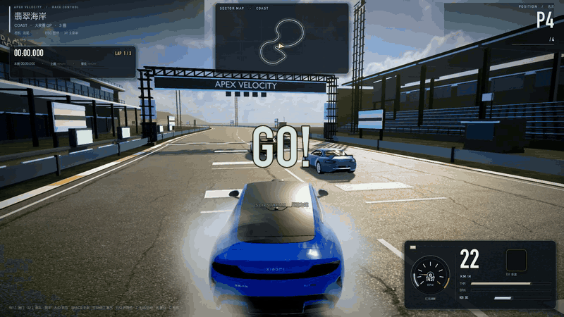
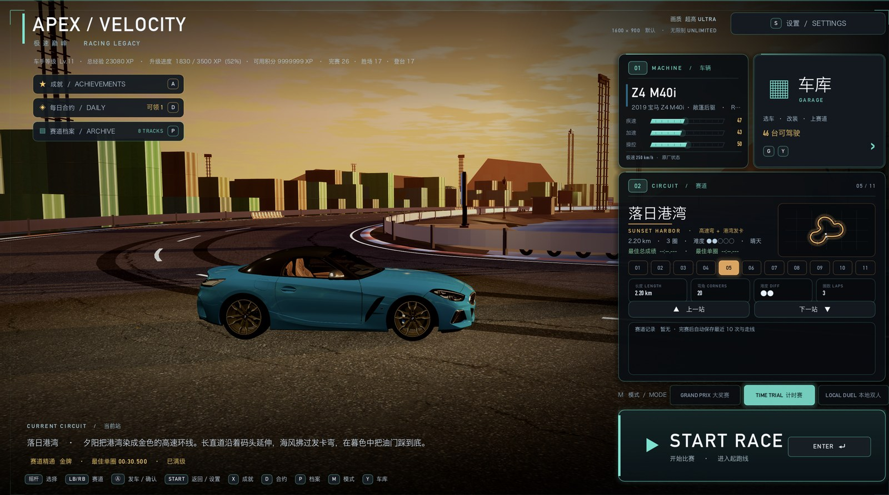
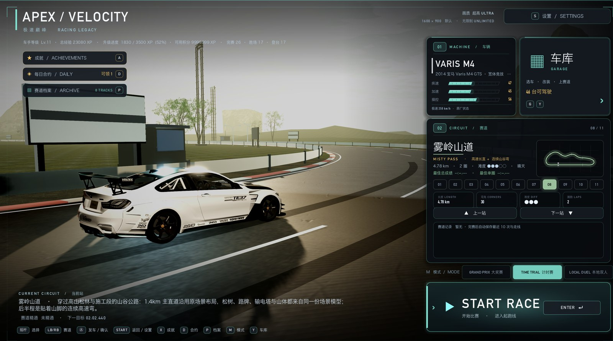
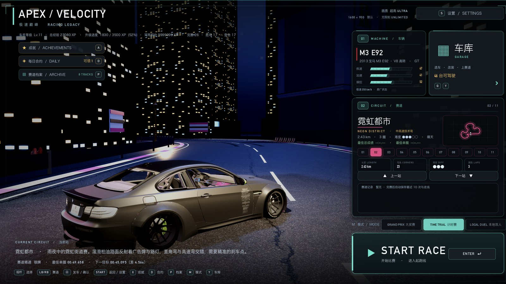
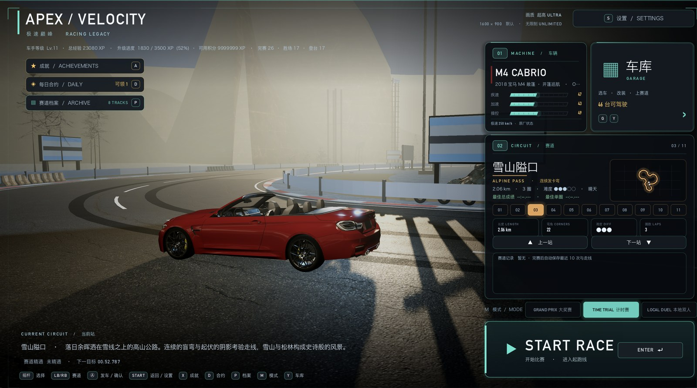
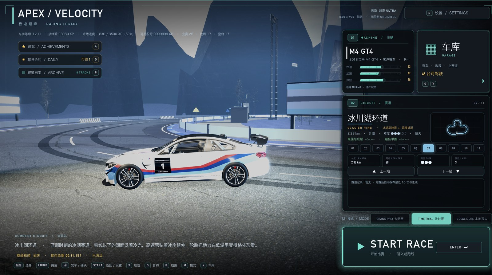
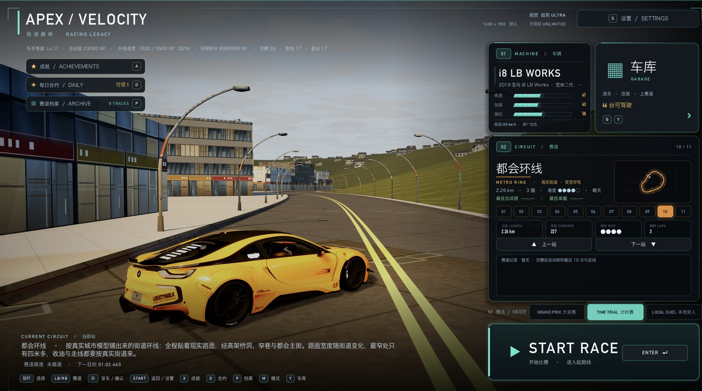
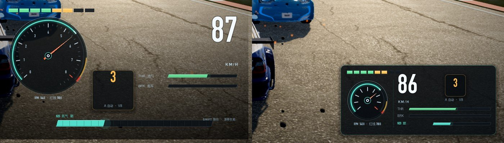
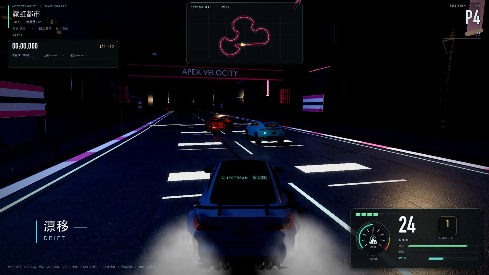

<div align="center">

# APEX VELOCITY · 极速巅峰

**Godot 4 原生重制 · 45 台可驾驶真车 · 11 条赛道**

[](https://godotengine.org/)
[](https://github.com/TongJX614/apex-velocity/releases)
[](#快速开始)
[](#技术架构)
[](docs/README.md)

[▶ 观看 84 秒宣传片](https://github.com/TongJX614/apex-velocity/releases/download/v0.54/apex-velocity-trailer-2026.mp4) ·
[下载 v0.55 安装包](https://github.com/TongJX614/apex-velocity/releases/tag/v0.55) ·
[文档索引](docs/README.md)

</div>



---

## 关于

《极速巅峰》最初是一个 three.js 的 WebGL 赛车游戏（约 3.8 万行 JavaScript、45 台车模、8 条 GP 赛道）。本项目是它的 **Godot 4 原生重制版**：复用旧工程的模型、数值、赛道数据与音频，重写渲染、物理、UI、AI 与发布管线，并在重写过程中补齐了都会环线实景城市赛道。

整个游戏不依赖手搭场景：路面、地形、植被、建筑、看台、龙门架全部在运行时按 `data/tracks.json` 与主题程序化生成。63 个 GDScript、40,498 行代码，从主菜单、车库改装、比赛 HUD 到结算与成就全部自绘。

| | |
| --- | --- |
| **45 台车** | 按真车标定功率 / 扭矩 / 质量 / 驱动 / 极速 / 0-100，11 类引擎声档，8 类改装 |
| **11 条赛道** | 9 条封闭赛道 + 都会环线实景城市 + 漂移练习开放场地，每图独立光照、天气与菜单实景 |
| **街机物理** | 扭矩负载起步打滑、速度敏感转向、OBB 车-车碰撞、防粘连分离、手动挡 / 氮气 |
| **画面** | 四档画质、程序化天空与流动云、CC0 真实植被建筑、SSR / SSAO / SSIL / 体积雾 / 速度拉丝 |
| **声音** | 逐车物理建模引擎声 + 29 首分赛道 BGM（每图 2-3 首随机轮换，无缝循环）+ 6 总线混音 |
| **本地双人** | 真·分屏、独立相机与输入、P1/P2 同场竞速 |

## 画面

| 落日港湾 | 雾岭山道 |
| --- | --- |
|  |  |

| 霓虹都市 | 雪山隘口 |
| --- | --- |
|  |  |

| 冰川湖环道 | 都会环线 |
| --- | --- |
|  |  |

比赛 HUD：小地图、圈速、名次、转速表、档位与氮气一屏呈现。



[](https://github.com/TongJX614/apex-velocity/releases/download/v0.54/apex-velocity-trailer-2026.mp4)

> 《从晨光到霓虹》— 84 秒，全片 100% 游戏内真实渲染，无引擎外 CG。
> 点击海报下载 1080p 成片。

---

## 快速开始

### 直接玩（不需要 Godot）

从 [v0.55 Release](https://github.com/TongJX614/apex-velocity/releases/tag/v0.55) 下载安装包，已内置全部车辆与赛道资源：

- **macOS 11+**：`APEX_VELOCITY_0.55.0_macOS_Universal.dmg`，支持 Apple Silicon 与 Intel。
- **Windows 10 / 11 64 位**：`APEX_VELOCITY_0.55.0_Windows_x64_Setup.exe`，显卡需支持 Vulkan。

macOS 首次打开如提示“无法验证开发者”，在 Finder 里右键 app 选择“打开”；Windows 首次运行如遇 SmartScreen，选择“更多信息 → 仍要运行”。安装包未做代码签名，发布页提供 SHA256 校验文件。

### 从源码运行

> **注意**：模型、贴图、音频等大体积资产（约 1.8GB 压缩包）因 GitHub 单文件与仓库体积限制，**不放在 Git 仓库里**，需要从 [Release](https://github.com/TongJX614/apex-velocity/releases/tag/v0.54) 下载后解压到项目根目录。

### 1. 克隆仓库

```bash
git clone https://github.com/TongJX614/apex-velocity.git
cd apex-velocity
```

### 2. 下载并解压资产

从 [v0.54 Release](https://github.com/TongJX614/apex-velocity/releases/tag/v0.54) 下载以下 4 个包：

| 资产包 | 内容 | 大小 |
| --- | --- | --- |
| `apex-velocity-assets-cars.zip` | 45 台车模（GLB + manifest） | ~668MB |
| `apex-velocity-assets-thirdparty.zip` | Poly Haven CC0 植被 / 建筑 / 城市环线（运行时 GLB + 贴图） | ~350MB |
| `apex-velocity-assets-venues.zip` | 场地套件与真实树 | ~537MB |
| `apex-velocity-assets-misc.zip` | 音频 / 启动 CG / 菜单背景 / UI / 远景楼群 | ~251MB |

全部解压到仓库根目录（四个包会合并进 `assets/`），随后执行一次归位脚本，把资产迁入 `cars/` 与 `maps/` 模块（可重复执行）：

```bash
unzip apex-velocity-assets-cars.zip -d .
unzip apex-velocity-assets-thirdparty.zip -d .
unzip apex-velocity-assets-venues.zip -d .
unzip apex-velocity-assets-misc.zip -d .
./tools/migrate_assets_layout.sh
```

校验和见 Release 中的 `SHA256SUMS.txt`：

```bash
shasum -a 256 -c SHA256SUMS.txt
```

### 3. 运行

需要 **Godot 4.7.2**。macOS 可直接双击 `双击开始游戏.command`，或命令行：

```bash
GODOT=~/Applications/Godot.app/Contents/MacOS/Godot
"$GODOT" --path .
```

Windows / Linux 用 Godot 打开本目录，或在命令行执行 `Godot --path .`。

> **首次运行**：Godot 会导入约 1.8GB 资产，耗时几分钟。项目里 51 个脚本靠 `class_name` 互相引用，如果 `.godot/` 缓存缺失，先执行一次：
>
> ```bash
> Godot --headless --path . --import
> ```
>
> 三个 `.command` 启动器已内置这一步自检。

### 4. 其他入口

| 入口 | 用途 |
| --- | --- |
| `双击开始游戏.command` | 主菜单正常游玩 |
| `双击编辑地图.command` | 场景装饰编辑器（拖点改树 / 楼 / 广告牌） |
| `启动尾翼调参.command` | 零件人工调参器（尾翼 / 车轮偏移微调） |

### 5. 调试命令

```bash
# 跳过菜单直接开一场
"$GODOT" --path . -- --autostart --track=city --car=byd_yangwang_u9

# 无头验收：9 站生成 + 车辆行驶 + 完整 GP 比赛模拟
"$GODOT" --headless --path . -- --verify

# 音频链路自检（BGM / 分赛道映射 / 引擎声）
"$GODOT" --headless --path . -- --audio-test

# 指定机位渲染截图
"$GODOT" --path . -- --shot=/tmp/frame.png --shot-scene=race --track=coast
```

---

## 操作

### 驾驶

| 按键 | 作用 | 按键 | 作用 |
| --- | --- | --- | --- |
| `W` / `↑` | 油门 | `S` / `↓` | 刹车 / 倒车 |
| `A` `D` | 转向 | `空格` | 手刹漂移 |
| `Shift` | 氮气 | `E` / `Q` | 升档 / 降档 |
| `T` | 手动挡 / 自动挡 | `C` | 追尾 / 近身 / 座舱 |
| `H` | 按住回头看 | `R` | 复位车辆 |
| `Esc` | 暂停 / 继续 | `M` | 返回主菜单 |
| `P` | 拍照模式 | `F2` | 实时画质设置 |

手柄（Xbox 布局）：左摇杆转向、RT/LT 油门/刹车、`A` 手刹、`X` 氮气、`B` 切视角、`Y` 手动/自动；`LB`/`RB` 与十字键上下升降档；右摇杆环视、`R3` 按住回头、`L3` 视角回正；`Back` 复位、`Start` 暂停；十字键左右分别进入拍照模式与快速设置。

漂移练习场摆桩：`V` 打开俯视图摆桩编辑器（鼠标左键落锥、右键删除附近；`1`/`2`/`3` 直线 slalom/定圆/八字、`[`/`]` 或滚轮调预设间距、`C` 清空、`R` 扶正、`V` 或 `Esc` 保存退出）。手柄：左摇杆/十字键移动光标、`A` 落锥、`X` 删除、`Y` 扶正、`LB`/`RB` 调间距、`B`/`Start` 保存退出。锥桶被撞倒只弹提示不挡车，布局自动存档、下次进场地恢复。

### 主菜单 / 车库

主菜单：左摇杆/十字键在按钮间移动焦点，`A`/`Enter` 确认；`LB`/`RB` 切换赛道；`M` 切换大奖赛/计时赛、`G` 或手柄 `Y` 车库、`X` 成就、`D` 或手柄 `B` 每日合约、`P` 赛道档案、`N` 新手教程、`S` 或手柄 `Start` 设置、`1`–`8` 直跳分站。右摇杆可旋转展车。

车库：`Tab` 或手柄 `Y` 在车辆网格 / 改装条之间切换，`↑↓←→` 或摇杆/十字键选择，`Enter`/`A` 选车或升级，`LB`/`RB` 切换改装项，`空格` 或手柄 `X` 直接上赛道，`L` 重置升级，`B`/`Start`/`Esc` 返回。鼠标拖拽或右摇杆可旋转车身。

### 本地双人（真分屏）

| | 转向 | 油门/刹车 | 手刹 | 氮气 | 降/升档 | 手动切换 |
| --- | --- | --- | --- | --- | --- | --- |
| P1 | `←` `→` | `↑` / `↓` | `空格` | `Shift` | `Q` / `E` | `T` |
| P2 | `A` `D` | `W` / `S` | `K` | `L` | `P` / `O` | `I` |

接两个手柄时 P1 用第一个、P2 用第二个；只有一个手柄时 P1 用手柄、P2 仍用键盘。手柄操作与单人驾驶一致。

---

## 技术架构

```
输入层    input_setup / analog_input ──► 车辆输入字典
车辆层    car（玩家物理）· ai_car（样条跟随 + 避让 + 橡皮筋）· car_visual（模型/轮组/换色）
赛道层    track_path（样条/曲率）· track_builder（路面/路肩/护栏）· terrain（起伏）
场景层    scenery_kit / theme_scenery / real_asset_kit / venue_kit / grass_scatter
比赛层    race_manager（倒计时/圈数/计时/名次/奖牌）· records_store · ghost_store
改装层    parts_library（零件规则 + 人工偏移）· garage_look（挂装）· garage_store（存档）
表现层    weather_fx · vfx_library · game_feel（hit-stop/火花/镜头震动）· haptics
UI 层     menu / race_hud / garage_screen / settings_screen / achievements / daily / archive
基础设施  settings · game_data · audio_manager · engine_audio · split_screen · profile_store
```

几个实现细节：

- **程序化世界**：`scenes/main.tscn` 只挂一个根节点，赛道与场景由 `track_path` + `track_builder` + `scenery_kit` 在启动时生成，换图只换数据；
- **车辆物理**：街机手感 + 扭矩负载、速度敏感转向、OBB 碰撞与低速防粘连，AI 按 skill 派生快慢 / 弯道自信 / 车线 / 激进度；
- **逐车声线**：物理建模合成（点火、缸数、断油、涡轮），45 台车各有独立档案；
- **输入**：键盘 / 手柄 / MCHOSE Ace68-II 磁轴键盘模拟量（按键深度 → 线性油门与转向）。

---

## 项目结构

```
apex-velocity/
├── project.godot                  引擎配置（主场景 / 物理 120Hz / 渲染默认）
├── README.md                      本文件
├── 双击开始游戏.command            游玩入口
├── 双击编辑地图.command            场景装饰编辑器入口
├── 启动尾翼调参.command            零件调参器入口
├── scenes/                        main.tscn（世界由脚本生成）· decor_editor.tscn
├── cars/                          ★ 车辆模块（契约见 cars/README.md）
│   ├── assets/models/             45 台车 GLB + 同目录贴图（Release 下载）
│   ├── assets/audio/engine/       引擎声质感层录音（Release 下载）
│   ├── scripts/                   车辆物理 / AI / 车模 / 零件 / 相机（8）
│   └── README.md                  车辆资源 / API / 数据契约
├── maps/                          ★ 地图模块（契约见 maps/README.md）
│   ├── assets/                    venues / buildings / backdrops / polyhaven / city_ring
│   ├── audio/bgm/                 赛道 BGM（Release 下载）
│   ├── scripts/tracks/            样条 / 路面 / 地形 / 植被 / 场景套件（10）
│   ├── scripts/openworld/         都会环线城市（3）
│   └── README.md                  地图资源 / API / 碰撞与烘焙契约
├── scripts/                       共享核心与 UI
│   ├── core/       (17)           状态机 / 比赛 / 存档 / 设置 / 音频 / 输入 / 分屏 / 天气
│   ├── ui/         (17)           菜单 / 车库 / HUD / 设置 / 成就 / 每日 / 档案
│   ├── fx/         (2)            Game Feel / VFX 资源库
│   └── tools/      (2)            装饰编辑器 / 覆盖数据
├── data/                          数值与配置（两者共享：cars / tracks / garage / engine_sounds …）
├── shaders/                       5 个着色器
├── tools/                         管线脚本（调参器 / 磁轴桥 / Blender / 车模审计 / 程序化配乐 / 一键导出）
├── trailer/                       宣传片抓帧 capture.py · 剪辑 edit.py（成片在 Release）
├── docs/                          54 篇开发文档 + 各期截图
└── assets/                        ★ 共享 UI / 品牌 / 菜单场景 / 视频（Release 下载）
```

模块边界与公共接口分别以 [cars/README.md](cars/README.md)、[maps/README.md](maps/README.md) 为准；跨模块改动只需回归对方的契约和实机截图。

`.godot/`（导入缓存，约 1.8GB）首次打开项目时自动重建，不入版本库。

---

## 里程碑

| 版本 | 内容 | 文档 |
| --- | --- | --- |
| v0.45–v0.46 | Game Feel 打磨 + 成长/成就 + 真分屏 | [47](docs/47-游戏手感_成长成就_本地双人.md) · [48](docs/48-喷气漂移特效_真分屏_成就界面.md) |
| v0.50 | 场景装饰编辑器 | [49](docs/49-场景装饰编辑器.md) |
| v0.51 | 45 台车模从 `.blend` 高清重导 + 车库影棚光影 | [50](docs/50-车模高清重导与游戏光影.md) |
| v0.52 | UI 美化 + 磁轴模拟量 + 8 图主题化 + 碰撞箱 OBB | [51](docs/51-前端美化_模拟键盘_地图主题化_改装精简_碰撞箱.md) |
| v0.53 | 紧凑 HUD 仪表卡 + 碰撞防粘连 | [54](docs/54-比赛HUD紧凑仪表卡.md) · [55](docs/55-车辆碰撞防粘连.md) |
| **v0.54** | 全图光效 + AI 分化 + 改装工厂 + 穿模清零 | [56](docs/56-全图光效_AI分化_改装工厂_穿模清零.md) |
| — | 宣传片《从晨光到霓虹》剧本 / 分镜 | [58](docs/58-宣传片剧本与分镜表.md) |
| — | 逐车个性化引擎声系统 | [61](docs/61-逐车个性化引擎声系统.md) |
| — | 零件人工调参器 | [62](docs/62-零件人工调参器.md) |

更早的画面重制、真实场地、CC0 资产、菜单改版与启动片记录见 [完整文档索引](docs/README.md)。

### 技术规模

| 项目 | 数值 |
| --- | --- |
| GDScript | 63 个文件 / 40,498 行 |
| 着色器 | 5 个 `.gdshader` |
| 车辆 | 45 台可驾驶（45 套车模 + 真车数值 + 配色 + 声线） |
| 赛道 | 11 条（9 封闭 + 1 都会环线实景城市 + 1 开放漂移场地） |
| 资产 | 1.8GB 压缩包（第三方 CC0 / 车模 / 场地 / 音频 / 视频） |
| 文档 | 54 篇里程碑文档 + 截图 |
| 实测帧率 | 1600×900 关闭垂直同步：城市 120–270fps（M1 Pro） |

---

## 已知限制 / Roadmap

**当前限制**

1. 地形以高度场为主，赛道是 2D 控制点样条，暂不支持隧道与立交；
2. 车模未做 LOD，45 台车全量加载时 draw call 约 777；
3. 拉花未渲染，涂装仅支持纯色 / 哑光 / 原厂保留；
4. AI 碰撞是事后修正而非物理响应（粘连/闪现已修，机制未换）；
5. 调参器保存是覆盖式，无自动备份轮转。

**下一步**

1. **M5 发布**：macOS / Windows / Android 出包；
2. 画面：PBR 材质三件套、轮胎印 / 磨损贴花、车模 LOD 与网格合并；
3. 内容：新增赛道与动态事件；
4. 工程：调参数据自动备份轮转、P0–P3 性能项分批落地。

---

## 致谢与素材说明

- 植被、岩石、建筑与 HDRI 来自 [Poly Haven](https://polyhaven.com)（CC0）；
- 车辆数值、赛道与音频源自旧版 WebGL 工程的重制与再加工；
- 车辆品牌、车标与车型外观版权归各自权利人所有，本项目仅用于技术演示与学习交流，不用于商业用途；
- 代码与文档版权归作者所有，未经许可请勿商用。

---

<div align="center">

**如果这个项目对你有帮助，欢迎点一个 ⭐**

</div>
