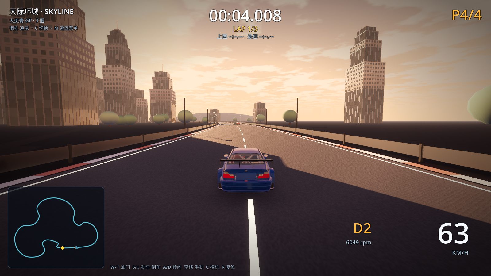
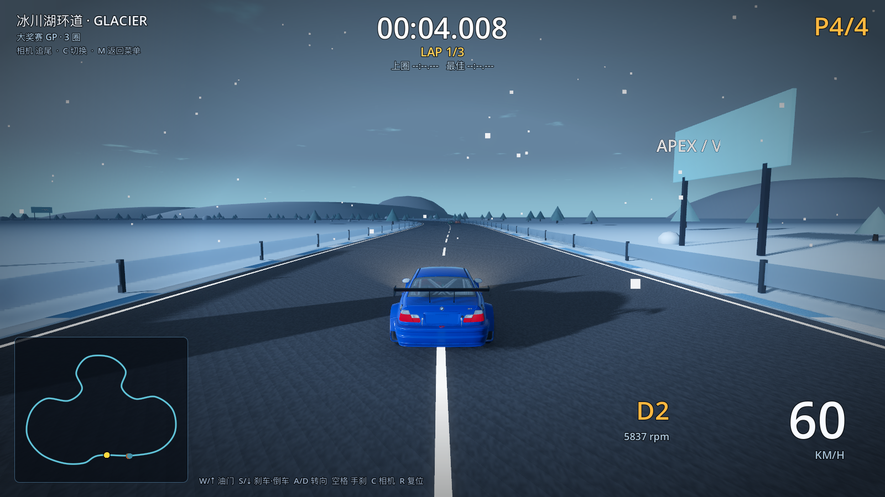
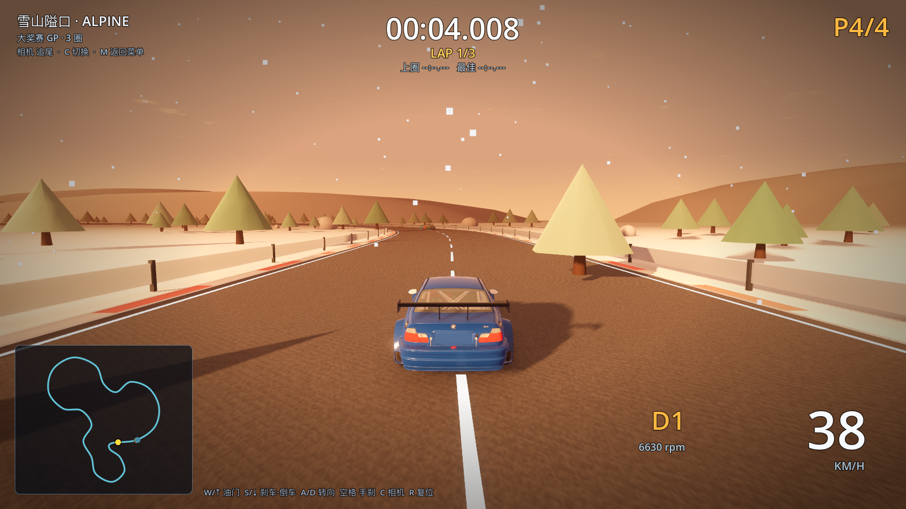

# 06 · 画面重制（v0.4）

> 2026-11-03 · 用户反馈"M3 画面进步太差"，要求：楼宇要像真实建筑、细节拉满、
> 有云和天气、修复穿模、画质大幅提升。本轮把渲染层整体重做。

---

## 一、这轮做了什么

### 1. 楼宇：从"发光盒子"到程序化摩天楼

- 新写着色器 `shaders/building_facade.gdshader`：在片元里程序化生成
  **窗格 / 楼层分隔 / 窗框 / 底层橱窗 / 夜间亮窗 / 楼层随机点亮 / 底部污渍 AO / 屋顶混凝土**；
- 每栋楼 2–4 段**退台堆叠**（下宽上窄），高塔带**屋顶设备（空调机组）+ 天线 + 红色航空障碍灯**；
- 楼体贴图比例按**真实米制**计算（窗 2.7m × 层高 3.6m），一栋楼一种姿态但窗格大小统一；
- 夜间窗户从主题色改为**暖白 + 冷白混合、随机亮度**，并用光晕阈值控制，不再"整栋粉红发光"；
- 所有楼仍是**一个 MultiMesh 一次绘制**（逐实例传尺寸/种子/墙色）。

### 2. 天空：程序化云层

- 新写着色器 `shaders/sky_clouds.gdshader`：
  - 双层 FBM 噪声云，按主题控制云量/云速/云色，地平线附近渐隐；
  - 太阳圆盘 + 光晕、金色时刻偏色、夜间星空（按 theme.stars）；
  - 天际线 haze 带；
- 每条赛道按旧版 theme 驱动：海岸薄云、雪山云层+暖雾、夜城厚雨云、峡谷尘云。

### 3. 天气粒子（按旧版 `theme.weather` 字段）

| 天气 | 赛道 | 效果 |
| --- | --- | --- |
| `rain` | 霓虹都市 | 1100 条斜向雨丝，跟随玩家 |
| `snow` | 雪山隘口、冰川湖环道 | 900 片飘雪 + 湍流漂移 |
| `dust` | 赤岩峡谷、熔岩盆地 | 800 个尘/灰烬颗粒 + 湍流 |

### 4. 光影与后处理

- **湿滑反光路面**：路面粗糙度/金属度改为读取旧版 theme（夜城 0.32/0.5），开启
  **SSR 屏幕空间反射**，霓虹与车灯能映在路面上；
- **体积雾**：雨/雪/尘/夜赛开启，配合车灯/路灯产生光柱；
- **SSIL**（夜间）+ **SSAO 加强**、Bloom 按 theme.glowOpacity 调；
- 车灯保持两盏 SpotLight，夜间自动开启；
- 曝光按 theme.exposure。

### 5. 穿模修复（4 处）

| 问题 | 修复 |
| --- | --- |
| 车身插进护栏 | 护栏判别从"中心点撞墙"改为**留出车半宽**（`half_width + 0.55`），车身贴栏不穿透 |
| 车辆互相穿过 | 新增车-车接触解算：玩家被推开并消除接近速度，AI 横向让线并轻微减速；AI 之间也互相分离 |
| 追尾相机穿护栏/穿地 | 相机做赛道走廊约束（横向限制在护栏内 + 最低高度 0.55m） |
| 车轮陷进路面 | 车模视觉高度抬升 2cm，让轮胎正好落在路面上 |

验证结果（无头自动检查）：

```
[M3] barrier clamp: lateral=9.05m (limit=9.05m)
[M3] camera clamp: lateral=9.60m
[M3] car contact: separation after forced overlap = 2.48m
```

## 二、效果对比

**夜城 · 旧（M3 第一版：盒子楼）→ 新（v0.4：窗格/退台/雨夜/湿路反光）**

旧：`docs/m3/city-night.png`

新：`docs/m4/city-night.png`

**海岸 · 旧（无云无天气）→ 新（云层 + 体积雾 + 棕榈）**

旧：`docs/m3/coast.png` → 新：`docs/m4/coast.png`

**天际环城（黄昏，退台楼群 + 云）**



**冰川湖环道（飘雪 + 冷色云层）**



**雪山（雪 + 暖雾 + 松林）**



## 三、性能（M1 Pro / 1600×900 / 关 vsync）

| 赛道 | 旧 M3 | 新 v0.4 | draw calls | 图元 |
| --- | --- | --- | --- | --- |
| 霓虹都市（雨/夜/SSR/体积雾） | 121–243 fps | **123 fps** | 713 | 697k |
| 翡翠海岸（云/雾） | 266 fps | **163 fps** | 698 | 849k |
| 雪山隘口（雪/松林） | 252 fps | **157 fps** | 703 | 733k |

画质大幅提升后帧率仍为 60fps 目标的 2–2.7 倍；正常开垂直同步即锁 60。

复现：

```bash
~/Applications/Godot.app/Contents/MacOS/Godot --path "/Users/tong/Desktop/极速巅峰" \
  --resolution 1600x900 --disable-vsync -- --perf-test --track=city
```

## 四、文件变更

| 文件 | 说明 |
| --- | --- |
| `shaders/building_facade.gdshader` | 新增：程序化楼宇外墙（窗格/楼层/亮窗/橱窗/AO/屋顶） |
| `shaders/sky_clouds.gdshader` | 新增：天空 + FBM 云 + 太阳/星空/雾霭 |
| `scripts/core/weather_fx.gd` | 新增：雨/雪/尘粒子系统（跟随玩家） |
| `scripts/tracks/scenery_kit.gd` | 楼宇生成重写：退台、屋顶设备、天线、障碍灯、楼体着色器 |
| `scripts/core/main.gd` | 天空着色器接入、SSR/SSIL/体积雾/曝光/雾密度按主题、天气挂载、车车接触解算 |
| `scripts/cars/chase_camera.gd` | 相机赛道走廊约束 |
| `scripts/cars/car.gd` | 护栏车半宽留白、车模视觉高度 |
| `scripts/ui/race_hud.gd` | （上轮）暗角 |

## 五、离"3A 级"还差什么（诚实说明）

这轮是**渲染框架 + 程序化内容的巨大提升**，但离真正 3A（如 Forza / NFS 那种）还有本质差距，
差距不在代码而在**资产生产管线**：

1. **没有真实 PBR 贴图资产**：现在墙面/路面是程序化生成，缺少法线贴图、粗糙度贴图、
   路面裂缝/轮胎印/雨渍贴花；需要接入 Blender/Substance 或 CC0 材质库；
2. **没有全局光照**：只有 SSR/SSAO/SSIL 近似，3A 靠烘焙 GI + 反射探针；
3. **车辆/植被仍是低模**：车模来自旧工程 GLB（60–80 网格/台，无 LOD），树是程序化几何；
4. **没有真实地形**：赛道建在平面上（旧版数据就是 2D 控制点），没有高度场、植被分布、道路贴合；
5. **动画/细节层**：没有行人、车流、飞鸟、路面水花、雨刷、轮胎水雾等。

如果要继续往 3A 方向走，建议顺序：**真实材质资产 → 地形高度场 → 车辆 LOD/合批 → GI 烘焙 → 细节粒子**。
这个方向需要外部素材或美术介入，纯程序化只能到"精致风格化"（当前水平）。
