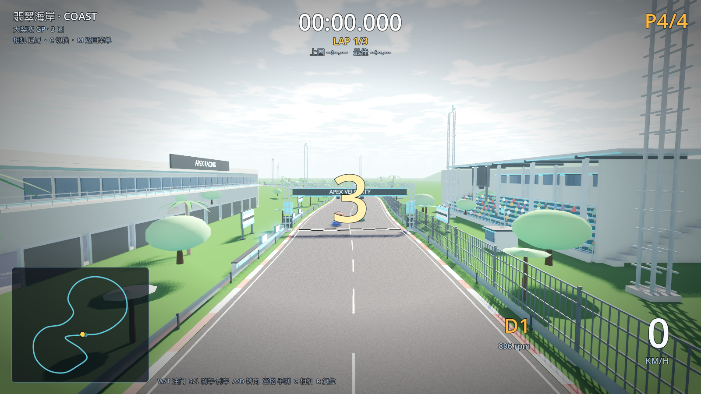

# 07 · 真实场地：Blender 直接建模 + 游戏内替换

> 2026-11-03 · 用户要求：装 Blender、找"直接建模"的 Skill、自己建 3D 场景并替换进游戏。
> 本轮完成：Blender 5.2.3 安装、建模 Skill 建立、赛道场地套件 9 件 + 精细树木 3 种、
> 8 条赛道全部接入、无头验证与性能回归通过。

---

## 一、Blender 安装

| 项 | 值 |
| --- | --- |
| 版本 | **Blender 5.2.3 LTS**（2026-10-22 build，Apple Silicon arm64） |
| 安装位置 | `~/Applications/Blender.app`（单 App，免安装器） |
| 验证 | `~/Applications/Blender.app/Contents/MacOS/Blender --version` → `Blender 5.2.3 LTS` |
| 下载源 | download.blender.org 官方 release 目录 |

## 二、"直接建模" Skill：调研与选择

调研了社区方案 [mcp-for-blender](https://github.com/ahujasid/mcp-for-blender)（GUI 内实时控制，
通过 socket/MCP 让 LLM 操作 Blender）。最终本项目采用**无头 bpy 脚本流水线**：

- `Blender --background --factory-startup --python <脚本>` 直接执行 Python 建模；
- 好处：产物可复现（脚本进仓库）、可 diff、不需要开 GUI/装扩展、可直接被 AI 代理迭代；
- GUI 实时微调作为备选保留。

Skill 文档：**[`skills/blender-direct-modeling/SKILL.md`](../skills/blender-direct-modeling/SKILL.md)**
（安装命令、建模规范、材质命名、导出约定、Godot 接入、质检清单）。

## 三、Blender 建模流水线

| 脚本 | 产出 |
| --- | --- |
| `tools/blender/blender_common.py` | 公共库：材质、箱体/圆柱/桁架/文字网格、按材质合并、GLB 导出 |
| `tools/blender/build_venue_kit.py` | 赛道场地套件（9 个 GLB + `venue_manifest.json`） |
| `tools/blender/build_trees.py` | 精细树木 3 种（棕榈/阔叶/松树） |

运行：

```bash
BL="$HOME/Applications/Blender.app/Contents/MacOS/Blender"
"$BL" --background --factory-startup --python tools/blender/build_venue_kit.py
"$BL" --background --factory-startup --python tools/blender/build_trees.py
```

### 本轮产出的场地资产（`assets/venues/`）

| 资产 | 尺寸 | 内容 |
| --- | --- | --- |
| `gantry.glb` | 24m 跨度 × 8.4m | 四腿桁架龙门架、横幅 + "APEX VELOCITY" 立体字、5 盏发车灯、立柱广告 |
| `grandstand.glb` | 61×17×13m | 8 级台阶看台、364 个座椅、顶棚+钢柱、VIP 玻璃包厢、栏杆、端部楼梯 |
| `pit_building.glb` | 80×14×13m | 10 个车库门（含门框/照明）、二层玻璃窗带、露台栏杆、屋顶空调机组/风管、队名立体字 |
| `pit_wall.glb` | 24m | 维修区隔墙、计时屏幕（自发光） |
| `light_tower.glb` | 28.5m | 桁架灯塔 + 12 组泛光灯（自发光灯面） |
| `ad_board.glb` | 6.2×4.5m | 广告牌（框架/三色条纹/支腿），运行时按主题染 accent 色 |
| `catch_fence.glb` | 10×4.2m | 护栏网片（立柱+横杆+竖条） |
| `marshal_post.glb` | 3.6×3.6×3m | 裁判亭（玻璃窗/工作台/旗杆） |
| `big_screen.glb` | 10.6×12.9m | 大屏塔（屏幕/发光边条/音箱） |
| `tree_palm/broadleaf/pine.glb` | 8–10m | 精细树木（分段树干、弯曲叶片/树枝+叶团/层叠树冠） |

所有资产按**真实米制**建模、Blender Z-up、正面 +Y（导出后 Godot -Z），
同一材质网格自动合并，重复道具在 Godot 端转 MultiMesh。

## 四、游戏内替换（`scripts/tracks/venue_kit.gd`）

- 自动寻找**最长直道**：主看台放一侧、维修区建筑放对面、维修墙贴着赛道；
- 起跑线放龙门架；起点附近放大屏幕；
- 沿整圈按间距摆放：广告牌（44m）、灯塔（82m）、裁判亭（172m）、弯道外侧轮胎墙；
- 主直道外侧铺护栏网（10m 一段）；
- 看台填充**观众人群**（2 个 MultiMesh：身体+头，约 150 人，衣服随机配色）；
- 树木替换：海岸/港口用棕榈、雪山/冰川用松树、城市/峡谷用阔叶树；
- 材质按主题染色：`VenueAccent`→赛道主题色、`VenueSeat`→看台座椅色、`VenueEmissive`→发光；
- 重复资产全部 MultiMesh 合批（每类 1–2 个 draw call）。



验证输出：

```
[M4] venue: nodes=51 instances=836
[VERIFY] PASS
```

## 五、性能回归（M1 Pro / 1600×900 / 关 vsync）

| 赛道 | 平均 FPS | 最低 FPS | draw calls | 图元 |
| --- | --- | --- | --- | --- |
| coast（含完整场地） | 135.3 | 125.0 | 811 | 1,003,288 |
| city（雨夜+场地） | 108.8 | 89.0 | 803 | 776,270 |

仍在 60fps 目标的 1.8–2.2 倍；后续可把灯塔/广告牌进一步合批、车模 LOD 化。

## 六、构建/替换流程（下次加新资产照做）

1. 在 `tools/blender/build_venue_kit.py` 里加建模函数（真实米制、材质用 `Venue*` 命名）；
2. 跑 Blender 无头导出 GLB 到 `assets/venues/`；
3. 在 `venue_kit.gd` 里加加载/摆放（重复道具用 MultiMesh）；
4. `Godot --headless --path . --import` → `--verify` → `--perf-test` → 截图确认。

## 七、下一步（继续"真实场地"）

- 城市赛道：把程序化盒子楼替换成 Blender 建的**真实街区模块**（楼群/店面/天桥/广告）；
- 赛道本身：用 Blender 建弯心路缘石、排水沟、轮胎印贴花，替换程序化路面细节；
- 看台观众改成坐姿人物低模（现在是小方块）；
- 更多场地件：维修区车库内赛车/工具、赛事指示牌、赞助商塔、直升机坪等。
