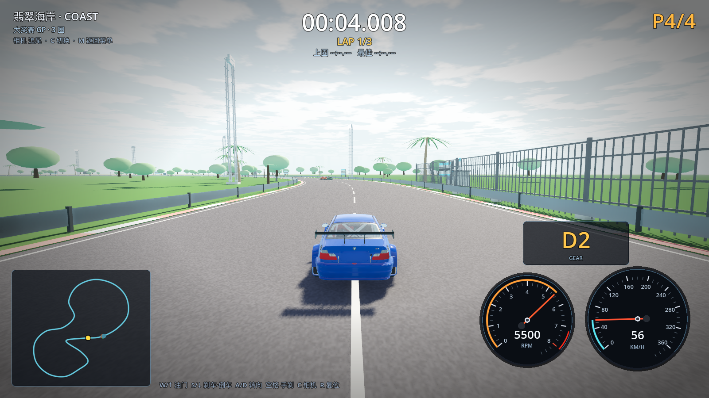
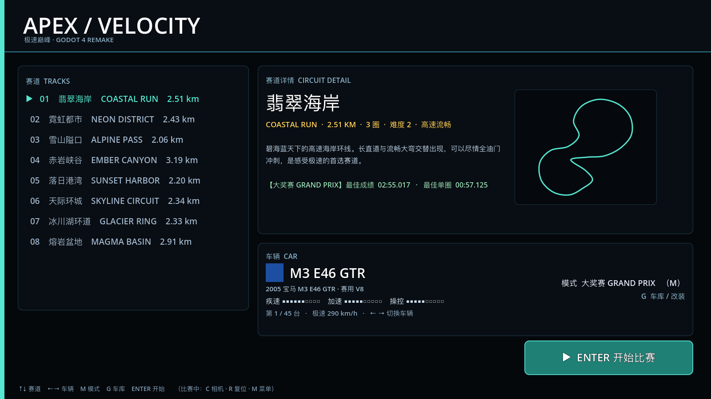

# 08 · 翡翠海岸复刻 + 仪表盘 HUD + 菜单排版

> 2026-11-03 · 用户要求：先只抠「翡翠海岸」一条赛道；按真实照片复刻树/厂房/路面/场景；
> HUD 要有时速表盘 + 转速表盘 + 档位；主菜单和比赛界面排版重做。

---

## 一、参考图收集

Bing / Google 图片均被反爬拦截，按建议改用 **百度图片** 搜索；原参考图已随项目清理删除，提取要点记录如下：

| 参考内容 | 提取的要点 |
| --- | --- |
| 海边/街道赛道 | 红白路肩、护栏+防护网、白色顶棚看台、维修区建筑、沿海岸线 |
| 海边棕榈树 | 弯曲带环纹的树干、羽状下垂长叶、成簇椰子、白沙滩+青绿海水+积云 |

（搜索关键词：海边赛车赛道、棕榈树 海边。）

## 二、按照片重做的 Blender 资产

### 棕榈树 v2（`tree_palm.glb`）
- 13 段弯曲树干 + 交替加粗模拟环纹，轻微弯曲；
- 16 片**羽状长叶**：每片 9 段、锯齿状收缩、下垂曲线，冠幅约 9m；
- 4 颗椰子簇；树高 9m，真米制。

### 维修区建筑 v2（`pit_building.glb`，84×15×13m）
- 二层建筑 + 车库区**雨棚（canopy）**+ 一排斜撑立柱；
- 10 个编号车库门（金属卷帘、门框、门头灯带、白字编号 01–10）；
- 二层通长玻璃窗带 + 竖梃 + 窗台板 + 外挑露台 + 双层栏杆；
- 屋顶女儿墙、通长栏杆、6 组空调机组 + 风管 + 天线；
- 队伍招牌「APEX RACING」立体字、赞助商条带、侧面楼梯。

### 场地套件其余资产保持并沿用
看台（含观众人群）、龙门架、灯塔、广告牌、护栏网、裁判亭、大屏幕。

重建命令：

```bash
BL="$HOME/Applications/Blender.app/Contents/MacOS/Blender"
"$BL" --background --factory-startup --python tools/blender/build_venue_kit.py
"$BL" --background --factory-startup --python tools/blender/build_trees.py
```

## 三、翡翠海岸场景专属

- **海岸岛**：草地岛（1450m）+ 沙滩环（1750m）+ **动态海面**（24000m，`shaders/water.gdshader`：
  程序化波纹法线、深浅色、菲涅尔、太阳高光）；
- 海岸主题不再生成远山（避免山漂在海上），保留云层/海平线；
- **起跑格**：发车区 2×2 白色格线（起跑线前后）；
- **轮胎印**：弯道内侧的路面暗色摩擦痕；
- **砂石缓冲区**：弯道外侧 8m 宽的砂石带；
- 光照按海岸调过：曝光 ×0.88、太阳能量下调、环境光 0.38，减少"过曝发白"。

## 四、HUD：指针仪表盘

新增 `scripts/ui/gauge.gd`（Control 手绘仪表），比赛 HUD 右下角改为**仪表台**：

| 部件 | 规格 |
| --- | --- |
| **转速表**（左） | 0–8000 RPM，每 1000 一大格 + 4 小格，7200 起红区，橙色指针 + 橙色数值弧 |
| **数字转速** | 表盘内显示当前 RPM（如 `5500`） |
| **时速表**（右） | 0–360 km/h，每 40 一大格，青色指针 + 青色数值弧 |
| **数字时速** | 表盘内显示当前 km/h |
| **档位** | 独立面板，大号 `D1/D2…/R`，下方 GEAR 标签 |

指针带平滑动画（上升/下降不同阻尼），换挡时随转速表联动；导航小地图、计时、名次保持原布局。



## 五、主菜单排版重做

- 顶栏标题 + 副标题 + 分割线；左侧「赛道」卡片列表（8 条、选中态主题色）；
- 右侧「赛道详情」卡片：名称/英文名/长度/圈数/难度 + 描述 + 最佳成绩/单圈 + **赛道平面图**预览；
- 下方「车辆」卡片：车漆色块、车名、中文名、三围性能条、序号/极速；
- 右下角大号 **ENTER 开始比赛** 按钮（主题色）；底部快捷键条；
- 修复旧版：描述文字压到地图上、元素贴边、空区过大、按钮位置不明。



## 六、验证与性能

```
import errors = 0
[M4] venue: nodes=52 instances=836
[M4] coast extras: sea=true start_grid=true tyre_marks=true
[VERIFY] PASS     （0 warning）
[AUDIO] PASS
```

1600×900 / M1 Pro / 关 vsync：**coast 145.8 fps**（draw calls 886，图元 992k），远高于 60fps。

## 七、下一步

- 观众从方块改为坐姿小人、看台加遮阳棚细节、维修区加车库内赛车/工具；
- 海边加礁石、沙滩椅/棕榈群、远处小船/灯塔；
- 赛道本身：按真实海岸赛道线形重建（当前为旧版 2D 控制点）。
