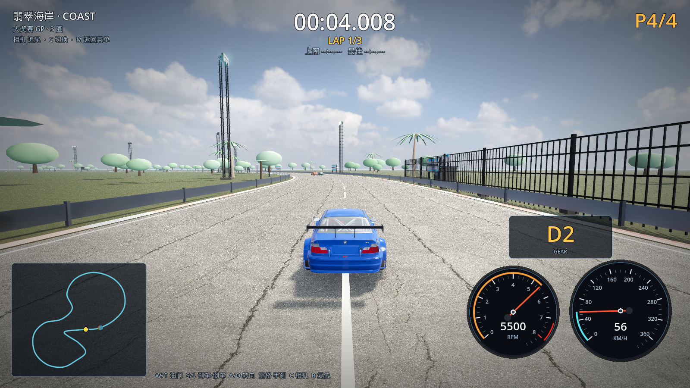
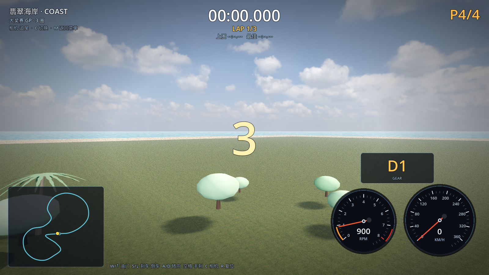

# 09 · 接入开源现成资产（HDRI / PBR 材质 / CC0 模型）

> 2026-11-03 · 用户反馈："场景还是没惊喜，可以去找开源已经做好的模型/材质来用"。
> 本轮接入 **Poly Haven（CC0 公共领域）** 的真实资产，翡翠海岸画面从"纯程序化上色"
> 升级为"真实天空 + 真实 PBR 表面 + 真实礁石模型"。

---

## 一、为什么用 Poly Haven

- 全部 **CC0（公共领域）**，可商用、可修改、无需署名（仍在此记录来源）；
- 提供 **HDRI 全景天空**（可直接给 Godot 做天空盒 + 间接光）、**PBR 材质**
  （diffuse / normal / roughness 全套）、**摄影测量模型**（岩石、道具、建筑构件）；
- 有稳定 API 与直链，适合写脚本批量下载（`tools/fetch_cc0_assets.py`）。

对比过的其他源：Kenney（403，且是低模风格化）、Quaternius（低模风格化）、
Sketchfab（需账号/授权参差）。要"真实感"首选 Poly Haven。

## 二、已接入的资产

| 类型 | 资产 | 用途 |
| --- | --- | --- |
| HDRI | `kloofendal_48d_partly_cloudy_puresky_2k.hdr` | 翡翠海岸真实天空 + 天空间接光 |
| 路面 | `asphalt_02`（1k 贴图三件套） | 赛道沥青：真实裂纹、补丁、粗糙度 |
| 草地 | `grass_ground` | 赛道周边草地 |
| 沙滩 | `coast_sand_01` | 海岸沙滩 |
| 混凝土 | `brushed_concrete` | 看台/维修区/建筑墙体 |
| 金属 | `metal_plate` | 龙门架/灯塔/栏杆 |
| 模型 | `boulder_01`（Poly Haven 原模 124k 面 → Blender 减面到 26k 面 LOD） | 海岸礁石 |

抓取脚本：`tools/fetch_cc0_assets.py`（含来源说明与 README 生成）；
减面脚本：`tools/blender/decimate_cc0.py`（Poly Haven 模型普遍百万面，不能直接用）。

## 三、代码接入点

| 文件 | 改动 |
| --- | --- |
| `scripts/tracks/pbr_assets.gd` | 新增：PBR 材质装载（asphalt/grass/sand/concrete/metal） |
| `scripts/tracks/track_builder.gd` | 路面、草地、沙滩改用真实 PBR 贴图；UV 平铺按米制 |
| `scripts/tracks/venue_kit.gd` | 看台/维修区/龙门架等按材质名自动套混凝土/金属贴图 |
| `scripts/tracks/scenery_kit.gd` | 翡翠海岸新增 7 块真实礁石（MultiMesh + 减面 LOD） |
| `scripts/core/main.gd` | 翡翠海岸天空改用 HDRI 全景（`PanoramaSkyMaterial`），环境光取自天空 |
| `assets/thirdparty/polyhaven/` | 下载的原始资产 + `README.md`（来源/许可） |

## 四、效果

比赛画面（真实沥青裂纹/补丁、真实草地、HDRI 云层、混凝土建筑）：

海岸全景（HDRI 天空 + 沙滩 + 海面）：

## 五、性能与验证

- `[VERIFY] PASS`，0 warning；
- coast 1600×900 / 关 vsync：**avg 132 fps / min 70 fps**（draw calls 889，
  减面 LOD 后比初版 124k 面礁石版本回升 55+ fps）；
- 原版高模礁石最低只有 44 fps，已用 Blender Decimate 解决。

## 六、许可与来源

所有资产来自 [polyhaven.com](https://polyhaven.com)，**CC0 1.0 Universal**（公共领域）。
具体清单与下载时间见 `assets/thirdparty/polyhaven/README.md`。

## 七、下一步

- Poly Haven 的树是百万面摄影测量模型（`island_tree_01` 3.7M 面、`island_tree_02` 1.76M 面），
  需要先**减面 + 叶子 alpha 卡**处理才能替换现在的程序化阔叶树——这是下一步最值得做的；
- 可继续下载：`coast_rocks`、`concrete_road_barrier`（护栏）、`modular_fire_escape`（建筑细节）、
  不同天气 HDRI（夕阳/雨夜）；
- 每条赛道配一套对应 HDRI + 地表材质（雪山/沙漠/城市夜景）。
