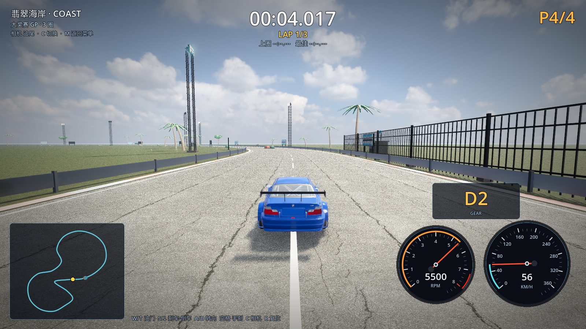
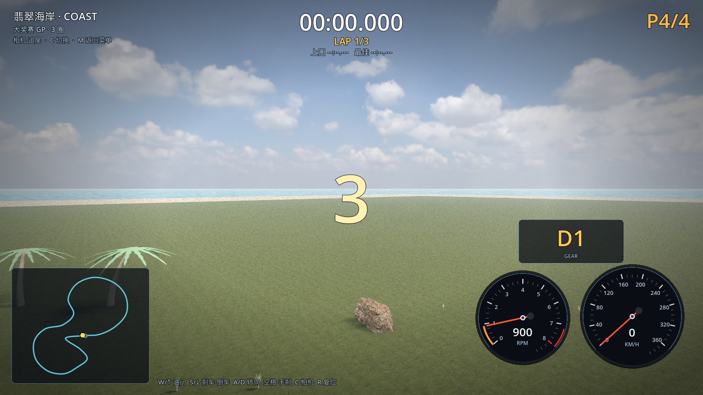
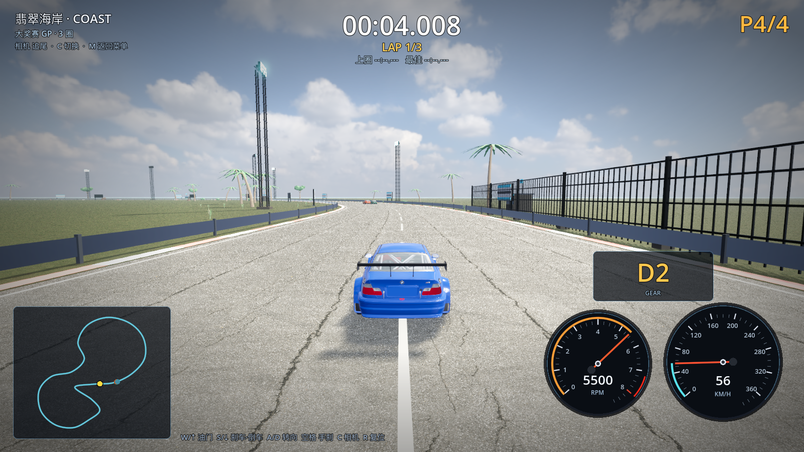

# 10 · 五种树 / 草地 / 画质档位

> 2026-11-03 · 用户要求：做五棵树、草地继续做、加画质高低档（其中要有一个"最高画质"档）。

---

## 一、五种树 + 灌木 + 草丛（Blender 建模）

新增 `tools/blender/build_coastal_flora.py`，一次生成 6 个资产：

| 资产 | 形态 | 用途 |
| --- | --- | --- |
| `tree_palm_tall.glb` | 10.2m 高棕榈，17 片羽状叶，微弯树干 | 海岸主景观树 |
| `tree_palm_bent.glb` | 7m 矮棕榈，强弯曲树干，15 片叶 | 近景/安全区 |
| `tree_broadleaf.glb` | 8.4m 阔叶树，5 根主枝 + 7 团冠层（双色叶） | 中景绿化 |
| `tree_coastal.glb` | 5m 风吹型海岸树，冠层偏向一侧 | 海边植被 |
| `tree_palm_tall`/`broadleaf` 组合 | 5 种树型按 1:1:1:1 随机分布 | 赛道两侧共 72 棵（High 档） |
| `shrub_coastal.glb` | 1.6m 海岸灌木丛 | 贴地植被 |
| `grass_clump.glb` | 0.5m 草簇（15 片草叶、双色） | 赛道边 260 簇草丛 |

- 海岸赛道不再使用旧的程序化"树干+圆球"树，全部换成上述真实结构模型；
- 树/灌木/草丛数量随画质档位缩放（0.35× / 0.6× / 1.0× / 1.35×）。





## 二、画质档位（低 / 中 / 高 / 超高）

新增 autoload `Settings`（`scripts/core/settings.gd`），保存在 `user://settings.json`：

| 档位 | 渲染缩放 | MSAA | SSR | SSIL | 树/草数量 | 粒子 | 阴影距离 | coast 实测 |
| --- | --- | --- | --- | --- | --- | --- | --- | --- |
| 低 LOW | 0.70 | 关 | 关 | 关 | 0.35× | 0.35× | 120m | **148 fps** |
| 中 MEDIUM | 0.85 | 关 | 32 步 | 关 | 0.6× | 0.6× | 220m | **114 fps** |
| 高 HIGH | 1.00 | 2× | 64 步 | 关 | 1.0× | 1.0× | 320m | **98 fps**（min 57，开垂直同步即锁 60） |
| 超高 ULTRA | 1.15（超采样） | 8× | 128 步 | 开 | 1.35× | 1.4× | 460m | **65 fps**（min 61，画质优先） |

- 菜单按 **Q** 切换画质；比赛中按 **F2** 实时切换并保存；
- 高档/超高档额外开启体积雾（仅原场景本身需要的天气/夜景开启）、SSIL、更高 SSR 步数；
- 超高档用 1.15× 渲染缩放（超采样）+ 8× MSAA，画面最锐利、边缘最干净，代价是帧率。




## 三、代码接入点

| 文件 | 改动 |
| --- | --- |
| `scripts/core/settings.gd` | 新增：4 档画质预设、持久化、MSAA/内容/粒子倍率 |
| `scripts/core/main.gd` | 应用画质：MSAA、渲染缩放、SSR/SSAO/SSIL/体积雾、阴影距离；F2 热键 |
| `scripts/ui/menu.gd` | 画质显示 + Q 切换 |
| `scripts/tracks/scenery_kit.gd` | 草丛 MultiMesh 散布（数量随画质）；海岸移除旧程序化树 |
| `scripts/tracks/venue_kit.gd` | 海岸 5 种树 + 灌木按画质数量分布 |
| `scripts/core/weather_fx.gd` | 雨/雪/尘粒子数量随画质缩放 |

## 四、验证

```
[M4] venue: nodes=62 instances=964
[VERIFY] PASS   （0 warning）
```
