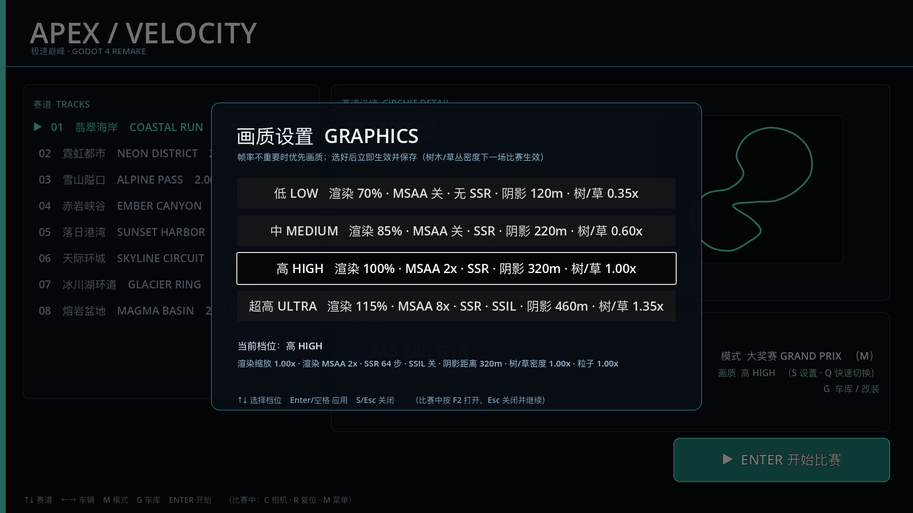
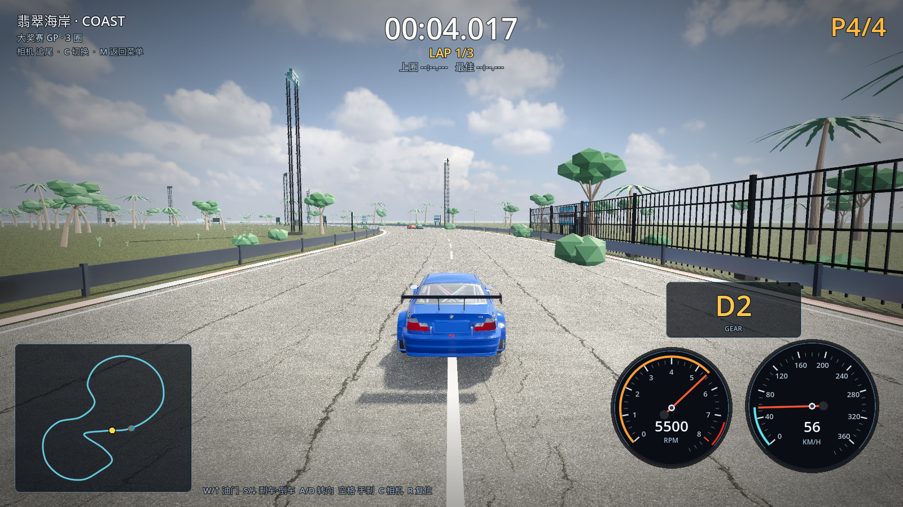
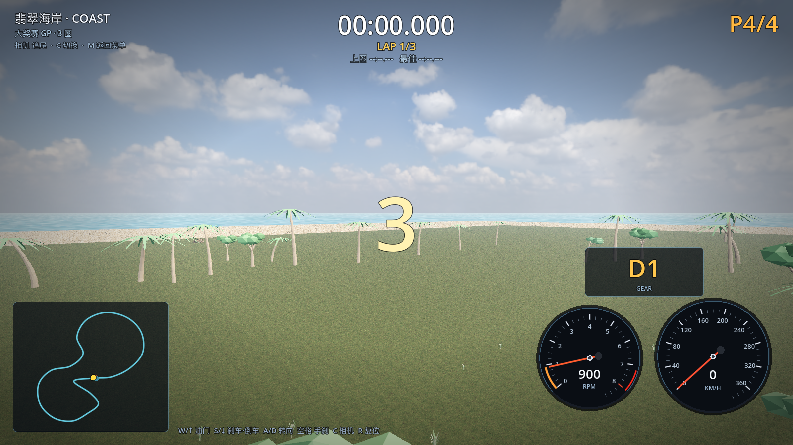

# 11 · 游戏内画质设置 + 密集植被 + 视锥剔除

> 2026-11-03 · 用户要求：树不是只做 5 棵，该有树的地方都要有树；画质调节放进游戏里；
> 要有海；建筑/天空/云渲染要好；看不到的地方不要渲染（视锥/分块剔除）。

---

## 一、游戏内画质设置界面（不是命令行）

新增 `scripts/ui/settings_screen.gd`：游戏内叠加式设置面板。

| 入口 | 操作 |
| --- | --- |
| 主菜单 | 按 **S** 打开画质设置 |
| 比赛中 | 按 **F2** 打开（自动暂停），Esc/S 关闭并继续 |
| 菜单快捷 | **Q** 快速切换档位 |

- 四个档位按钮：低 / 中 / 高 / 超高，每档实时显示"渲染缩放、MSAA、SSR、SSIL、阴影距离、树/草密度"；
- 选择后**立即生效并写入** `user://settings.json`，下次启动保持；
- 说明文字：树木/草丛密度这类"场景内容"下一场比赛生效（渲染类设置立即生效）。



## 二、该有树的地方都有树

- 海岸赛道 **约 560 棵树**（High 档）：高棕榈 / 弯棕榈 / 阔叶树 / 海岸树 按 1:1:1:1 分布，
  沿赛道两侧 10–130m 随机密植，越靠赛道越密；
- **约 120 棵海岸棕榈带**：环绕岛屿海岸线（半径 505–640m）排布，形成海边棕榈林；
- **约 160 丛海岸灌木**贴护栏分布；
- **约 780 簇草丛**沿赛道散布（0.5m 高、双色草叶）；
- 海：岛屿草地缩到 1180m、沙滩 1480m（沙滩环 150m 宽），海面就在沙滩外侧，
  海岸线上还有 16 块真实礁石（Poly Haven boulder 减面 LOD）。





## 三、看不到的地方不渲染（剔除优化）

Godot 默认只做单物体视锥剔除，但一个 MultiMesh 覆盖整条赛道时 AABB 太大、
几乎永远"在视锥里"，等于不剔除。本轮改成：

1. **空间分块 MultiMesh**：树/灌木/草丛按 180m × 180m 网格切成 16 块，
   每块独立 AABB → 摄像机转身时，背后/侧面的块被整块剔除；
2. **树木/草不投影**：树、灌木、草的 MultiMesh 关闭 `cast_shadow`
   （建筑、龙门架、礁石仍投影），阴影 pass 开销大降；
3. 高/超高档保留 SSR、SSAO、SSIL、体积雾；低/中档关闭这些开销大的后处理；
4. 阴影贴图升到 **8192**、天空辐射度 **512**（HDRI 光照更细腻）、SSAO 半径/强度调优。

## 四、四档性能实机（1600×900 / 关 vsync / M1 Pro）

| 档位 | 平均 FPS | 最低 FPS | draw calls | 图元 |
| --- | --- | --- | --- | --- |
| 低 LOW | **103.0** | 101 | 793 | 1.7M |
| 中 MEDIUM | **86.9** | 80 | 893 | 2.2M |
| 高 HIGH | **65.4** | 64 | 902 | 2.7M |
| 超高 ULTRA | **52.3** | 45 | 910 | 3.2M |

> 用户明确"帧率不是优先，画质优先"：超高 = 1.15× 超采样 + 8×MSAA + 128 步 SSR + SSIL
> + 1.35× 植被密度，即使 50fps 也保留最高画质；低/中档给配置较弱的电脑。

## 五、验证

```
[M4] venue: nodes=108 instances=2946
[M4] coast extras: sea=true start_grid=true tyre_marks=true
[VERIFY] PASS   （0 warning）
```

## 六、下一步

- 把"五种树 + 草丛 + 分块剔除"推广到其余 7 条赛道（雪山松林/城市行道树/峡谷灌木）；
- 阔叶树冠再细分（现在仍偏"球状"，下一步换成多层小叶片团）；
- 建筑继续用 Blender 加细节（观众看台雨棚、维修区车库内赛车、围场酒店/控制塔）。
