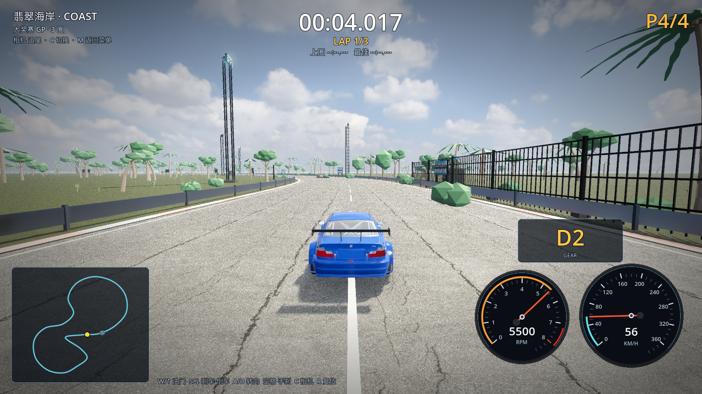

# 12 · 近景精细 / 远景粗糙（分层 LOD + 距离剔除）

> 2026-11-03 · 用户要求：只精细做赛道周围，远处的可以粗糙一些。

---

## 一、植被分三层

| 层 | 范围（距赛道中心线） | 内容 | 单株成本 | 可见距离 |
| --- | --- | --- | --- | --- |
| **近景 detail** | 10–90m | 5 种高模树（高棕榈/弯棕榈/阔叶/海岸树/灌丛）+ 草丛 + 灌木 + 真实礁石 | 1–3k 面 | 树 430m、草 140m、灌木 240m |
| **远景 far** | 80–300m | 低模树（`lowtree_palm`/`lowtree_round`，<200 面，无阴影） | <200 面 | 950m |
| 超远 | >950m / 视锥外 | 完全不渲染（只留地面/海/HDRI 天空） | — | — |

低模树资产：`tools/blender/build_lowpoly_flora.py` → `lowtree_palm.glb`（7 片叶扇）、
`lowtree_round.glb`（树干+2 个低面球）、`lowtree_pine.glb`（后续给雪山用）。

## 二、剔除机制

1. **空间分块**：近景树/草按 180m×180m 切成 16 块 MultiMesh，每块独立 AABB → 视锥外整块剔除；
2. **距离剔除（visibility_range_end）**：草 140m、灌木 240m、树 430m、低模树 950m，
   超出距离自动不渲染（带渐隐 margin，避免突然消失）；
3. 树/灌木/草/低模树**不投射阴影**，建筑/龙门架/礁石保留阴影；
4. 远景低模树只有 ~200 面，620 棵合计 < 12 万面，几乎不占性能。



## 三、性能

| 档位 | 改前（HIGH） | 改后（HIGH） |
| --- | --- | --- |
| 平均 FPS | 65.4 | **71.3** |
| 最低 FPS | 64 | **67** |
| draw calls | 902 | 912 |
| 图元 | 2.69M | 2.70M |

（ULTRA 档：52.5fps 平均 / 45 最低，仍以画质优先。）

## 四、验证

```
[M4] venue: nodes=… instances=…
[VERIFY] PASS   （0 warning）
```
