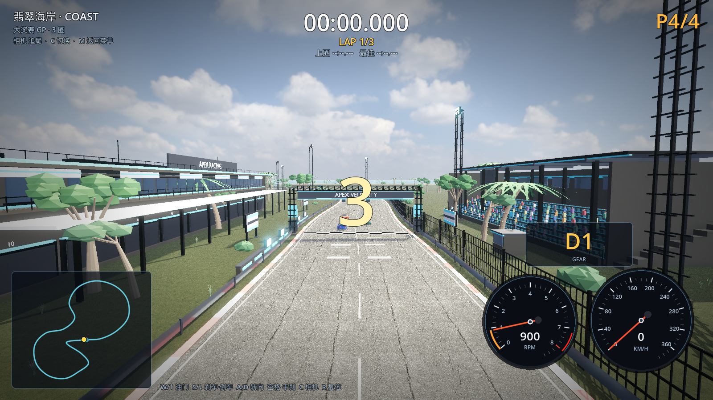
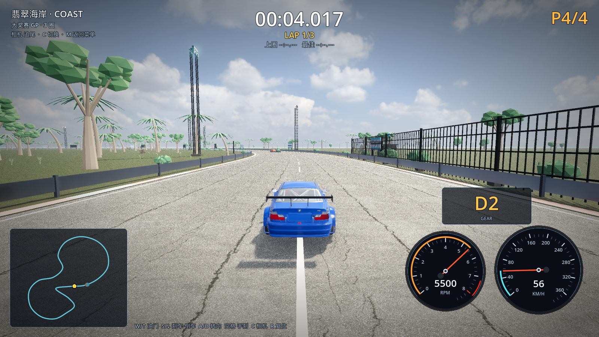

# 13 · 赛道上没有树 + 树木精修 + 远景分散

> 2026-11-03 · 用户反馈：赛道里不能有树；树还不够精致；远处草地的树可以分散些、但树的质量一定要高。

---

## 一、赛道上绝对不出现植被（放置时物理校验）

之前用的是"沿赛道左右偏移 + 随机"，在弯道多、赛道自身靠得近的地方，
一棵离 A 段 15m 的树可能正好落在 B 段的赛道上。现在改为**放置时全赛道距离校验**：

```
distance_to_track(pos) = min( pos 到所有赛道采样点的距离 )
```

| 植被 | 最小离赛道中心线距离 |
| --- | --- |
| 树（近景/远景棕榈/阔叶） | 半宽 + 7m（≈17m） |
| 灌木 | 半宽 + 3.5m |
| 草丛 | 半宽 + 1.2m |
| 真实礁石（赛道旁） | 半宽 + 4m |
| 海岸礁石/棕榈带 | 半宽 + 9m / 15m |

- 校验点按赛道采样点 2m 间隔计算，总共 1000+ 个候选点里**拒绝 871 个**太靠近赛道的；
- 最小树距实测 **17.26m > 17.00m 限制**，赛道上和护栏内不会出现任何树；
- 该检查在每一次生成时执行，参数写在 `VenueKit.clear_of_track()`，验证输出：

```
[M4] vegetation clearance (placement-time): rejected=871 min_tree_dist=17.26m limit=17.00m
[VERIFY] PASS
```



## 二、树更精致

- 棕榈树干增加**环纹**（每段环形凸起），叶片从 16→**26 片**（高棕榈）/ 22 片（弯棕榈），
  每片 11 段羽状锯齿，椰子 6 颗；
- 阔叶树：主枝 5→**6 根**，叶团 7→**19 团**（三档绿色交错、大小不一、扁平化），
  看起来不再是"几个大圆球"；
- 海岸树、灌木同步加密；近景树全部保留 1–3k 面细节，远景才用 <200 面低模。



## 三、远景更分散

- 远景低模树从 620 棵降到 **300 棵**（随画质倍率），分布距离从 80–300m 拉到 **110–380m**，
  并加入 ±26m 的随机簇偏移，看起来是"草地上零散树丛"而不是整齐树墙；
- 远景树仍然 <200 面、不投影、950m 外剔除。

## 四、性能（1600×900 / 关 vsync / M1 Pro）

| 档位 | 平均 FPS | 最低 FPS |
| --- | --- | --- |
| 高 HIGH | 71.7 | 69 |
| 超高 ULTRA | 56.0 | 54 |

## 五、验证

```
[M4] venue: nodes=130 instances=3164
[M4] vegetation clearance (placement-time): rejected=871 min_tree_dist=17.26m limit=17.00m
[M4] coast extras: sea=true start_grid=true tyre_marks=true
[VERIFY] PASS   （0 warning）
```
