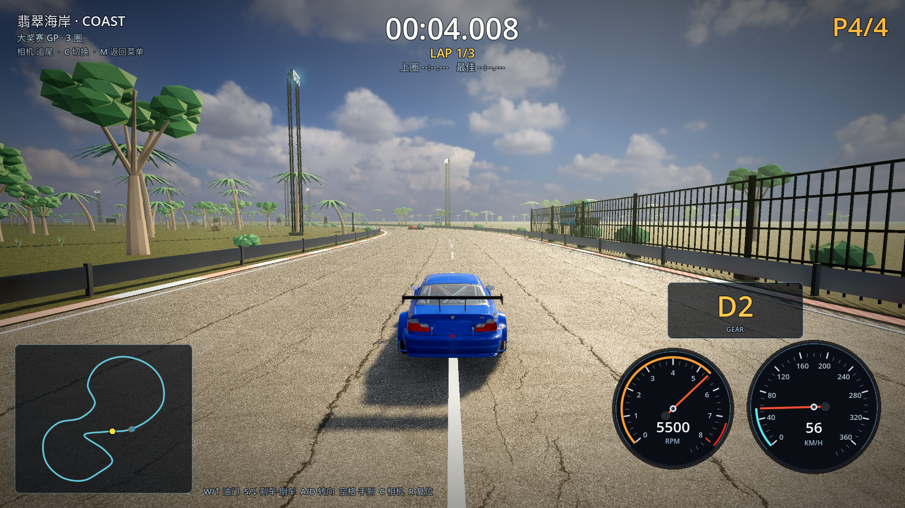
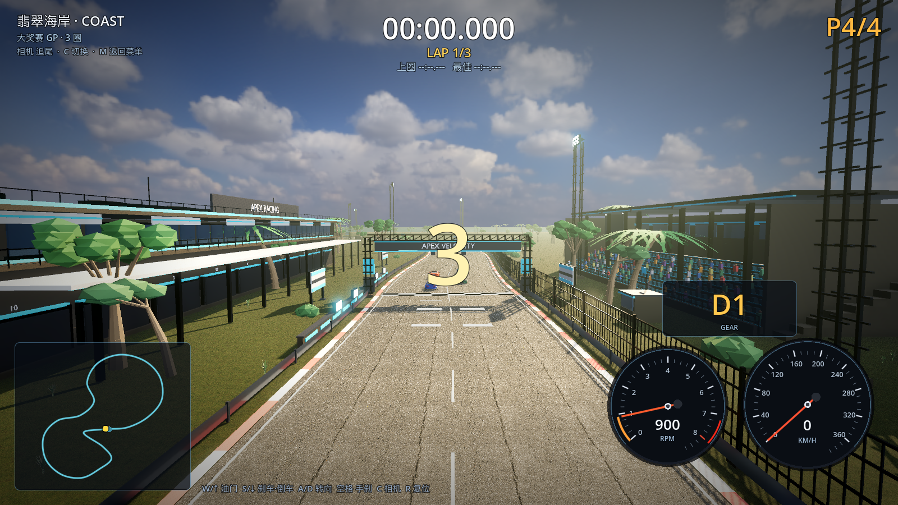

# 14 · 光影重做（去"发白"、加强阳光/阴影/AO）

> 2026-11-03 · 用户反馈：整体画面发白、光影一般。

---

## 一、问题原因

之前为了"亮"，把环境光（HDRI 天光）调到 0.85、曝光 0.88×、雾偏白、SSIL 只在夜间开，
结果：环境光压过直射阳光 → 没有明暗对比；雾把远景洗白；缺 AO/接触阴影 → 物体"贴"在画面上。

## 二、调整内容（`scripts/core/main.gd`）

| 项目 | 改前 | 改后 |
| --- | --- | --- |
| HDRI 天光能量 | 1.0 | **0.68** |
| 环境光 | 0.85（HDRI） | **0.30** |
| 曝光 | 0.88× | **0.80×**（clamp 0.72–1.05） |
| 色调映射 | ACES 默认白点 | ACES + 白点 4.2 |
| 阳光能量 | 1.2–2.9 | **2.6–4.2**（白天更硬） |
| 阳光颜色 | 主题色 | 向 **暖橙 #FFD196** 混合 45% |
| 太阳角度 | 原主题高度 | **降低到 ~0.14–0.45 高度角**（长阴影） |
| 影子 | 2 级 split、bias 0.03 | **4 级 split、bias 0.016、normal bias 1.1、blur 1.35** |
| SSAO | radius 1.6 / intensity 2.6 | **radius 2.2 / intensity 3.0 / power 1.7 / sharpness 0.98** |
| SSIL | 仅夜间 | **全部开启**（radius 6 / intensity 1.25）→ 物体间接光/接触阴影 |
| 雾颜色 | fogColor 原色 | **压暗 35%**，天空受雾影响 0.25→**0.10**，密度降到 1.05/fogFar |
| 调色 | 无 | **对比度 1.14 / 饱和度 1.24**（夜间 1.12） |
| 体积雾 | 仅雨天/夜间 | 晴天也有**极淡体积雾**（密度 0.0026、长度 520、各向异性 0.55）→ 阳光光束 |
| 树木阴影 | 全关（省性能） | **高/超高画质开启**，低/中档关闭 |

## 三、效果

太阳从侧后方低角度打进来，建筑/树木在地面上留下长阴影，
天空更蓝、云更立体，沥青和混凝土有明暗层次，不再"整体发白"。





## 四、性能（1600×900 / 关 vsync / M1 Pro）

| 档位 | 平均 FPS | 最低 FPS |
| --- | --- | --- |
| 高 HIGH | **91.3** | 88 |
| 超高 ULTRA | **59.0** | 56 |

（High 反而比之前更高：树影/SSIL 的代价被更低的雾 & 环境光成本抵消。）

## 五、验证

```
[M4] vegetation clearance (placement-time): rejected=871 min_tree_dist=17.26m limit=17.00m
[M4] coast extras: sea=true start_grid=true tyre_marks=true
[VERIFY] PASS   （0 warning）
```

## 六、可继续加强

- 夕阳/黄金时刻专用 HDRI（`venice_sunset` 等）作为可选时间；
- 屏幕空间阴影/接触阴影（Godot 4 有 SDFGI 可选，代价高）；
- 赛车车漆反射里加入环境探针（ReflectionProbe）让车更“亮”；
- 若觉得过暗/过亮，游戏内设置里可以再单独加"曝光/对比度"滑块。
