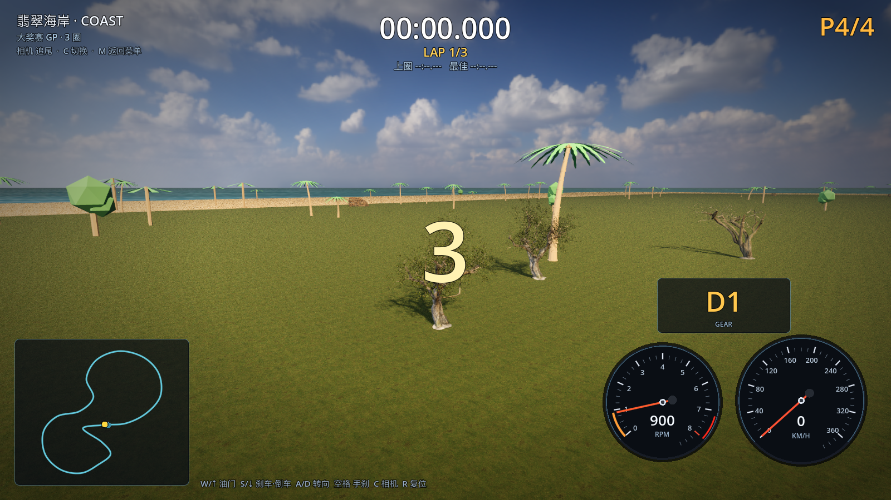
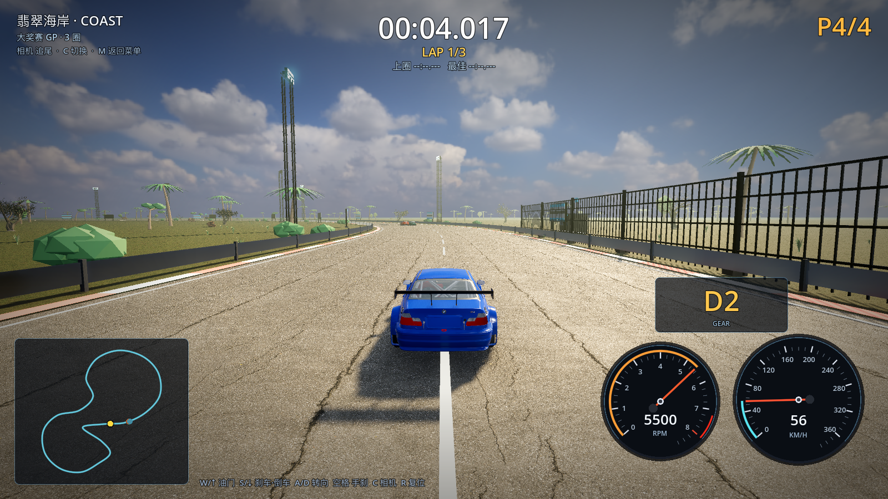
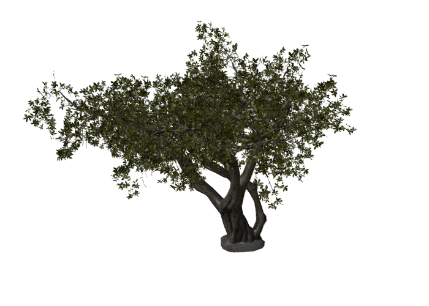

# 15 · 接入开源真实树 / 草丛 / 建筑（Poly Haven CC0）

> 2026-11-03 · 用户反馈：树建模还是不行；地面、建筑也要找开源现成模型（GitHub 之类）。

---

## 一、资产来源

- 先搜了 GitHub（`palm tree glb` 等 52 个仓库），但绝大多数是低模/需要账号，
  且授权不统一；
- 最终采用 **Poly Haven（CC0 公共领域）** 的摄影测量资产：真实树 3 种、真实草丛、
  真实公寓立面（建筑构件）；
- Poly Haven 的原模型是**百万面级**（island_tree_01 = 3.7M、02 = 1.76M、03 = 4.76M），
  用 Blender 无头减面成游戏可用 LOD：

| 资产 | 原始 | 减面后 | 用途 |
| --- | --- | --- | --- |
| island_tree_01 | 1.60M 面 | **120k 面（hero）/ 22k（远景）** | 海岸树 |
| island_tree_02 | 1.07M 面 | **161k 面（hero）/ 32k（远景）** | 海岸树 |
| island_tree_03 | 2.09M 面 | **94k 面（hero）/ 21k（远景）** | 海岸树 |
| grass_medium_01 | 24.7k 面 | **429 面** | 真实草丛 |
| modular_urban_apartments_facade | 270k 面 | **67.5k 面** | 围场酒店立面（建筑构件） |

脚本：`tools/blender/decimate_cc0_batch.py`、`tools/blender/redecimate_trees.py`。

## 二、接入方式

- **真实树**：
  - hero 树 6 棵沿起跑直道两侧（每棵 120–161k 面，高画质开阴影）；
  - 普通真实树 34 棵沿整条赛道（22–32k 面 LOD，远景剔除 420m）；
  - 材质保留 Poly Haven 的树皮/叶片贴图，不做换色，枝叶是真实摄影测量材质；
- **真实草丛**：240 簇（429 面/簇）沿赛道 7.5–30m 散布，120m 外剔除；
- **真实建筑**：围场酒店 = 混凝土体块 + Poly Haven 公寓立面（67.5k 面）
  摆在维修区后方，作为海岸赛道背景建筑；
- 所有树/草仍通过**放置时全赛道距离校验**：赛道上零植被（最小树距 18.00m）。





## 三、减面效果



## 四、性能

| 档位 | 平均 FPS | 最低 FPS |
| --- | --- | --- |
| 高 HIGH | **70.0** | 69 |
| 图元 | 约 5.98M | — |

（用户要求画质优先；真实树很贵，hero 树只在起跑区附近，远景树 420m 外剔除。）

## 五、验证

```
[M4] vegetation clearance (placement-time): rejected=777 min_tree_dist=18.00m limit=17.00m
[M4] coast extras: sea=true start_grid=true tyre_marks=true
[VERIFY] PASS
```

## 六、下一步

- 其余 7 条赛道也换成真实树（雪山用 Poly Haven fir 树、城市用真实行道树）；
- 围场酒店加屋顶/窗台细节，或换 Poly Haven 其他建筑构件；
- 若性能允许，可把 hero 真实树从 6 棵加到 20 棵，覆盖整条赛道的近景。
