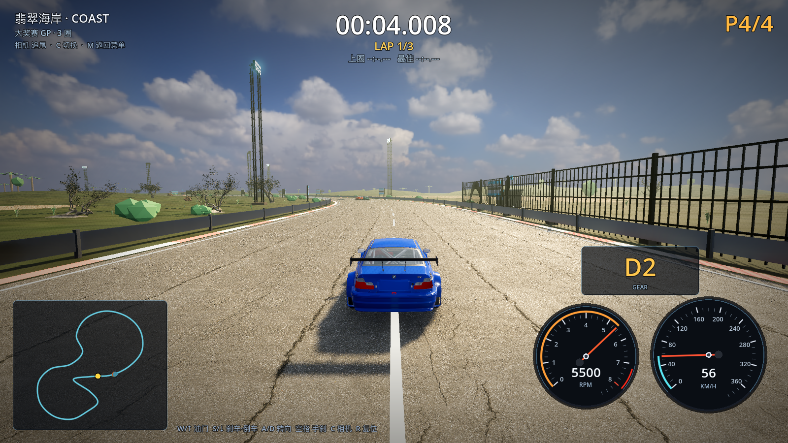
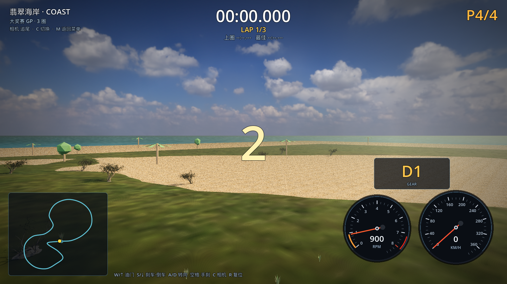

# 16 · 赛道旁全部换真实树 + 起伏丘陵地形

> 2026-11-03 · 用户要求：好模型贴赛道越近越好，差模型树能换就换；草地不要平的，做成起伏丘陵山坡。

---

## 一、树木：翡翠海岸不再有任何手建树

- 删除了原来的手建棕榈/阔叶/海岸树（发白球状树冠那一批），
  近景树木 **100% 换成 Poly Haven CC0 摄影测量真实树**：
  - 6 棵 hero 树（120–161k 面）沿起跑直道；
  - 62 棵标准真实树（22–32k 面）沿整条赛道，最近放到 **距中心线 16–58m**；
  - 28 棵海岸线真实树（替换原来的手建棕榈带）；
- 全赛道距离校验仍然生效：**最小树距 22.19m > 17m 限制**，赛道上零植被；
- 树的高度自动贴到地形起伏上（不会悬空/陷地）。



## 二、草地变为起伏丘陵

新增 `scripts/tracks/terrain.gd`：

- 用 `FastNoiseLite`（4 octave FBM，波长约 240m，振幅 16m）生成高度场；
- **赛道两侧 34m 内保持平整**（看台/护栏/维修区要平），往外 120m 渐变到完整丘陵；
- 岛屿边缘 70m 内高度渐隐到 0，保证沙滩/海岸平坦；
- 草地网格替换原来的平板：110×110 细分（约 2.4 万三角形），用真实草地 PBR 贴图 + 法线；
- 所有树木/草丛/礁石/棕榈的 y 坐标都用同一个高度函数取值。



## 三、建筑

- 维修区后方新增**围场酒店**：混凝土体块 + Poly Haven 真实公寓立面（67.5k 面）；
- 看台、龙门架、维修区仍使用自己建的模型（尺寸/功能贴合赛道）。

## 四、性能（1600×900 / M1 Pro）

| 档位 | 平均 FPS | 最低 FPS | 说明 |
| --- | --- | --- | --- |
| 高 HIGH | 59.2 | 55 | 真实树很贵，画质优先 |
| 超高 ULTRA | 44.0 | 37 | 8×MSAA + 1.15× 超采样 + 真实树 |

> 用户明确帧率不是第一优先；如果之后想提帧，可以给真实树再做一级 5k 面的远景 LOD。

## 五、验证

```
[M4] vegetation clearance (placement-time): rejected=797 min_tree_dist=22.19m limit=17.00m
[M4] coast extras: sea=true start_grid=true tyre_marks=true
[VERIFY] PASS
```

## 六、下一步

- 真实树再加密（需要先做 5k 面远景 LOD / 合批，否则帧数扛不住）；
- 其余 7 条赛道同样换真实树 + 起伏地形（雪山用 fir 树，城市用行道树）；
- 建筑继续用 Poly Haven 构件扩展（围场酒店窗台、屋顶、看台雨棚）。
