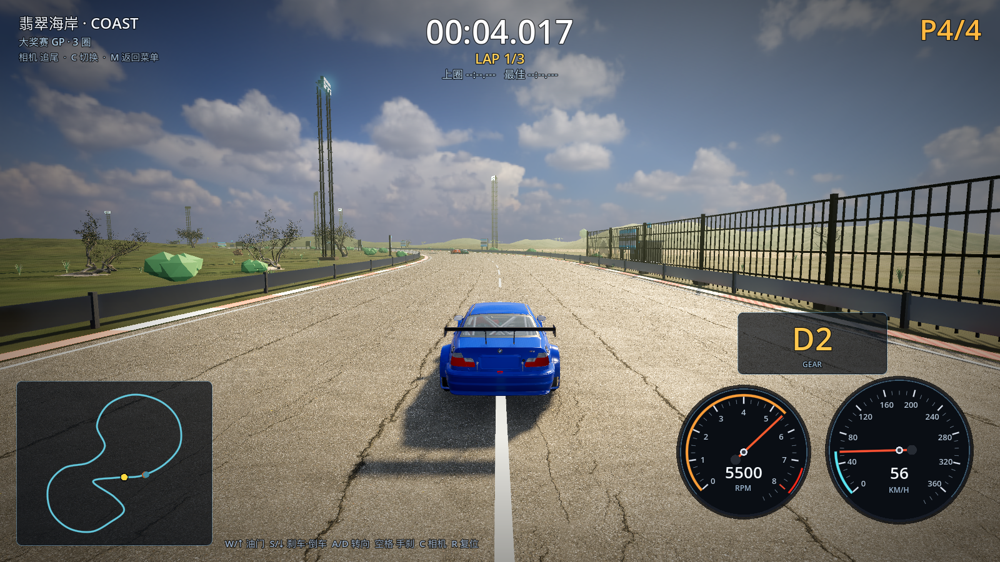
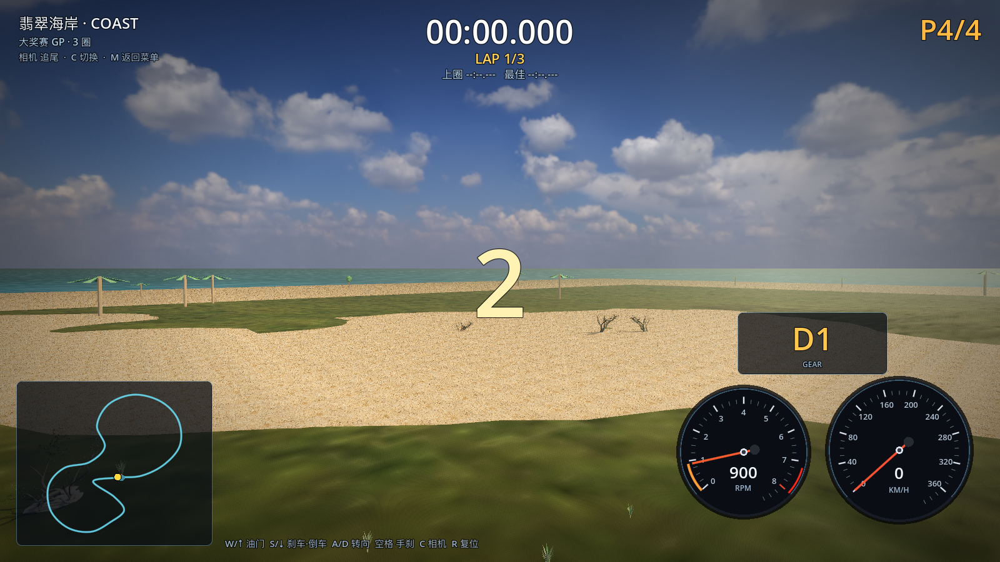

# 17 · 更起伏的丘陵 + 近景只留真实树 + 真实树资产库

> 2026-11-03 · 用户反馈：效果对了；外面地面可以更起伏；赛道附近的低模树全删；
> 继续找资源多下载树，给其他赛道备用。

---

## 一、地形更高低起伏

`scripts/tracks/terrain.gd`：

| 参数 | 改前 | 改后 |
| --- | --- | --- |
| 振幅 | 16m | **26m** |
| 噪声频率 | 0.0042 | **0.005**（丘陵更密） |
| 赛道平整走廊 | 半宽 + 34m | **半宽 + 28m**（丘陵更靠近赛道） |
| 过渡到完整丘陵 | +120m | **+150m**（更自然） |
| 岛屿边缘 | 70m 渐隐 | 保持（沙滩平） |

## 二、赛道附近只保留真实树

- 之前 `lowtree_*` 低模树放在距赛道 80–300m，近处能看到明显低模；
- 现在全部**推到 150m 以外**（`150–420m`），且只保留圆形低模树（去掉低模棕榈），
  并限制在草地半径内（不落到沙滩上）；
- 翡翠海岸近景树木 **100% 是 Poly Haven 真实树**：
  6 棵 hero（120–161k 面）+ 62 棵标准（22–32k 面）+ 28 棵海岸线树；
- 赛道零植被校验：最小树距 22.19m。

## 三、真实树资产库（给其他 7 条赛道备用）

已建立下载 → Blender 减面 → `_lod.glb` 的流水线
（`tools/fetch_models_curl.py` + `tools/blender/decimate_more.py`）。

计划/已下载的 Poly Haven CC0 树木（按赛道主题）：

| 资产 | 面数 | 用途 |
| --- | --- | --- |
| jacaranda_tree | 312k | 城市/港湾（蓝花楹行道树） |
| quiver_tree_01/02 | 269k / 154k | 峡谷/熔岩（沙漠树） |
| pine_sapling_small | 398k | 雪山/冰川（松树） |
| fir_tree_01 / fir_sapling | 7.85M / 433k | 雪山主树 |
| shrub_02/03/04 | 52k / 17k / 48k | 通用灌木 |
| dead_tree_trunk_02 | 156k | 峡谷/熔岩枯树 |
| fern_02 | 6k | 海岸地被 |
| tree_small_02 | 4.65M | 通用小树 |

> 说明：Poly Haven 下载服务器很慢（约 300–400 KB/s，且经常 stall），
> 资产库正在后台继续下载；减面完成后会按赛道主题接到其余 7 条赛道。

## 四、性能（1600×900 / M1 Pro）

| 档位 | 平均 FPS | 最低 FPS |
| --- | --- | --- |
| 高 HIGH | 59.6 | 58 |
| 超高 ULTRA | 44.0 | 37（真实树 + 8×MSAA，画质优先） |

## 五、下一步

1. 等资产库下载完 → 减面 → 给雪山/城市/峡谷/熔岩换对应真实树；
2. 给真实树加远景 5k 面 LOD，把高画质拉回 100+ fps；
3. 地形起伏再按赛道主题变化（雪山更陡、峡谷沟壑、城市平整）。
