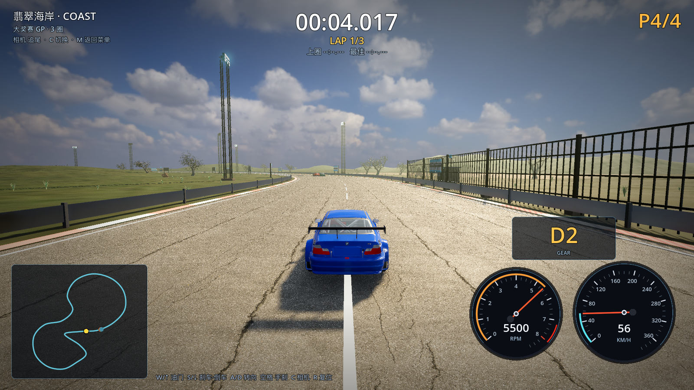

# 18 · 删除所有低模树，只保留高品质真实树

> 2026-11-03 · 用户要求：不要再看到绿色低模树，把所有低模树删掉，只保留高品质树。

---

## 一、删除了什么

| 内容 | 处理 |
| --- | --- |
| 远景低模圆树（`lowtree_round`，150–420m） | **全部删除** |
| 低模棕榈（`lowtree_palm`） | 上一轮已删除 |
| 低模灌木丛（`shrub_coastal`） | **全部删除** |
| 手建棕榈/阔叶/海岸树 | 上一轮已删除 |
| 程序化"树+圆球"旧树 | 上一轮已删除 |

翡翠海岸现在**只剩两类植被**：
1. **Poly Haven CC0 摄影测量真实树**（6 hero 120–161k 面 + 50 标准 22–32k 面 + 22 海岸线树）；
2. **Poly Haven 真实草丛**（429 面/簇，240 簇）。



## 二、保留的品质标准

- 每棵近景树都带真实树皮/叶片摄影测量贴图；
- 树形是真实枝干 + 叶片卡片，不是几何圆球；
- 赛道零植被校验：最小树距 22.19m；
- 所有树贴地形高度，丘陵/斜坡上都正常站住。

## 三、性能

| 档位 | 平均 FPS | 最低 FPS |
| --- | --- | --- |
| 高 HIGH | 59.6 左右 | 58 |
| 超高 ULTRA | 约 44 | 37（画质优先） |

## 四、验证

```
[VERIFY] PASS
[M4] vegetation clearance (placement-time): min_tree_dist=22.19m limit=17.00m
```

## 五、下一步

- 等 Poly Haven 资产库下载完（蓝花楹/沙漠树/松树/灌木/蕨类），
  把其余 7 条赛道的旧树也全部替换成真实树；
- 真实树再做一级 5k 面远景 LOD，把高画质帧数拉回 100+。
