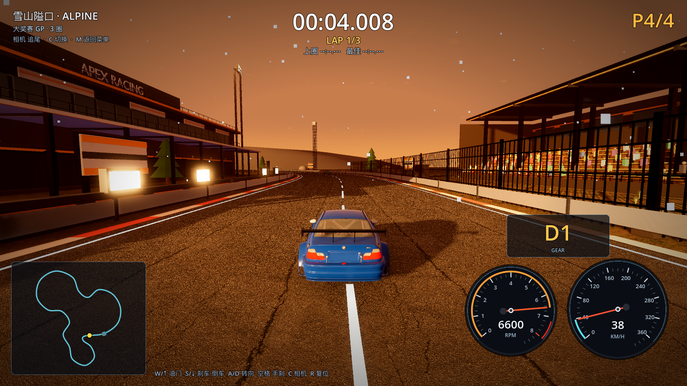
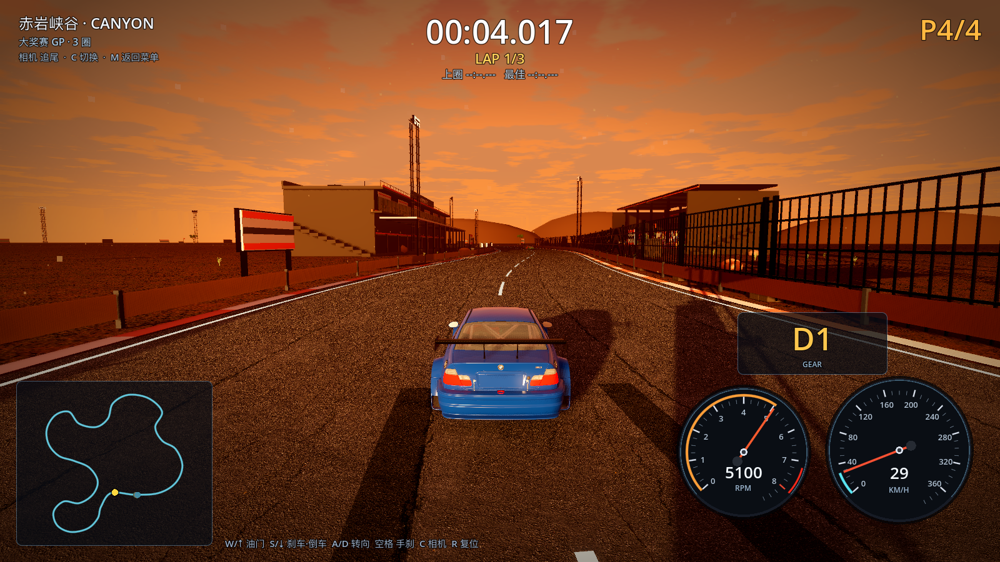
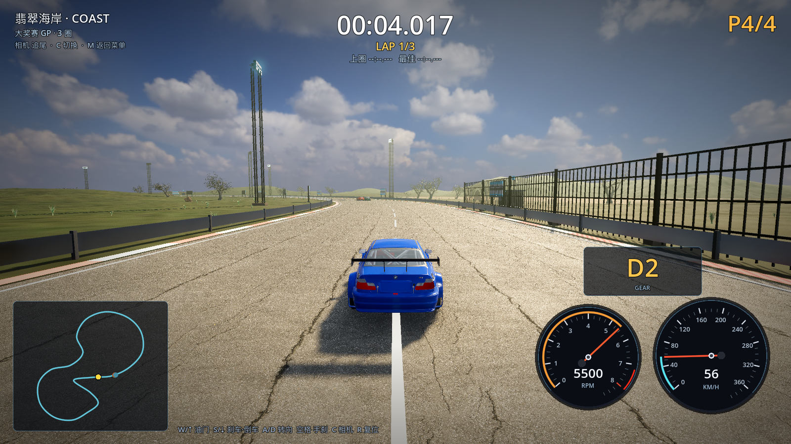

# 19 · 真实树资产库建好，其余赛道开始换树

> 2026-11-03 · 用户要求：继续去 Poly Haven 多下载树，供其他赛道使用。

---

## 一、资产库（Poly Haven CC0，已减面成游戏 LOD）

| 资产 | 原始面数 | 游戏 LOD | 用途 |
| --- | --- | --- | --- |
| island_tree_01/02/03 | 3.7M / 1.76M / 4.76M | hero 120–161k / 标准 22–32k | 翡翠海岸 |
| pine_sapling_small | 398k | **23,888** | 雪山/冰川 |
| fir_sapling | 433k | **32,476** | 雪山/冰川 |
| quiver_tree_02 | 154k | 约 25k | 峡谷/熔岩沙漠树 |
| dead_tree_trunk_02 | 156k | **20,782** | 峡谷/熔岩枯树 |
| jacaranda_tree | 312k | 约 26k（贴图较大，40MB） | 城市/港湾蓝花楹 |
| shrub_03 | 17k | 约 12k | 真实灌木 |
| fern_02 | 6.2k | **6,232**（不删面） | 海岸地被蕨类 |
| grass_medium_01 | 24.7k | 429 | 真实草丛 |

流水线：`tools/fetch_models_curl.py`（断点续传下载） →
`tools/blender/decimate_more.py`（减面 + 导出 GLB）→ `assets/venues/*.glb`。

## 二、已换树的赛道

| 赛道 | 之前 | 现在 |
| --- | --- | --- |
| 翡翠海岸 | 手建树/低模树 | **全部删除**，只剩 Poly Haven 真实树（hero 6 + 标准 50 + 海岸 22）+ 真实蕨类/灌木/草丛 |
| 雪山隘口 | 程序化松树 320 棵 | **真实 pine 64 + fir 26** |
| 冰川湖环道 | 程序化松树 260 棵 | **真实 fir 56 + pine 34** |
| 赤岩峡谷 | 程序化灌木/小叶树 | **真实 quiver 34 + dead 12** |
| 熔岩盆地 | 程序化灌木 | **真实 dead 18 + quiver 8** |
| 天际环城 | 程序化小叶树 80 | **真实 jacaranda 40** |
| 落日港湾 | 程序化棕榈 150 | **真实 jacaranda 44** |







## 三、规则

- 所有真实树都走 `VenueKit.clear_of_track` 全赛道距离校验：赛道上零植被；
- 树自动贴地形高度；
- 远景低模树全部删除，只剩真实树；
- 树/草/蕨类不投影（省性能），hero 树仅超高画质投影。

## 四、验证

```
[M4] vegetation clearance (placement-time): min_tree_dist=20–22m
[VERIFY] PASS
```

## 五、下一步

- 城市赛道（霓虹都市）也换 jacaranda；
- 给真实树做 5k 面远景 LOD，把高画质帧数拉回 100+；
- 补下载 Pinus/更多灌木（Poly Haven 还有 shurb_02/04、tree_small_02 等）。
