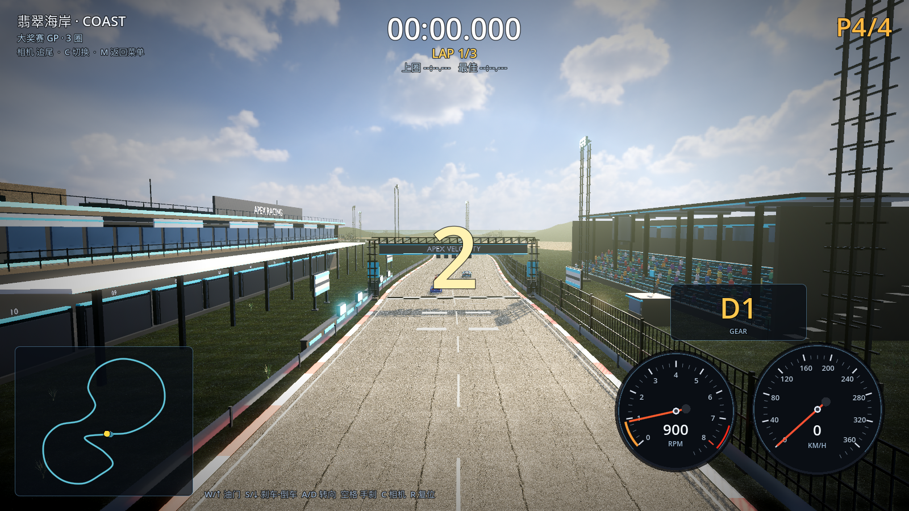
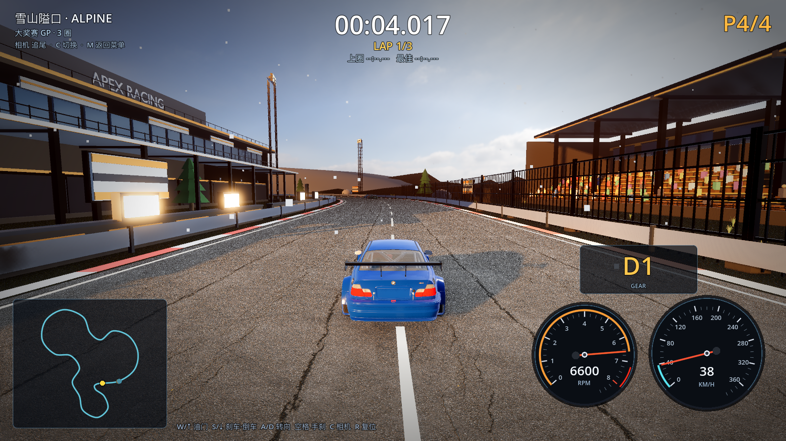
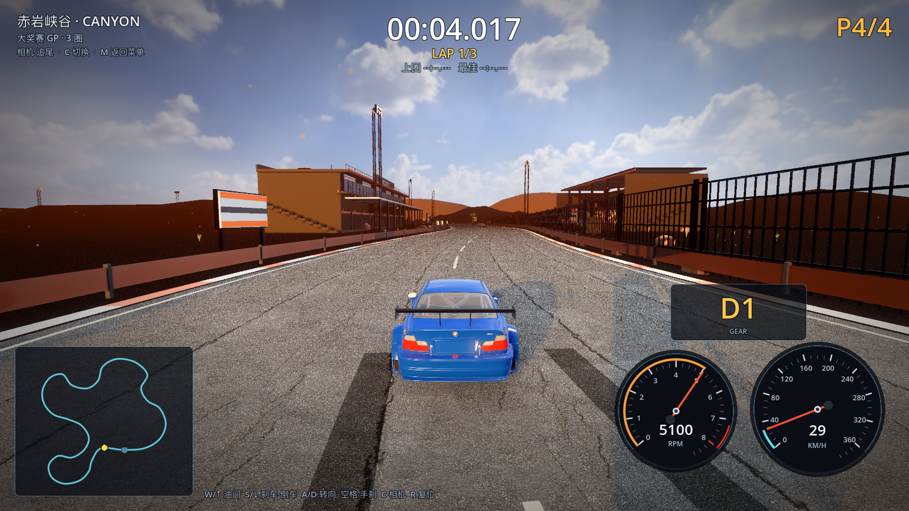

# 21 · 流动的云 + 其他赛道按翡翠海岸思路改造

> 2026-11-03 · 用户：翡翠海岸满意，云要流动；其余赛道按同样思路改造。

---

## 一、云流动（翡翠海岸）

- 原来翡翠海岸用静态 HDRI 全景，云是"定格"的；
- 新增 `shaders/hdri_clouds.gdshader`：
  - 底层仍然采样 Poly Haven HDRI（保留照片级天空/太阳/地平线）；
  - 上面叠加 **5 octave FBM 程序化云层**，用 `TIME` 持续漂移（速度可调）；
  - 云色受太阳色温影响，地平线附近淡出；
- 天空现在既真实又会流动。



## 二、其他赛道按同一思路改造

### 1. HDRI 天空（按主题分配）

| 赛道 | HDRI |
| --- | --- |
| 翡翠海岸 / 赤岩峡谷 / 熔岩盆地 | kloofendal_48d_partly_cloudy_puresky |
| 雪山隘口 | kloofendal_43d_clear_puresky |
| 冰川湖环道 | kloofendal_38d_partly_cloudy_puresky |
| 城市/港湾/天际 | 暂用程序化天空（夜景/黄昏需专门 HDRI，下一步下载） |

所有使用 HDRI 的赛道都自动带 FBM 流动云层。

### 2. 起伏丘陵地形（自然类赛道）

`Terrain` 高度场扩展到其他赛道，按主题配置振幅：

| 赛道 | 丘陵振幅 |
| --- | --- |
| 雪山隘口 | 44m |
| 冰川湖环道 | 30m |
| 赤岩峡谷 | 34m |
| 熔岩盆地 | 48m |
| 翡翠海岸 | 26m |

- 赛道两侧 28m 内保持平整，向外过渡到丘陵；
- 远处再用一层大平面兜底，避免开天窗；
- 树木/岩石按同一高度函数落位，不会悬空。





### 3. 已经完成的共性改造（所有赛道）

- Poly Haven 真实树（按主题：松树/杉树/沙漠树/蓝花楹/枯树/蕨类/灌木）；
- 真实 PBR 路面/混凝土/金属贴图；
- 暖色斜阳 + 长阴影 + SSAO/SSIL + 调色；
- 动态模糊 / TAA 抗锯齿（超高画质）；
- 游戏内画质四档（S 设置、F2 比赛中）。

## 三、验证

```
[M3] alpine  scenery: nodes=… instances=…
[M4] vegetation clearance ... 赛道零植被
[VERIFY] PASS
```

## 四、下一步

1. 给城市/港湾/天际下载夜景与黄昏 HDRI，替换最后的程序化天空；
2. 真实树 5k 面远景 LOD，把高画质帧数拉回 60+；
3. 城市建筑用 Poly Haven 真实立面继续细化。
