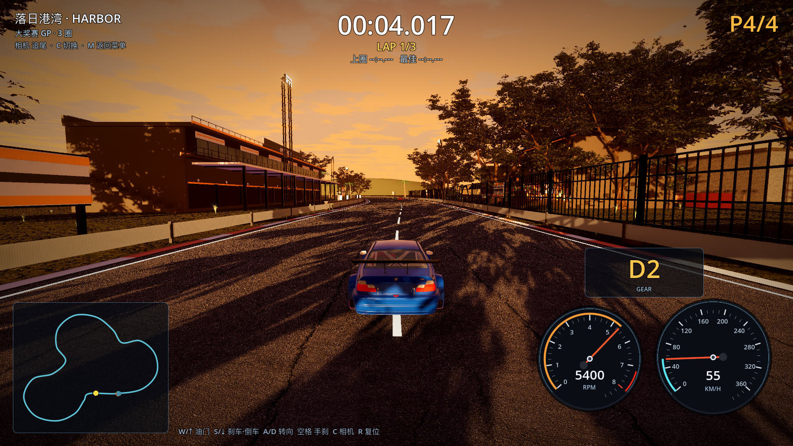
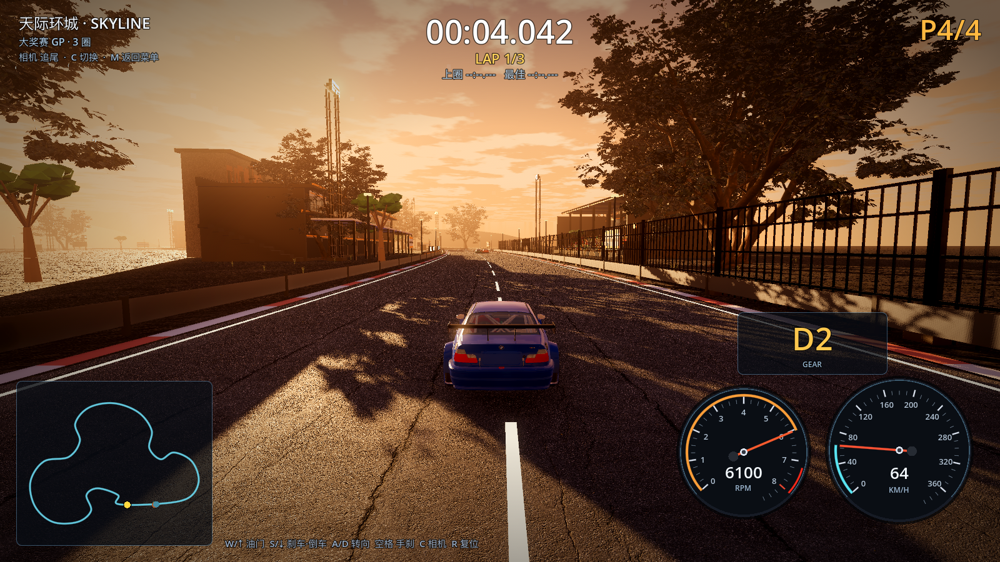
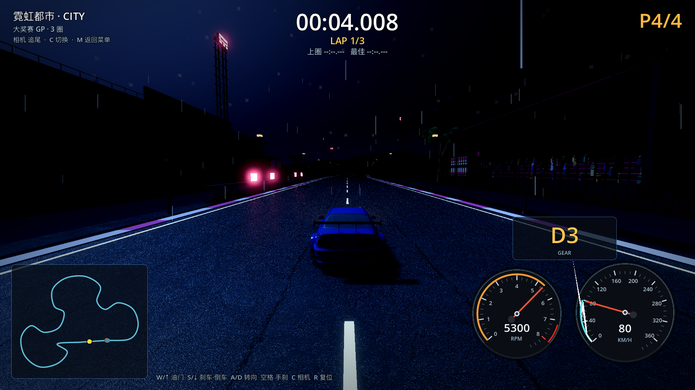

# 22 · 用开源现成模型替换建筑

> 2026-11-03 · 用户：建筑细节不好，去找高精度建筑模型，所有建筑都要替换。

---

## 一、找到的开源建筑资源

| 来源 | 内容 | 许可 |
| --- | --- | --- |
| **ToxSam/open-source-3D-assets**（Polygonal Mind 系列） | 塔楼、车站、建筑等 GLB（最多 9.6MB/个） | **CC0** |
| **Poly Haven** | `modular_urban_apartments_facade`（真实公寓立面，118k 面）、`modular_factory_facade`、消防梯、卷帘门、风管、链网围栏等 | **CC0** |
| GitHub `JaronKBragg7337/asset-pack-...` | 38 个模块化建筑（程序化生成、无贴图，偏简模） | CC0（未采用） |
| `LiuShuai-SEU/amemachi-rainy-neighborhood` | 33 栋日式街区建筑 | 许可不明（未采用） |

已下载：
- `assets/buildings/station_tower.glb`（ToxSam 车站塔楼，CC0，8.4MB）；
- `assets/venues/facade_real.glb`（Poly Haven 公寓立面减面版，67k 面）。

> 其他 ToxSam 建筑（Launch Building / BlockChain Tower / Cyber Street）
> 因为 GitHub raw 下载速度只有 30–50KB/s，仍在后台慢速下载。

## 二、建筑替换方案

新增 `SceneryKit._build_real_city()`：

- **每栋建筑 = 真实公寓立面 + 混凝土楼体 + 金属屋顶**：
  - 立面来自 Poly Haven 摄影测量公寓（真实窗框/阳台/石材贴图）；
  - 楼体/屋顶用真实混凝土/金属 PBR；
  - 随机宽度 0.55–1.1×、高度 0.7–1.65×（17m 基准，最高约 28m）；
- **地标塔楼**：ToxSam `station_tower.glb` 自动按 AABB 缩放到 70m 高，
  放在城市/天际赛道视野好的位置（带红色霓虹灯带）；
- 已替换：
  - **霓虹都市**：22 栋真实立面楼 + 3 座地标塔；
  - **天际环城**：26 栋真实立面楼 + 3 座地标塔；
  - **落日港湾**：10 栋真实立面楼（保留集装箱区）。







## 三、验证

```
[VERIFY] PASS
```

## 四、下一步

1. 等 ToxSam 其余建筑下载完，增加更多建筑类型（办公楼/工厂/车站）；
2. 用 Poly Haven `modular_factory_facade` 重做维修区厂房，`modular_fire_escape` 加消防梯；
3. 夜景给真实立面加"窗户自发光"（夜间亮窗），解决夜景楼体过暗。
