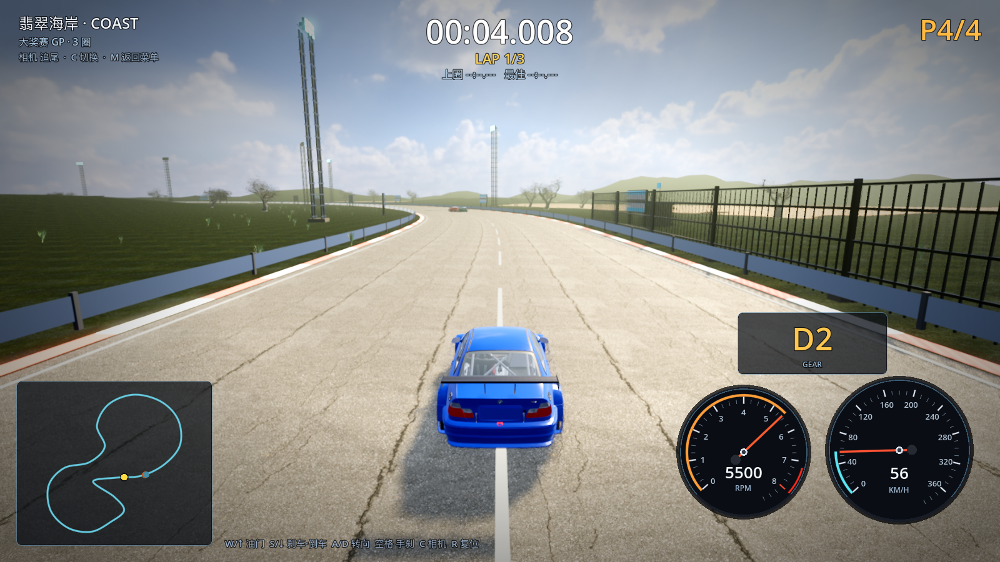
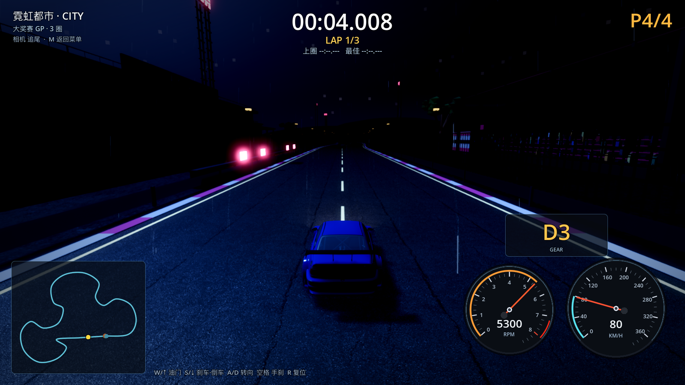
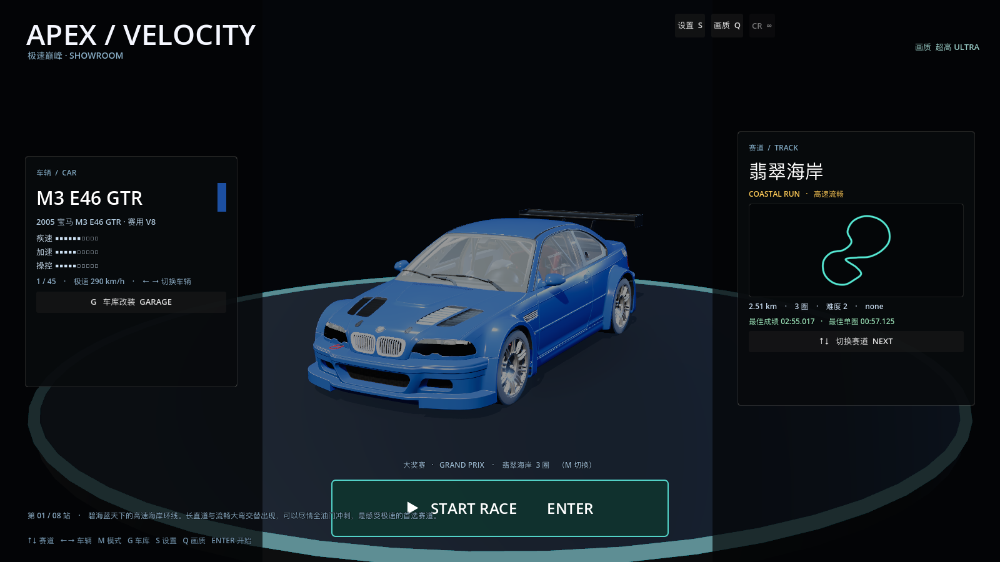

# 23 · 单一追尾机位 + 光影加强 + 真实雨 + 展厅式主菜单

> 2026-11-03 · 用户：只保留一个视角（抬高、下倾，前后距离不变）；光影再加强；
> 雨做得真实；主菜单参考旧网页前端重做。

---

## 一、单一追尾机位

- 删除了「近身 / 座舱」两个机位和 C 键切换；HUD 提示同步去掉；
- 追尾机位参数：
  - 前后距离保持 **6.6m**（原来 6.4m，基本不变）；
  - 机位高度 **2.35m → 3.55m**；
  - 视点压低：看向车前方 5.8m、离地 0.15m（原 7.5m / 1.05m）→ **明显向下俯视**；
  - FOV 64 → 62，视角更稳。



## 二、光影再加强

- 曝光 0.80→**0.86**、太阳能量 4.2→**4.8**、对比度 1.14→1.18、饱和度 1.24→1.28；
- SSAO 半径 2.2→**2.4**、强度 3.0→**3.6**；SSIL 1.25→**1.5**；
- HDRI 天空能量不变，但整体更亮更立体。

## 三、真实的雨

- 雨丝：1100 条 → **2400 条**，更长（1.0m）、更细（0.024m）；
- 斜度/重力加强（风偏 +2.0、重力 -24），配合湿滑路面 SSR 反光；
- 尝试过"落地水花"粒子，但夜间看起来像白方块，已回退，后续用贴片水花重做。



## 四、展厅式主菜单（参考旧网页前端）

参考旧 web 前端 `css/menu.css` 的 "showroom home"：
- **3D 车居中展示**（复用车库展厅：暗色地台、轮廓光、缓慢转台）；
- 左侧「车辆」竖卡：名称/中文名/三色性能条/极速/车色块/G 车库入口；
- 右侧「赛道」竖卡：名称/英文/赛道图/长度/圈数/难度/最佳成绩/↑↓ 切换；
- 底部居中大按钮 **START RACE · ENTER**，上方显示模式与赛道；
- 右上角设置/画质/CR 按钮，左下角站数与赛道描述；
- 键盘：↑↓ 赛道、←→ 车辆、M 模式、G 车库、S 设置、Q 画质、ENTER 开始。



## 五、验证

```
[VERIFY] PASS
```
