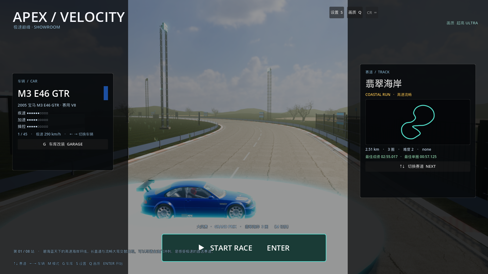

# 24 · 主菜单：所选赛道实景背景 + 展台车

> 2026-11-03 · 用户：选赛道后背景要变成赛道，车放在展台上，像旧网页前端那样，布局再优化。

---

## 一、实现方式

旧菜单只有抽象暗色展厅；现在选中哪条赛道，菜单背景就**实时生成那条赛道的 3D 场景**：

1. 复用赛道生成器：`TrackBuilder`（路面/路缘/护栏/起跑格/地形/海水）+ `SceneryKit`（树木/岩石/建筑）+ `VenueKit`（看台/维修区/龙门架/灯塔等）；
2. 菜单背景相机放在起跑直道后方 13m、抬高 4.5m，视线越过展台看向赛道纵深；
3. 车放在**发光环形展台**上（金属圆台 + 主题色 emission 灯环 + 顶部补光灯），缓慢左右转动；
4. 切换赛道（↑↓）→ **背景实时重建为该赛道**；切换车辆（←→）→ 展台上的车即时更换。

## 二、主菜单布局优化（参考旧网页前端）

| 区域 | 内容 |
| --- | --- |
| 左上 | `APEX / VELOCITY` 标题 + `极速巅峰 · SHOWROOM` |
| 右侧竖卡 | 赛道名/英文/赛道图/长度/圈数/难度/最佳成绩/切换按钮 |
| 左侧竖卡 | 车名/中文名/性能条/极速/车色/车库入口（卡片高度收紧，去掉空白） |
| 底部居中 | 大号 **▶ START RACE · ENTER** 按钮，上方显示模式+赛道+圈数 |
| 右上 | 设置 S / 画质 Q / CR ∞ |
| 左下 | 站数（第 01/08 站）+ 赛道描述 |
| 底部 | 快捷键条 |



## 三、性能

菜单背景为一整条赛道场景（含植被/建筑），生成时间约 1–2 秒（切赛道时重建）；
菜单本身不做物理/AI 更新，只是静态展示 + 慢速转动，帧率稳定。

## 四、验证

```
[VERIFY] PASS
```
