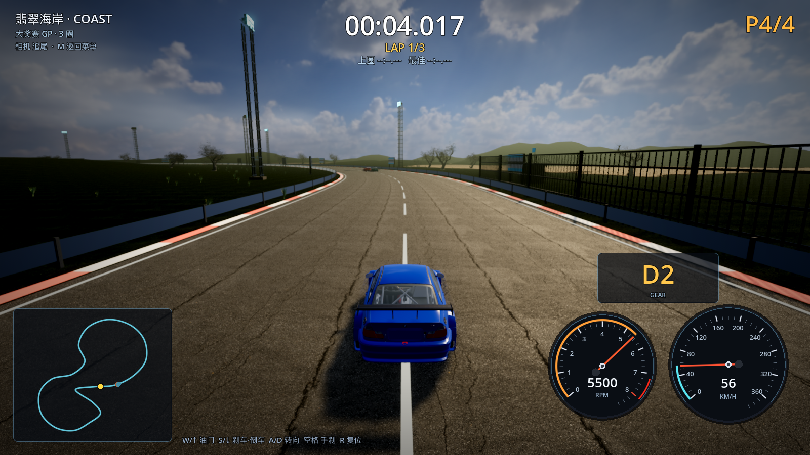
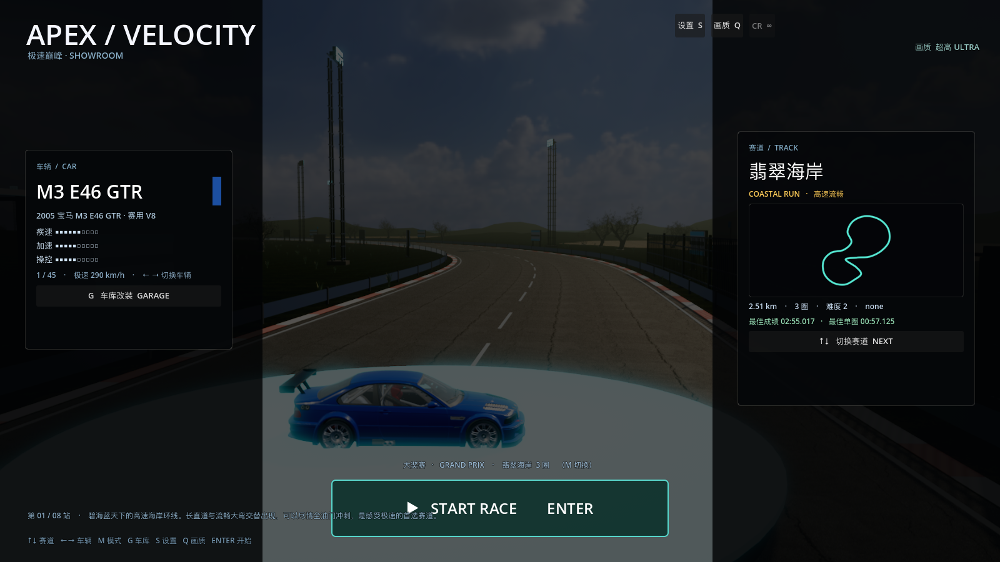

# 25 · 暗调电影感光影（"该暗的地方要暗"）

> 2026-11-03 · 用户：光影不是越亮越好；该深色时叫深，整体界面偏暗一点、更有感觉。

---

## 一、调整思路

之前的问题：曝光高 + 天光强 + 雾偏白 + 材质偏亮 → 画面"处处亮"，没有明暗层次。
这次整体压暗，让亮部（阳光/高光）和暗部（阴影/背光面）拉开对比：

| 项目 | 上一版 | 现在 |
| --- | --- | --- |
| 曝光 | 0.86× | **0.60×**（clamp 0.52–0.86） |
| 白点 | 4.2 | **3.4** |
| HDRI 天空亮度 | 1.0 | **0.58**（shader 里独立控制） |
| 环境光（天光） | 0.50 | **0.18** |
| 阳光能量 | 2.9–4.8 | **1.9–3.2** |
| 对比度 | 1.18 | **1.30** |
| 饱和度 | 1.28 | **1.18** |
| 亮度 | 1.00 | **0.90** |
| SSAO 强度 / Light Affect | 3.6 / 0.12 | **4.0 / 0.06** |
| SSIL | 1.5 | **1.15**（少补光 → 阴影更暗） |
| 雾色 | fogColor 压暗 35% | **压暗 55%** |
| 沥青贴图亮度 | 1.0 | **0.72** |

## 二、主菜单也压暗

- 菜单遮罩 0.42→**0.66**、两侧暗栏加深；左侧车辆卡背景加深；
- 展台加**主光 + 蓝色补光**，车在暗环境里作为唯一亮部——更像车展/旧网页前端的氛围。





## 三、验证

```
[VERIFY] PASS
```

## 四、如果还想调

- 觉得太暗：告诉我"再亮一点"，我把曝光从 0.60 提到 0.65–0.70；
- 觉得对比不够：可以加 SSAO 强度 / 对比度；
- 想让暗部更偏蓝（电影感）：给阴影加色温，需要加一层调色 LUT。
