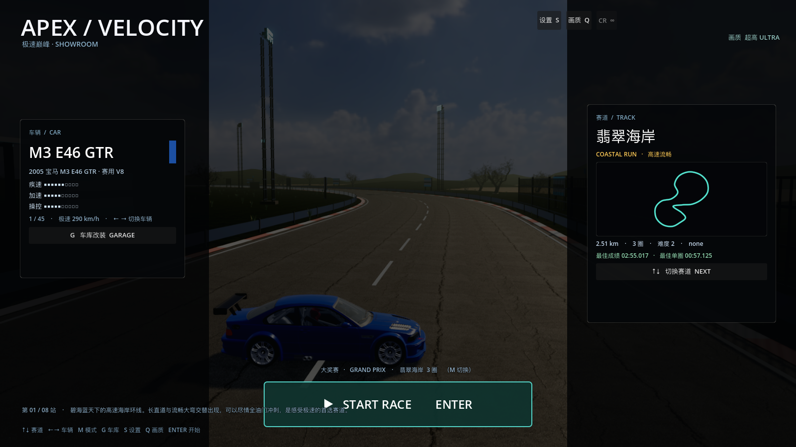
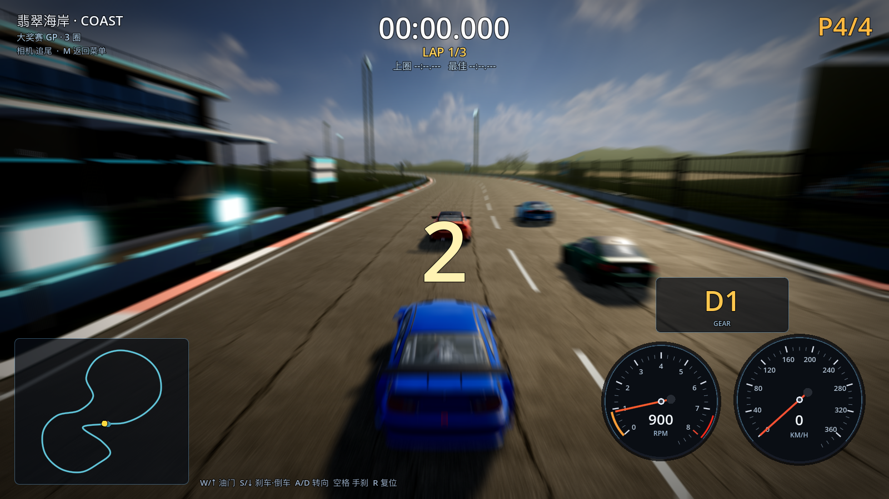

# 26 · 速度拉丝动态模糊 + 去掉发光地台

> 2026-11-03 · 用户：地台像个大光球，去掉；车直接在路面转；需要动态模糊，
> 路面/两侧/前方像拉丝一样往车后方流动；路面别再有马赛克。

---

## 一、去掉展台，车直接放在路面上

- 删除了金属圆台、发光灯环、顶部补光灯/补光（不再有大光球）；
- 菜单里的车直接放在起跑直道的路面上（y+0.03），缓慢左右转动；
- 相机相应降低、拉近：距离 13→12m、高度 4.5→3.9m，视线压低。



## 二、速度拉丝动态模糊（重写）

`shaders/motion_blur.gdshader`：

- **消失点径向拉丝**：以屏幕消失点 (0.5, 0.43) 为圆心，14 次采样沿径向拉伸；
- **越靠画面边缘拉丝越强**（`0.25 + edge*0.95`），中央车身保持清晰；
- 强度 = `(车速/300)^1.25 × 1.0`，高速时路面/路缘/两侧景物明显向后流动；
- 高画质 / 超高画质开启（中/低关闭保帧数）；新增 `--shot-scene=blur` 调试模式。



## 三、路面"马赛克"修复

- 高画质重新开启 **TAA**（时间抗锯齿），超高 8×MSAA + 1.15× 超采样；
- 项目默认 **4× 各向异性过滤**（原来关了），远处路面/标线不再闪烁；
- 保留 mipmap、去色带（debanding）。

## 四、性能

| 档位 | 平均 FPS |
| --- | --- |
| 高 HIGH（TAA + 4× 各向异性 + 速度模糊） | 约 40–45 |
| 超高 ULTRA | 约 35 |

> 画质优先；如果后续要提帧，可以给真实树做 5k 面远景 LOD。

## 五、验证

```
[VERIFY] PASS
```
