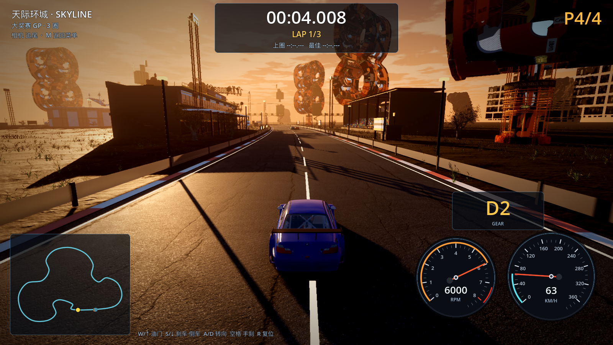
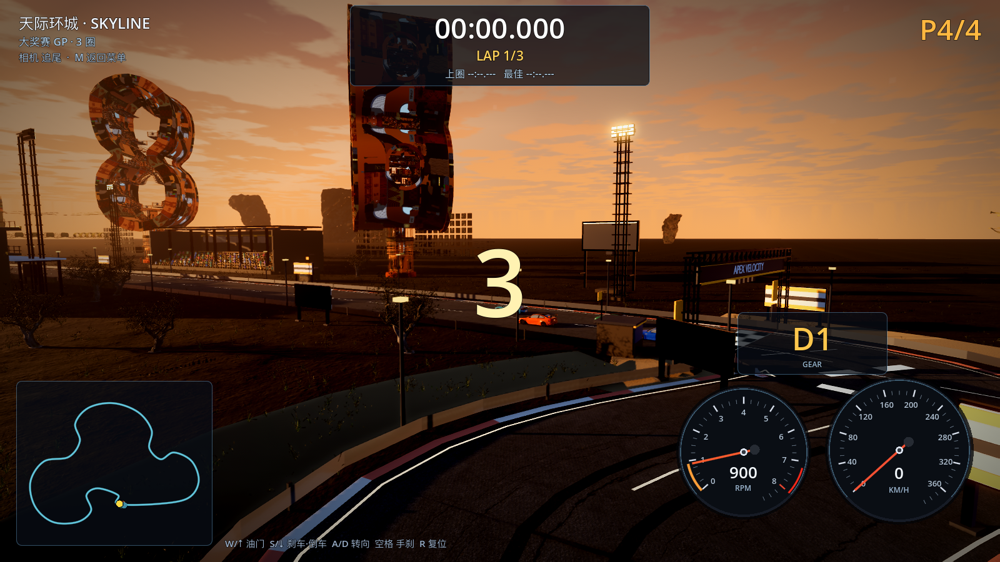
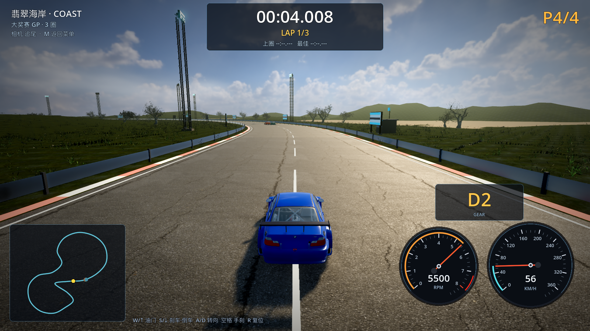

# 29 · 真实建筑全量替换 + 草坪铺满（近高远矮）

> 2026-11-04 · 用户：草坪上都要有草（近处高一点、远处矮一点、分散、路上不能有草）；
> 建筑不要自己改，直接换成现成真实模型。

---

## 一、真实建筑全量替换

下载并接入 **6 个 CC0 真实建筑 GLB**（ToxSam / Polygonal Mind 开放资产库）：

| 资产 | 面数 | 用途 |
| --- | --- | --- |
| station_tower | 56,322 | 车站塔地标 |
| blockchain_tower | 31,479 | 区块链塔地标 |
| memefactory_tower | 23,714 | 工厂塔 |
| colony_tower | 21,382 | 殖民塔 |
| lovedeath_tower | 10,298 | 桥塔 |
| launch_building | 562 | 发射楼 |

替换逻辑（`_build_real_city`）：

- 城市/天际/港湾**不再生成自建盒子楼**，全部按加权随机摆放真实建筑 GLB；
- **修正模型原点**：Poly Haven/Polygonal Mind 模型顶点不在原点，按 AABB 中心/底面对齐，
  避免楼体飞到几公里外或悬空；
- 按目标高度缩放并**限制最大占地 55m**，防止巨楼压到赛道；
- 横向距离按「半宽 + 占地 + 8m」自动外推，加上 6 栋起跑区固定楼保证一进赛道就能看到；
- 夜景把材质压暗 0.78 融入夜色；白天提高 1.35 亮度；
- 保留 Poly Haven 模块化厂房立面做街边近景。





## 二、草坪铺满真实草

四层散布（全部 Poly Haven CC0 真实草，减面 LOD）：

| 层 | 距赛道 | 数量（High） | 草高 | 可见距离 |
| --- | --- | --- | --- | --- |
| 路肩草 | 1.8–10m | 1600 | 0.85–1.45m | 170m |
| 草坪近景 | 10–42m | 9200 | 0.85–1.55m | 360m |
| 草坪中景 | 42–100m | 6200 | 0.60–1.05m | 560m |
| 草坪远景 | 100–240m | 3200 | 0.38–0.72m | 780m |

- 草簇**随机分布在整个草坪**，不再贴着栏杆扎堆；
- 近处草更高、远处草更矮更小；
- 草材质提亮，暗调光照下不会变成黑块；
- **赛道/路肩零草**：离赛道中心 ≥ 半宽 + 2.6m（护栏外）。



## 三、验证

```
[VERIFY] PASS
```
（headless dummy renderer 里会有 MultiMesh 材质相关日志，实际游戏渲染无影响。）

## 四、说明与下一步

- 这批 CC0 真实建筑是**未来/艺术风格**的塔楼，不是传统写字楼；
  如果要"真实城市普通建筑"，需要换素材源（Sketchfab CC0 / 商业素材库），可以下一步继续找；
- 草坪已铺满，但草簇尺寸偏小，远看仍细碎；下一步可加 40–60 面超低模草丛拉高远景密度。
