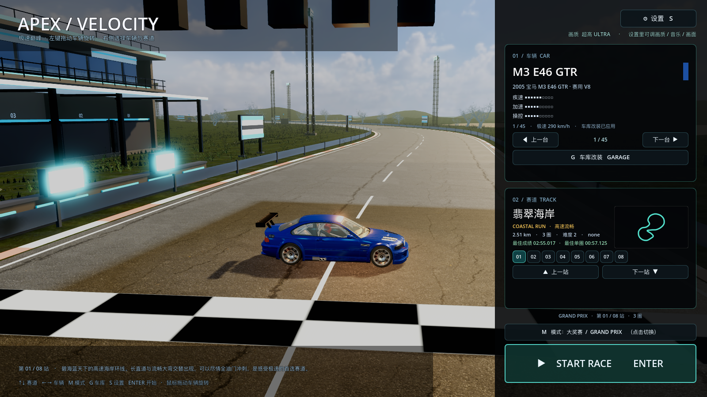
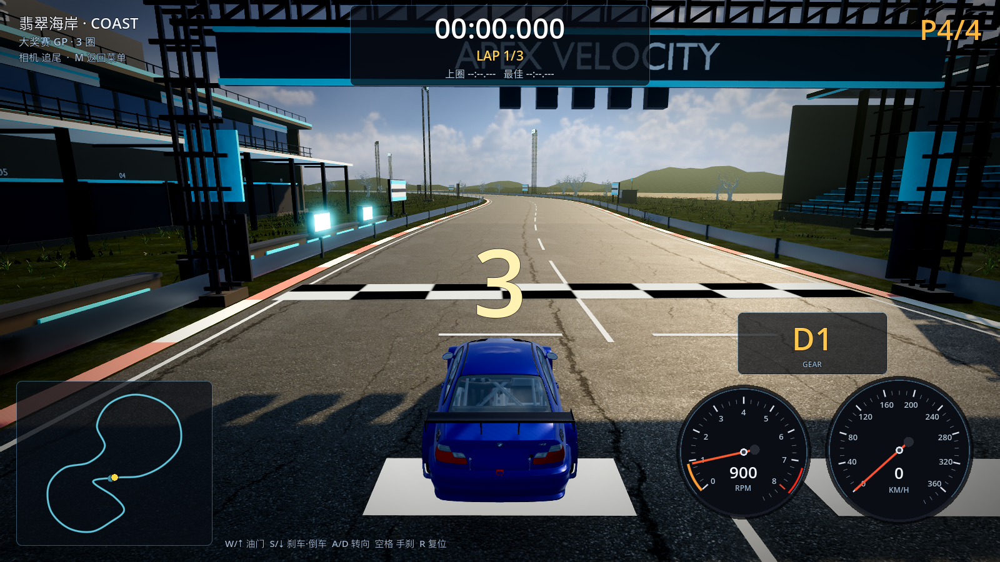

# 30 · 前端改版：可拖动看车 + 右侧选车/选赛道 + 起跑位置修正

> 2026-11-04 · 用户：主菜单左侧显示赛道起点门楼+车、可拖动旋转看车；
> 右侧上选车下选赛道+开始；车放大、地图缩小；车模渲染提升；看台去人；起跑位置修正。

---

## 一、主菜单新布局

```
┌────────────────────────────────────────────┬──────────────────┐
│  APEX / VELOCITY                          │  ⚙ 设置 S        │
│                                            │  画质 ULTRA      │
│        [ 赛道起点实景 + 展车 ]              │ ┌──────────────┐ │
│         · 相机在起跑线之前                  │ │ 01 车辆 CAR  │ │
│         · 龙门架/看台/维修区入画            │ │ 换车 / 车库  │ │
│         · 左键拖动车辆旋转                  │ └──────────────┘ │
│                                            │ ┌──────────────┐ │
│                                            │ │ 02 赛道 TRACK│ │
│                                            │ │ 小地图/站点  │ │
│                                            │ └──────────────┘ │
│  第 01/08 站 · 赛道描述                    │ 模式 / START RACE│
└────────────────────────────────────────────┴──────────────────┘
```

- **左侧 3D 实景**：相机放在起跑线之前，能看到龙门架/看台/维修区；
  车放在起跑线上，**左键拖动即可旋转查看任意角度**（不拖动时缓慢自转）；
- 换赛道 → 左侧整条赛道实景重建；换车 → 左侧车模即时更换；
- **右侧上=选车、下=选赛道**，底部 START RACE；
- 车是主角（占据左侧大画面），赛道图缩小到右侧卡片里（168×96）。

## 二、车模渲染提升

- 车漆材质加 **clearcoat（清漆层）**：metal 0.35 / roughness 0.26 / clearcoat 0.8；
- 菜单场景单独加亮：曝光 ×1.45、环境光 +0.22、亮度 1.02；
- 车周围加 **ReflectionProbe + 主光/补光/轮廓光**（暖主光 9、冷补光 4、暖轮廓 5.5）；
- 换车界面里车明显更亮、车漆有高光和反射，不再是灰蒙蒙一块。

## 三、看台去人

- 删除了看台上的方块观众人群（`_add_crowd` 调用移除），现在看台是空的，
  避免"彩色小方块"拉低观感。

## 四、起跑位置与计时修正

- 发车格整体移到**起跑线之后（后方）**：玩家 -8m、AI -15/-22/-29m；
- 起跑后**第一次越过起跑线才开始计时**（RaceManager 新增 `race_started`），
  这次越线不计圈；之后的越线才计圈，避免"少跑一圈"的问题。

## 五、验证

```
[VERIFY] PASS
```
（headless dummy renderer 会打印 MultiMesh 材质相关日志，实际游戏渲染正常。）




