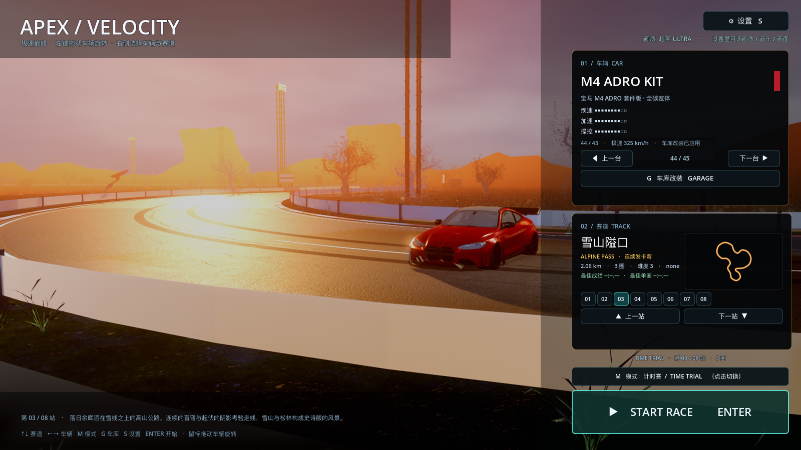
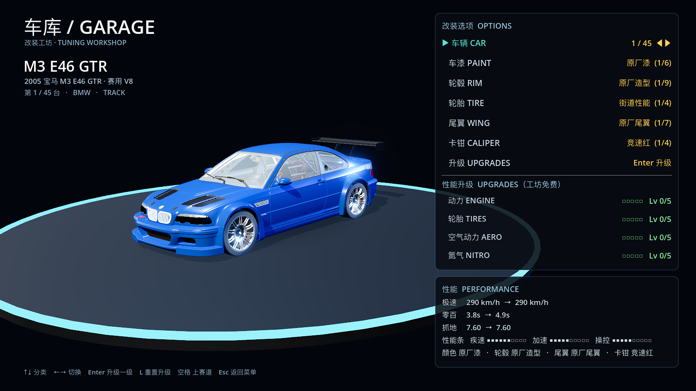
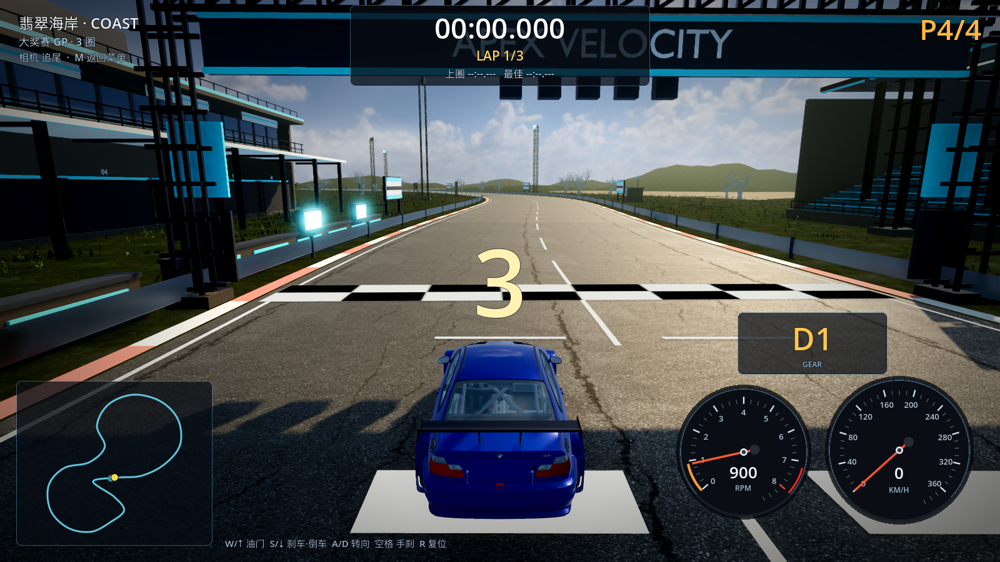

# 32 · 全屏赛道主菜单 + 车库布局 + 起跑低视角

> 2026-11-04 · 用户：菜单左侧要全屏赛道背景、右侧半透明浮层、每赛道选有特点的弯；
> 车更大；车库车放左侧、数据右侧；起跑前视角贴近车看尾灯，高速再抬到常规视角。

---

## 一、主菜单：全屏赛道背景 + 右侧半透明浮层

- 背景不再只有左侧一块：**整条赛道场景铺满全屏**；
- 右侧操作区改成**半透明浮动卡片**（alpha 0.72），能透出后面的赛道；
- 每条赛道自动挑选**曲率最大的弯（hero corner）**作为主菜单背景视角：
  - 车放在弯心附近，相机在弯道外侧略低位置；
  - 背景能看到这个弯的延伸、路肩、护栏、远近景，而不是每次都停起跑线；
- 车放大 1.15×，相机更近，车成为画面主角；小地图放大到 196×112。



## 二、车库布局：车在左、数据在右

- 车位与相机重新构图，车移到画面**左侧**；
- 右侧：改装选项面板（上）+ 性能数据面板（下），两个面板都在右列；
- 左侧只保留车型标题/中文名/台数，视觉更干净。



## 三、起跑/高速视角自适应

`ChaseCamera._rig_params()` 按速度插值：

| 状态 | 机位距离 | 机位高度 | 视线 |
| --- | --- | --- | --- |
| 起跑/低速（0km/h） | **4.6m** | **1.30m** | 看车尾+前方（能看到尾灯） |
| 高速（≈300km/h） | 6.4m + 0.45 | 3.45m | 抬到常规追尾视角，视线略前移 |

- 起步：贴近车尾、低机位，先看尾灯再冲出去；
- 加速：机位平滑升高、后拉到常规追尾视角，不会突然跳变；
- 最高速不再大幅后拉，只是轻微前移视线（"车往前走一点点"）。



## 四、验证与性能

```
[VERIFY] PASS
```
高画质约 **47.9 fps**。

> 注：测性能时发现有一个之前卡死的 Godot 进程在后台持续吃 GPU，
> 已清理；清理前后帧率 18 → 48，属环境问题不是工程问题。
