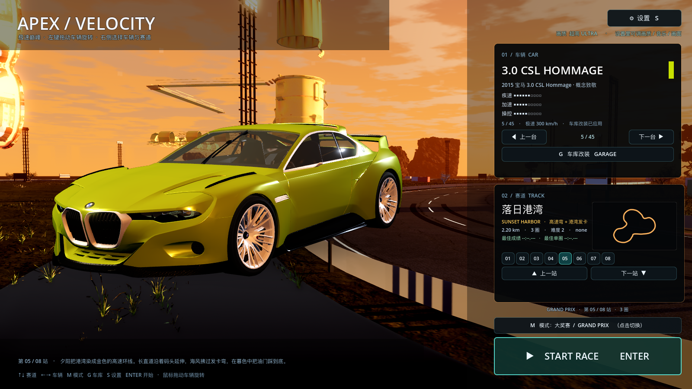

# 33 · 每张地图专属背景（key art）+ 菜单重构

> 2026-11-04 · 用户：给不同地图做专门的背景，换图换背景，车放在背景前；
> 主菜单重点是车，直接放真实赛道会显得不对劲。

---

## 一、为什么不再直接用真实赛道当菜单背景

真实赛道直接当背景的问题：

- 相机只要稍微不对，构图就怪（切弯、护栏、建筑穿帮）；
- 每条赛道都要实时建整个世界，菜单加载慢、GPU 开销大；
- 车和赛道透视/光影不匹配，看着像"车被贴上去"。

所以改成 **每张地图一张专门烘焙的 key art 背景** + **独立 3D 展车舞台**。

## 二、每图专属背景（8 张）

用引擎把每条赛道**曲率最大的弯**渲染成 1600×900 的 key art：

```
assets/backdrops/
  coast.png  city.png  alpine.png  canyon.png
  harbor.png skyline.png glacier.png magma.png
```

- 相机放在弯道外侧、略高，能看到弯道延伸和该图的特点（海岸/城市/雪山/峡谷…）；
- 隐藏车、AI、HUD，纯场景截图，作为菜单背景；
- 换赛道时只换背景图，菜单不再重建整个赛道世界 → 打开菜单快很多。



## 三、车是主角：透明 3D 展车层

- 用 `SubViewport`（透明背景、4×MSAA）单独渲染 3D 展车；
- 叠在背景图上，车约占画面 **60% 宽度**，前 3/4 视角；
- 车底加径向软阴影（贴图），不让车"飘"在背景上；
- 暖主光 + 主题色补光 + 冷轮廓光，车漆 clearcoat 高光明显；
- 左键拖动依然可以旋转车看各个角度。

## 四、右侧浮动卡片

- 右侧选车/选赛道/开始按钮改为**半透明浮层**（72% 不透明度），能透出背景；
- 小地图放大到 196×112；
- 车卡、赛道卡、模式、START 都在右列，不挡车。

## 五、验证与性能

```
[VERIFY] PASS
```
高画质 **47.8 fps**（菜单背景是静态图，比之前实时建赛道更省）。

## 六、说明

- 背景是静态 key art：换赛道时背景立即切换，车保持 3D 可拖动；
- 如果想让背景带轻微视差，可以再加鼠标跟随的缓慢平移（下一步可选）。
