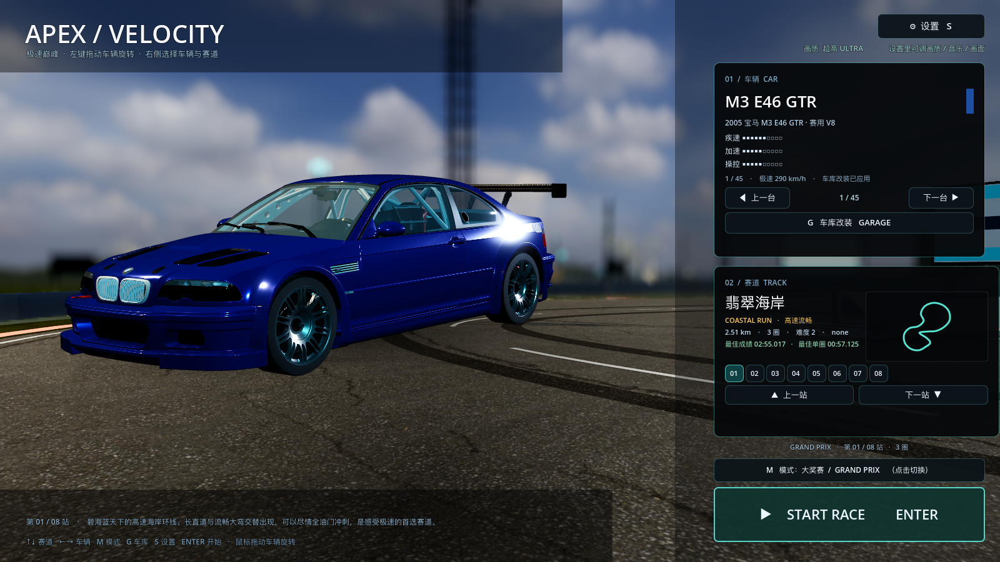

# 34 · 菜单构图重做：车放左下、背景为车让位

> 2026-11-04 · 用户：比例很奇怪；要用生图模型生成每个地图的界面，或者从赛道里挑一个
> 合适的位置，让车能放在左边、突出车。

---

## 一、没有生图模型时的做法：用引擎"摆拍"出 key art

这个环境里没有可用的文生图模型，所以采用用户给的第二个方案：
**从赛道里挑位置 + 专门为"车在左边"构图的引擎渲染**。好处是背景与游戏美术完全一致。

重烘 8 张背景时改了构图：

- 机位放到**进弯前的路面上、贴近地面（1.45m）**，不是弯外高处；
- 前景左下是大片**沥青路面**，弯道和景色落在画面中/右侧；
- 加 **景深（DOF）**：远处赛道和景色轻微虚化，给前面的 3D 车让出视觉焦点；
- 隐藏车/AI/HUD，纯场景输出 1600×900。

这样车放在左下角时，地面透视、光线方向和背景是接得上的，不会像贴图。

## 二、车层比例与融合

- 车缩小到约**画面 48% 宽度**（原来 60%+，显得比例怪）；
- 机位降低到 1.15m，与背景的低机位一致，前 3/4 视角；
- 车底加两层融合：
  1. 3D 软阴影（径向阴影贴图）；
  2. 背景上的径向压暗层（TextureRect，中心偏左下），让车与沥青过渡自然；
- 背景整体压暗 16%，车漆 clearcoat 高光更突出；
- 右侧浮层卡片从 x≈1140 开始，不压车。

## 三、效果



- 背景：海岸公路、贴近地面的视角、远景轻微虚化；
- 车：蓝色 M3 在左下、占画面约一半宽，轮胎落在沥青上；
- 右侧：半透明浮层卡片，可以透出背景。

## 四、验证与性能

```
[VERIFY] PASS
```
高画质 **47.8 fps**。

## 五、下一步

- 如果某张地图的取景还是不好，告诉我**站名**，我单独换那个弯/机位重烘；
- 如果你能提供文生图模型/API，我也可以按每个赛道的主题直接生成 key art 图替换。
