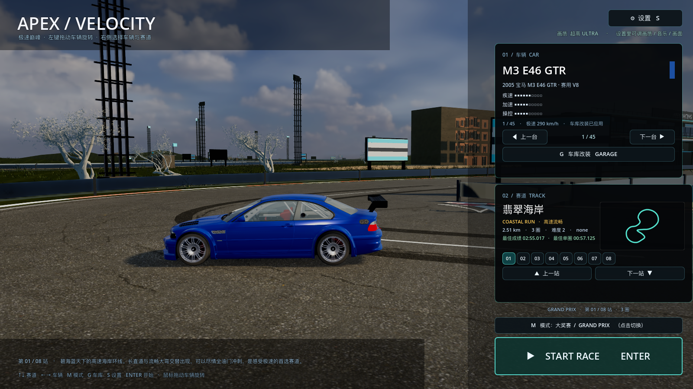
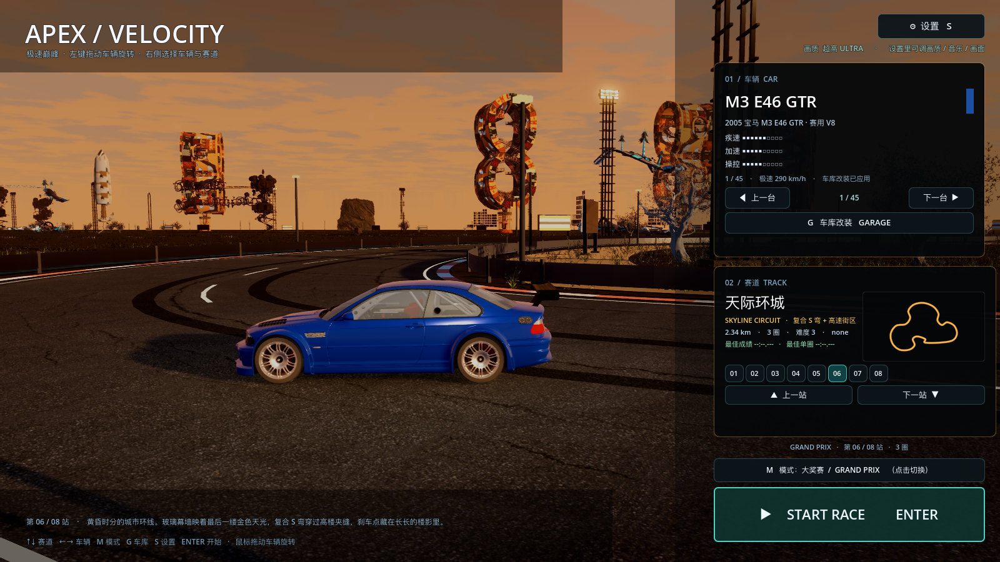

# 35 · 菜单参考旧网页版：车真实停在赛道特色点

> 2026-11-04 · 用户：车不用这么突出，参考旧网页版每个场景车放在哪。

---

## 一、参考旧网页版的做法

旧版 three.js 的 `buildShowroom()` 是这么做的：

```js
let view = MENU_VIEWS[track.id] || DEFAULT_VIEW;
let dist = track.length * view.frac;          // 每条赛道一个特定位置
let frame = track.frameAt(dist);
let pos = frame.pos + frame.side * view.lat;  // 车停在赛道旁
stage.position.set(pos...); stage.rotation.y = heading + view.yaw;
```

- 车是**赛道场景里的一个元素**，不是单独的展台；
- 每条赛道有自己的 `frac/lat/yaw`（停哪、偏多少、车头角度）；
- 镜头也有每站参数：`side / back / height / fov / ahead / look`；
- UI 浮层在右侧，车通过 `camera.setViewOffset` 推到画面左边。

## 二、Godot 版照这个思路重做

- 主菜单恢复**真实 3D 赛道场景**（TrackBuilder + SceneryKit + VenueKit）；
- 每条赛道自动找**曲率最大的弯**（最有代表性的位置），车停在**弯前一点的赛道上**，
  车身斜 0.42rad，展示前 3/4 角度；
- 镜头：弯道外侧、低机位（2.05m），车放画面左侧，视线中心往右偏 7m 给右侧卡片让位；
- 车宽只占画面约 **22%**，不再放大，也不贴图；
- 左键拖动仍可旋转车身看角度；
- 右侧选车/选赛道/开始仍是半透明浮层。

| 翡翠海岸 | 天际环城 |
| --- | --- |
|  |  |

## 三、验证与性能

```
[VERIFY] PASS
```
高画质 **47.8 fps**。

## 四、说明

- 菜单现在每站背景都是该赛道真实场景，车停在特色弯道处，构图接近旧网页版；
- 背景 key art（之前烘焙的 8 张）暂存 `assets/backdrops/` 不参与菜单渲染，
  以后如果要"海报化"菜单可以直接切换；
- 如果哪一站的停车点/机位不好看，告诉我站名，我把该站的 frac/lat/camera 参数单独调。
