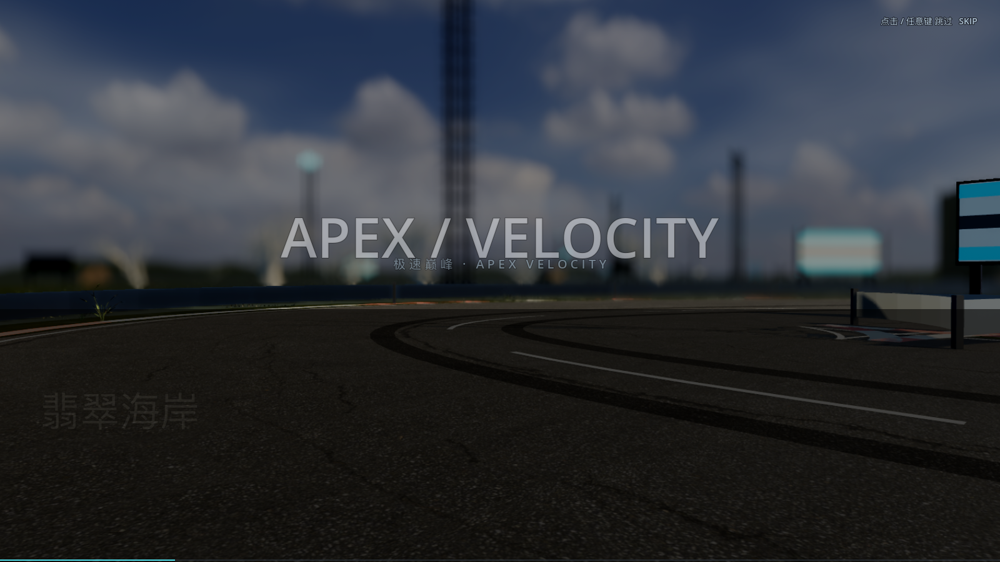
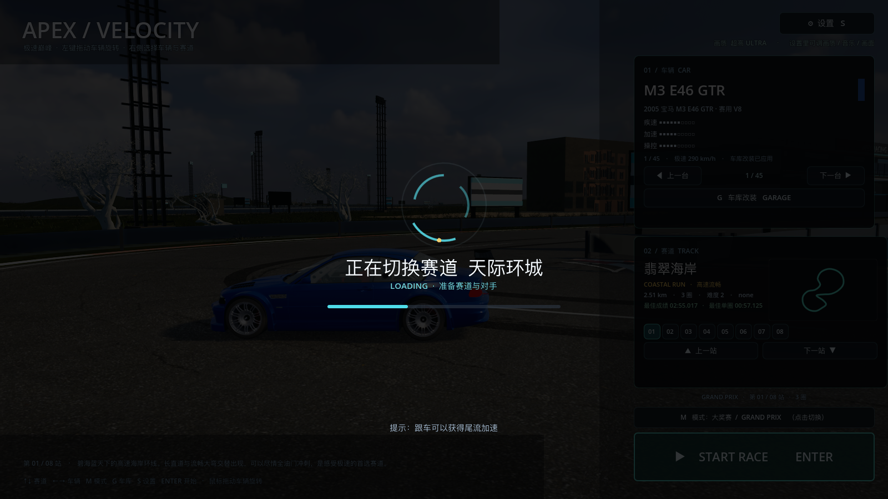

# 36 · 启动宣传片 + 加载动画 + 暂停菜单

> 2026-11-04 · 用户：参考网页版做转场动画；进游戏先放宣传片、可单击跳过，不点就播完进菜单；
> 切地图的加载等待也要做成动画；UI 参考网页版，缺的功能补上。

---

## 一、启动宣传片（可跳过，约 9 秒）

旧网页版启动时播放 boot 视频（`#boot-video`，10 秒，可跳）。这里没有视频解码器/ffmpeg，
改成**程序化蒙太奇**，效果等价：

- 标题动画：`APEX / VELOCITY` 缩放入场 + 副标题；
- 7 段场景快切（各赛道 key art 图，1.0s/段，推镜 + 闪白切镜 + 中英文地点字幕）；
- 最后一镜展示赛车，收在标题 + "点击/任意键进入"；
- **单击 / 任意键立即跳过**（`BootScreen._input`），不点则播完自动进主菜单；
- 整体约 9 秒，底部有进度条。



## 二、加载动画（换图/开赛时）

以前切赛道、开赛是同步建世界，画面会白屏卡住。现在包了一层 `LoadingScreen`：

- 旋转弧线 spinner + 进度条 + 赛道名 + 轮播小提示；
- 半透明暗底，覆盖在菜单/场景上，**阻断点击**避免误触；
- 显示 2 帧后再建世界，建完淡出，换图/开赛不再是"干等"。



## 三、转场与 UI 动画

- 主菜单进入时：车辆卡/赛道卡从右侧滑入 + 淡入；
- 启动片 → 菜单、菜单 → 比赛、换图 → 重建都有淡入淡出；
- 暂停菜单：遮罩 + 面板淡入。

## 四、补上缺失功能：暂停菜单

旧网页版有暂停（`btn-pause`），Godot 版之前没有。现在比赛中按 **Esc** 打开：

- 继续比赛（Esc）
- 重新开始（保留当前赛道/车辆）
- 设置（打开画质面板）
- 返回主菜单（M）

暂停时 `get_tree().paused = true`，暂停面板 `PROCESS_MODE_ALWAYS` 正常操作。

## 五、验证与性能

```
[VERIFY] PASS
```
高画质 **47.8 fps**。

## 六、下一步（参考网页版还缺的）

- 车库抽屉式换车（旧版 car drawer）、赛道大图选择层（track layer）
- 音量/电台面板、设置持久化细节
- 结算页的完整奖励/分段/记录列表（旧版 results 更详细）
