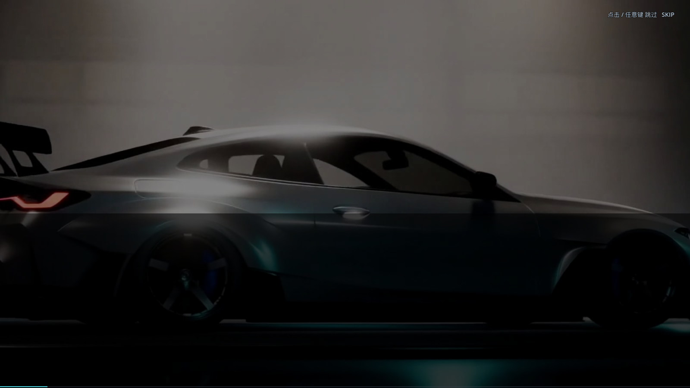
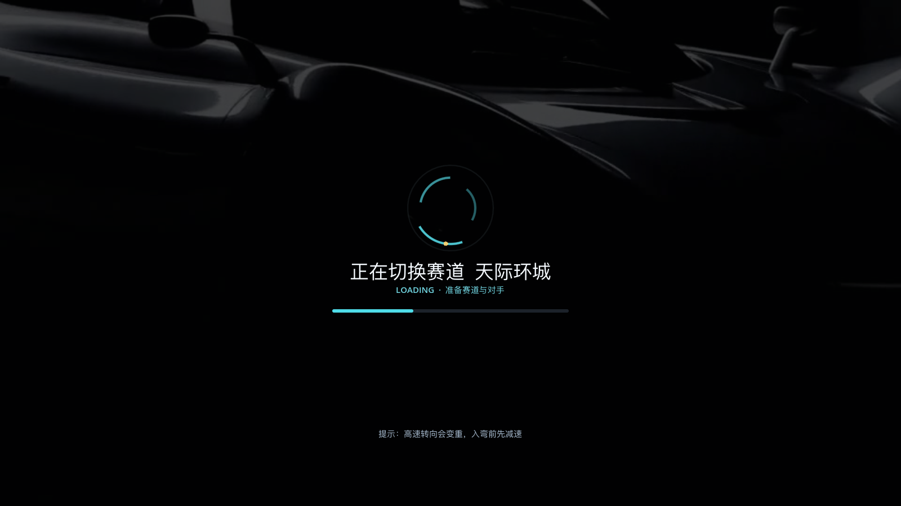

# 37 · 真实宣传片接入：启动 CG + 加载影片

> 2026-11-04 · 用户：素材总文件夹里有网页版用的视频，去找来用。
>
> 现状注记（2026-11-08）：加载页后来改为菜单场景预烘焙（见 38 篇），未再被引用的
> `assets/video/loading_film.ogv` 已在项目清理中移除；启动 CG 现用 `launch.ogv`，
> `intro.ogv` 仅作缺失回退。本文保留当时的实现记录。

---

## 一、找到的素材（`/Users/tong/Desktop/Ai/赛车游戏/`）

| 文件 | 规格 | 用途 |
| --- | --- | --- |
| `APEX_VELOCITY_opening_CG_24s.mp4` | 2560×1440 · 24s · 有音轨 | 启动宣传片 |
| `赛车游戏/video/loading-film.mp4` | 2560×1440 · 30.5s · 有音轨 | 加载过场影片 |
| `赛车游戏/video/film-title-main.png` | 标题图 | 启动片备用海报 |
| `赛车游戏/video/loading-film.jpg` | 加载片海报 | 加载页备用图 |

## 二、转码：MP4 → Godot 可播的 Ogg Theora

Godot 4 的 `VideoStreamPlayer` 只支持 **Ogg Theora (.ogv)**，机器上又没有 ffmpeg
（素材里只有 Windows 版 `ffmpeg.exe`）。用已安装的 **Blender 5.2 的视频序列编辑器**
自带 FFmpeg 输出转码：

```python
# tools/blender/convert_video.py
scene.render.image_settings.media_type = 'VIDEO'
scene.render.image_settings.file_format = 'FFMPEG'
scene.render.ffmpeg.format = 'OGG'
scene.render.ffmpeg.codec = 'THEORA'
scene.render.ffmpeg.audio_codec = 'VORBIS'
```

产出：

- `assets/video/intro.ogv` — 24s / 1280×720 / 带原音轨 / 约 17.8MB
- `assets/video/loading_film.ogv` — 前 12s / 960×540 / 静音循环 / 约 4.8MB
- 海报：`assets/video/intro_poster.png`、`loading_poster.jpg`

## 三、启动宣传片（真视频，可跳过）

- `BootScreen` 检测到 `res://assets/video/intro.ogv` 就直接用 `VideoStreamPlayer` 播放原始开场 CG；
- 右上角"点击/任意键跳过 SKIP"；单击/任意键立刻跳过，不点则播完自动进主菜单；
- 底部进度条跟随视频播放位置；
- 没有视频时自动回退到之前的程序化蒙太奇（离线/缺资源也能跑）。



## 四、加载动画（真影片 + UI 动画）

- `LoadingScreen` 背景播放 `loading_film.ogv`（静音循环、压暗）：
  换图/开赛时不再是纯色干等，而是在看旧版加载影片；
- 上面叠：旋转弧线 + 进度条 + 赛道名 + 轮播提示；
- 加载完成淡出。



## 五、验证与性能

```
[VERIFY] PASS
```
高画质 **47.9 fps**（视频只在启动/加载时播，不影响比赛帧率）。

## 六、说明

- 转码脚本保留在 `tools/blender/convert_video.py`，以后换素材直接跑；
- 想换更短的启动片（比如 10s 版）告诉我，我改 `seconds` 参数重转；
- 启动 CG 原音轨保留，音量 -3dB；加载影片静音处理（避免和 BGM 打架）。
