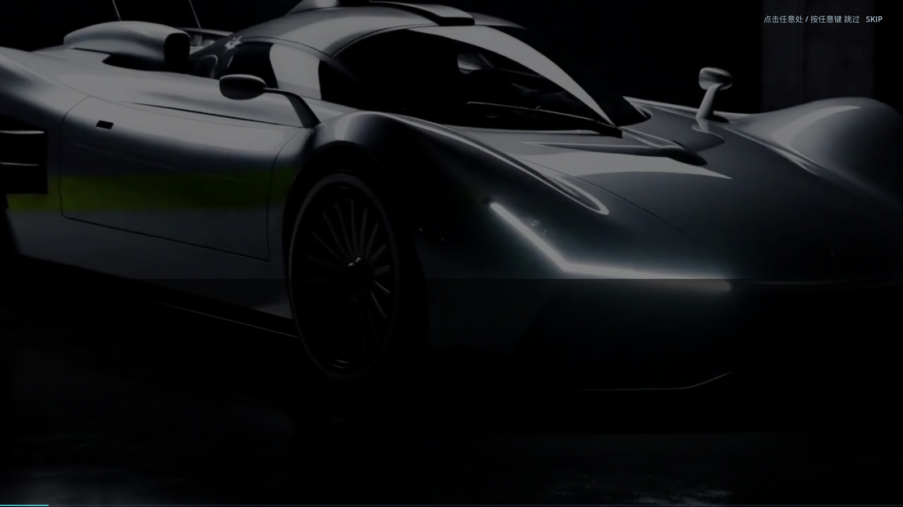
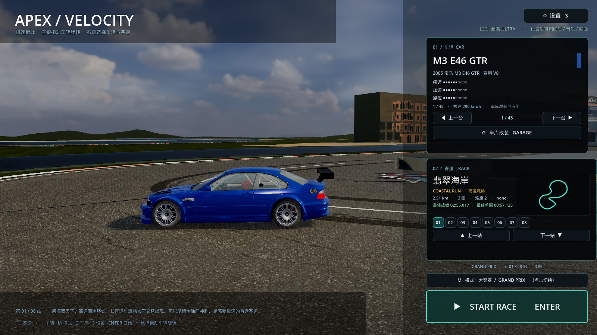

# 38 · 启动片换成 loading-film + 菜单场景预烘焙 + 彩色加载转场

> 2026-11-04 · 用户：刚进游戏用 loading-film，只放一遍，播完/点击立刻进游戏；
> 换赛道时视频卡半截不行，改用颜色风格或真实场景的转场，前提是播放流畅。

---

## 一、启动片：换成 loading-film，播完/点击立刻进菜单

- 用素材总目录 `赛车游戏/video/loading-film.mp4` 转成 `assets/video/launch.ogv`
  （30.5 秒 / 1280×720 / 保留原音轨）；
- 启动即播，只播一遍；
- **播放完 → 直接进主菜单**（不再额外等待）：菜单场景在视频播放期间已经
  **后台线程预加载**好，视频一结束只做一次实例化（毫秒级）；
- **点击/任意键立即跳过**，同样直接进菜单；如果跳过太早预加载还没完成，
  用新的彩色加载转场等它读完（动画流畅，不会卡半截）。



## 二、菜单场景预烘焙：换赛道不再现场建 5 秒世界

之前每次换赛道要现场重建：**景物 3.7s + 场馆 1.3s**，必然卡住。

现在启动时用 `--bake-menu` 离线把 8 条赛道的菜单场景烘焙成 `.scn`：

```
assets/menu_scenes/
  coast.scn city.scn alpine.scn canyon.scn
  harbor.scn skyline.scn glacier.scn magma.scn
```

运行时：

- 首次从磁盘**后台线程**加载（约 1.5s，主线程不卡，转场动画正常播放）；
- 加载完成后 **实例化只要 2–13ms**；
- 切到相邻赛道时通常已经**预加载好**（进菜单后自动预加载前后各 2 站）→ 秒切；
- 载入的菜单场景完全一致（真实 3D 赛道 + 车停在特色弯）。



### 预烘焙命令

```
Godot --headless --path . -- --bake-menu
```

场景烘焙脚本在 `main.gd` 的 `_bake_menu_scenes()`。

## 三、换赛道加载转场：程序化彩色动画（不是视频）

按你说的"用不同颜色风格"做，彻底避免视频播一半被主线程卡住：

- 全屏 CanvasItem shader：流动的斜向色带 + 光扫 + 暗角，青色主题；
- 叠加旋转弧线 + 进度条 + 赛道名 + 轮播提示；
- 菜单场景 **在线程里加载**，所以这个动画全程流畅，不会冻结；
- 加载完成后淡出，不会出现"视频放出一点点就卡"。


## 四、实测流程

```
[BOOT] finished -> menu
[MENU] scene ready: coast
[SWITCH-TEST] switching to next track
[MENU] scene ready: city
```

- 启动片播放结束 → 菜单立即就绪（coast 场景已在视频期间预加载）；
- 换到 city：后台加载 → 就绪，无脚本错误。

## 五、验证与性能

```
[VERIFY] PASS
```
高画质 **47.9 fps**。

## 六、说明 / 下一步

- 比赛开赛（点 START RACE）目前还是现场建赛道世界（景物/场馆同步构建），
  加载层是彩色转场但会有一次较长停顿；下一步可以把这套预烘焙复用到比赛场景，
  让开赛也变成"秒进"；
- 菜单场景 `.scn` 合计约 120MB（磁盘），运行时按需线程加载、缓存 4 个左右。
