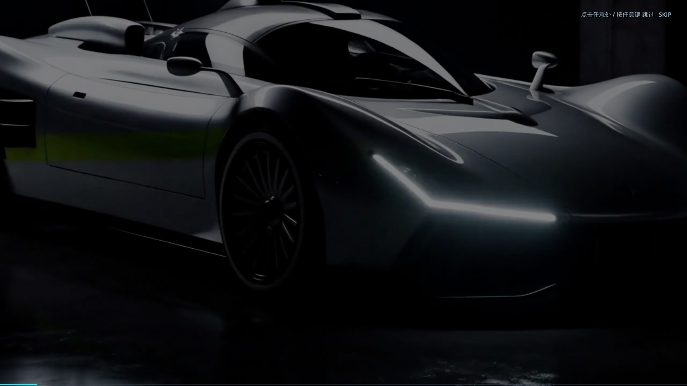

# 39 · 启动视频底部灰色阴影修复

> 2026-11-04 · 用户：刚进游戏那个视频，下面有一块灰色阴影。

---

## 问题原因

`BootScreen` 里为了让标题/字幕可读，加过一个**从画面 55% 到底部的纯黑渐变遮罩**
（`grad` ColorRect，黑色 55% 透明度）。启动视频换成 loading-film 后，这段固定的
矩形压暗就变成了一条"硬边灰色阴影"盖在视频下方——不是视频本身的问题
（已检查 loading-film 原片底部像素，是正常画面）。

## 修复

- 删除底部整块矩形渐变遮罩，视频完整显示，不再有灰色块；
- 保留全屏一层很淡的均匀压暗（只影响整体亮度，不会出现边缘）；
- 跳过提示改成描边文字，不依赖遮挡条；
- 进度条仍是底部 2px 细条。

## 验证

- 1600×900（16:9）和 1440×810 分辨率都检查过，底部无灰边；
- `[VERIFY] PASS`；
- 高画质 **47.9 fps**。
