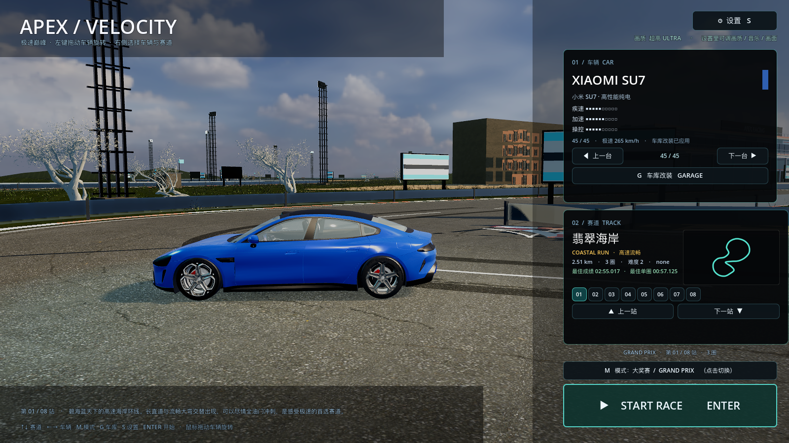
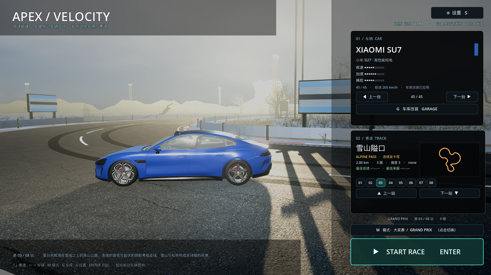
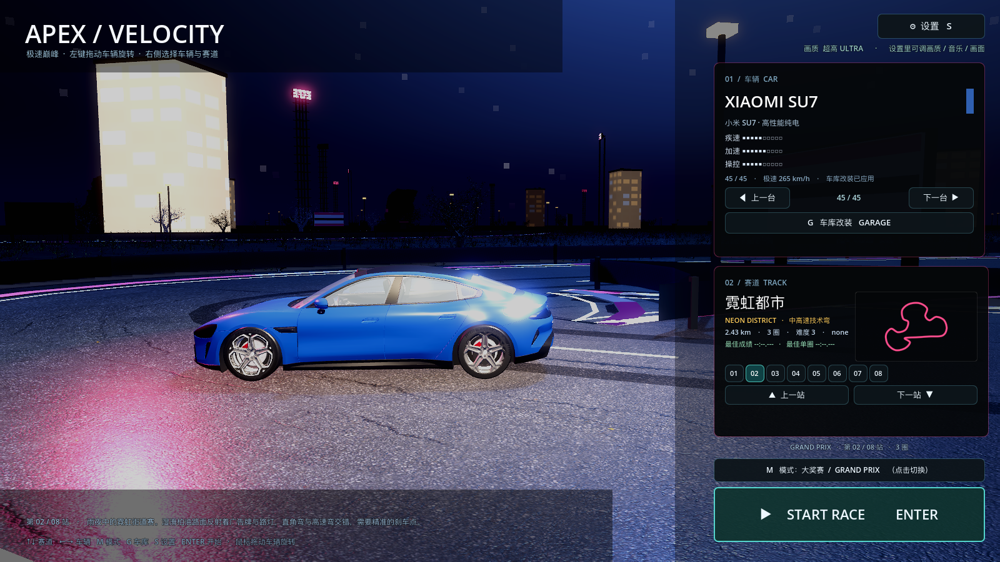
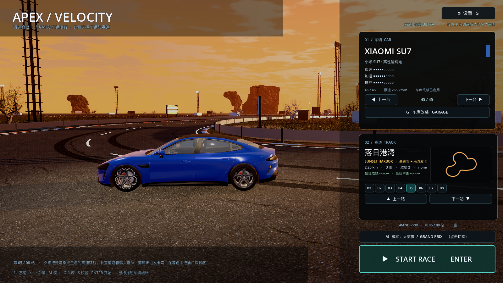
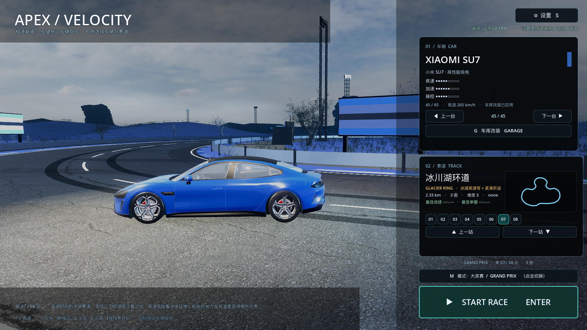
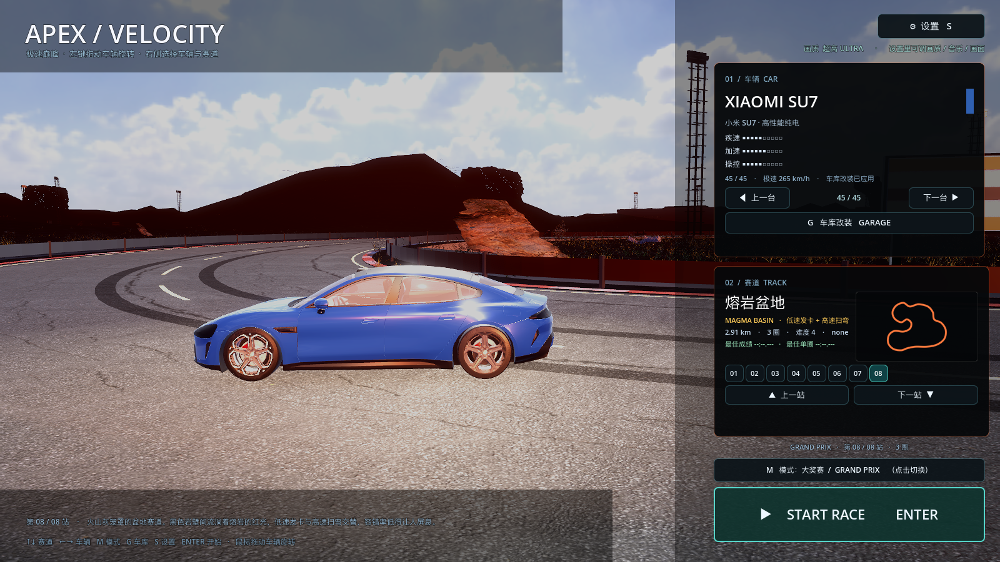

# 40 · 菜单背景清理：删杂乱建筑、提亮暗场景、去掉地面闪动、修车被挡

> 2026-11-04 · 用户逐张截图反馈：地面闪、城市/冰川/熔岩太黑、雪山像戈壁、
> 峡谷看不到车、港湾/天际有乱七八糟的漂浮建筑。

---

## 一、删掉"乱七八糟"的漂浮建筑

之前海岸/港湾/天际用的是 ToxSam 的元宇宙风塔楼（Blockchain / MemeFactory 等），
模型原点/缩放有问题，摆出来像漂浮的怪结构。**全部删除**：

- 不再加载任何 ToxSam 塔楼；
- 城市/天际改为规整的**程序窗户贴图楼体**（8×16 窗格，夜里随机亮灯 + 自发光）；
- 港湾只保留集装箱/场馆/路灯，不再有塔楼；
- 屋顶空调、金属屋顶保留。

## 二、暗场景提亮

菜单场景（烘焙后）会按主题再做一次展示级调光：

- 夜间/暗色主题（city / skyline / glacier / magma / canyon）曝光 ×1.75、环境光 +0.34、
  亮度 ≥1.16，雾密度 ×0.72、雾色提亮；
- 车周围加暖主光 16 + 主题色补光 7（暗色主题），车在暗景里能看清；
- 亮色主题（coast / alpine / harbor）轻微提亮 ×1.10。

## 三、地面闪动

菜单里关掉会抖的屏幕空间效果：

- **SSR / SSIL 关闭**（反光/间接光在水面、沥青上的闪烁来源）；
- **TAA 关闭**（静态场景 + 相机完全静止，避免像素级抖动）；
- 相机去掉原来细微的上下浮动；
- 回到比赛/车库时通过 `_apply_quality()` 恢复原画质设置。

## 四、雪山不再像戈壁

- alpine 主题从"黄昏橙色"改成**冷色冬日白天**：蓝天、白雾、低饱和雪坡；
- alpine / glacier 的地面材质换成**雪地白色**（`PbrAssets.snow()`），不再用草地贴图；
- 冰川主题曝光/太阳/环境光整体提亮。

## 五、车永远完整入镜

菜单相机构图改成**自适应投影**：迭代调整视线中心，让车稳定落在画面左侧约 32% 处，
不再出现"峡谷那站车只剩一半 / 城市那站车被右卡挡住"。

## 六、顺手修掉的大坑：烘焙场景丢 MultiMesh

Godot 的 `PackedScene` **不会保存 MultiMesh 的实例变换**，之前烘焙的菜单场景里
树木/草/岩石/雪峰全部塌在原点。现在烘焙时把 mesh/material/变换数组写进
`BakedMultiMesh` 脚本的导出变量，运行时 `_ready` 重建 MultiMesh，并显式设置
`custom_aabb`（否则远离节点原点的实例会被视锥剔除）。

## 七、效果

| 海岸 | 雪山（冬日） | 城市 |
| --- | --- | --- |
|  |  |  |

| 港湾（已清干净） | 冰川（提亮） | 熔岩（提亮） |
| --- | --- | --- |
|  |  |  |

## 八、验证与性能

```
[VERIFY] PASS
```
高画质 **47.8 fps**。

## 九、说明

- 菜单场景重新烘焙过：`Godot --path . -- --bake-menu`（要窗口模式，headless 下
  MultiMesh 数据读不回来）；
- 雪峰目前用"雪地地形 + 冬日天空"表达，没有额外远景雪峰模型；如果还想要
  真正的白色山峰轮廓，下一步单独做远景山体资源。
