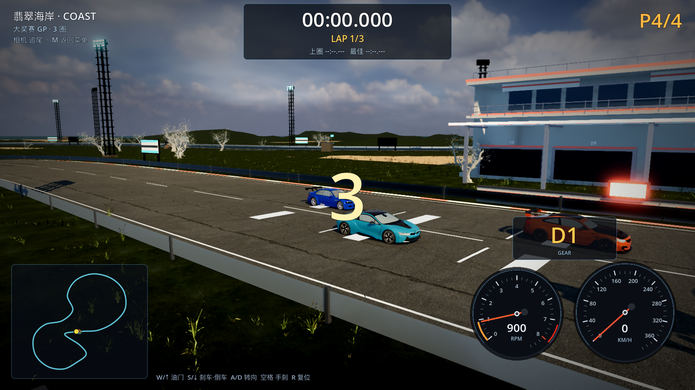

# 41 · 开赛秒进 + 电影机位 + 玩家末位发车 + 车辆碰撞重写

> 2026-11-04 · 用户：点进入游戏过场还是卡；想要一个从起点右侧慢慢推近到车的机位；
> 玩家默认最后一位发车、AI 往前放；车辆碰撞/穿模/被顶着走的问题重做逻辑。

---

## 一、开赛不再卡：直接复用菜单里的 3D 世界

以前 START RACE 会先 `_free_menu_world()`，然后现场重建整条赛道（景物 3.7s + 场馆 1.3s），
加载层必然卡住。

现在：

- 点 START RACE 时，**直接把菜单里已经显示的那套真实赛道世界搬过来当比赛世界**
  （同一条赛道、同一批景物/场馆）；
- 只需要重算一次赛道 Path + 地形高度场，**实测 311ms** 就绪；
- 不再出现"加载动画卡死"；
- 从车库/重开等没有现成世界的场景，则用缓存里的预烘焙 `.scn` 实例化
  （几毫秒）；只有在完全没有缓存时才显示彩色加载转场。

```
[RACE-TEST] race ready in 311 ms, state=0
```

## 二、开赛电影机位（3 秒，接倒计时）

- 机位从**起点线右侧高处**开始，越过前方车群看向最后一位的玩家车；
- 倒计时 3 秒内平滑推近/降低到车尾后方的追尾起跑视角；
- 倒计时结束（绿灯）自动切回正常追尾相机，直接开车走；
- 截图（机位第 1 秒）：



## 三、玩家最后一位发车

- 发车格从 2 排扩到 **4 排**（-9 / -17 / -25 / -33m）；
- **玩家在最后一排（-33m）**，3 台 AI 在 -9 / -17 / -25；
- 开局 HUD 直接显示 **P4/4**；AI 都在前面，需要自己超车。

## 四、车辆碰撞重写

之前的逻辑只是把玩家位置推开、AI 速度 ×0.985：
所以被追尾会被"顶着往前跑"，追尾别人减速也不明显，并且会穿模。

新逻辑（`_resolve_car_contacts`，每物理帧）：

1. **位置分离**：玩家与 AI 各退一半，硬性禁止穿模；
2. **相对速度冲量**（质量相同）：

```
closing = (双方速度差沿碰撞法线的分量)
impulse = closing * 0.5 * 1.08   // 只在 closing > 0.8m/s 时生效
```

- **速度差很大** → 冲量大：玩家追尾前车会明显减速，同时前车被推快；
- **速度几乎一样** → closing < 0.8，只有位置分离，**不减速**（贴着开）；
- **被追尾**：玩家得到一个向前的冲量，但后车同时损失同样的速度，
  不会出现"被 AI 顶着一直往前跑"；
- **正面相撞**：双方都按相对速度损失速度并向两侧弹开；
3. **AI 之间**：同样位置分离 + 前后速度传递，避免堆叠穿模；
4. 撞后清掉玩家反向速度，避免弹进后车模型里。

## 五、验证与性能

```
[VERIFY] PASS
```
高画质 **47.5 fps**（比赛世界复用后开赛瞬间完成）。

## 六、说明

- 碰撞参数（半径 2.1m、冲量 0.5×1.08、阈值 0.8m/s）是按"追尾/被追尾/同速"
  三种情况推的；你实测后如果觉得"减速太狠 / 弹太远"，告诉我方向，我调这三个数；
- 正常从菜单开赛已经不再显示加载动画（世界直接复用），所以不会再卡。
