# 42 · 全面美化 / 每图场景扩展 / 游戏系统优化

> 2026-11-04 · 用户：找游戏前端美化参考，把前端+游戏内 UI 全部改到商业游戏审美；
> 每张地图加树/建筑/道具并用现成开源 CC0 模型替换；优化碰撞、加速、引擎声；
> 设置拆分类（音频分轨、画质分辨率/帧率/细项全部可调）。

本轮由 Lead + 两个并行子代理完成（UI/前端、场景/CC0 素材），Lead 负责驾驶/音频/碰撞/整合与验收。

---

## 一、前端 / HUD / 设置系统重做（UI 子代理）

新增设计系统 `scripts/ui/ui_style.gd`：深色高级底、科技切角、扫描线、碳纤/网格程序化贴图、
统一 CJK 字体、按钮/Tab/滑条/开关/数值步进与 0.12~0.25s 动效。

- **主菜单**：保留"左侧真实 3D 车+赛道、右侧浮动卡"的确认布局；右侧重新设计为
  车辆卡 / 赛道卡 / 发车大按钮三块，accent 跟随赛道，数值条、角标、hover 动效。
- **比赛 HUD**：计时塔（本圈/上圈/最佳）、名次、圈数、转速表+换挡灯、巨型速度数字、
  档位、小地图、氮气条、油门/刹车条、尾流提示、最终圈、3-2-1-GO、超车提示、结算面板。
- **车库**：右侧改装卡 + 性能对比卡 + 升级卡 + 操作区，配色跟随车漆。
- **启动 / 加载 / 暂停**：CG 叠加品牌 HUD 与进度条；分段进度环加载；暂停指挥台布局。

### 设置中心（4 个 Tab）

- **画面**：画质档（低/中/高/超高）、分辨率下拉、窗口/无边框/全屏、帧率上限
  （不限/30/60/120/144）、垂直同步、渲染缩放、时间升频（自动/强制/关闭）、
  MSAA（关/2x/4x/8x）、TAA、SSR、SSAO、SSIL、体积雾、树木阴影、
  动态模糊 + 强度、锐化、远景清晰度、暗角。
- **音频**：Master / Music / Engine / Wind / SFX / UI 六条总线独立滑条，
  实时写入 AudioServer 并持久化；输出设备/总线映射/声音设计说明。
- **操作**：按键映射、转向灵敏度、相机震动开关、手柄信息。
- **游戏**：HUD 各模块开关、速度单位（km/h / mph）、圈数覆盖、存档/平台信息、恢复默认。

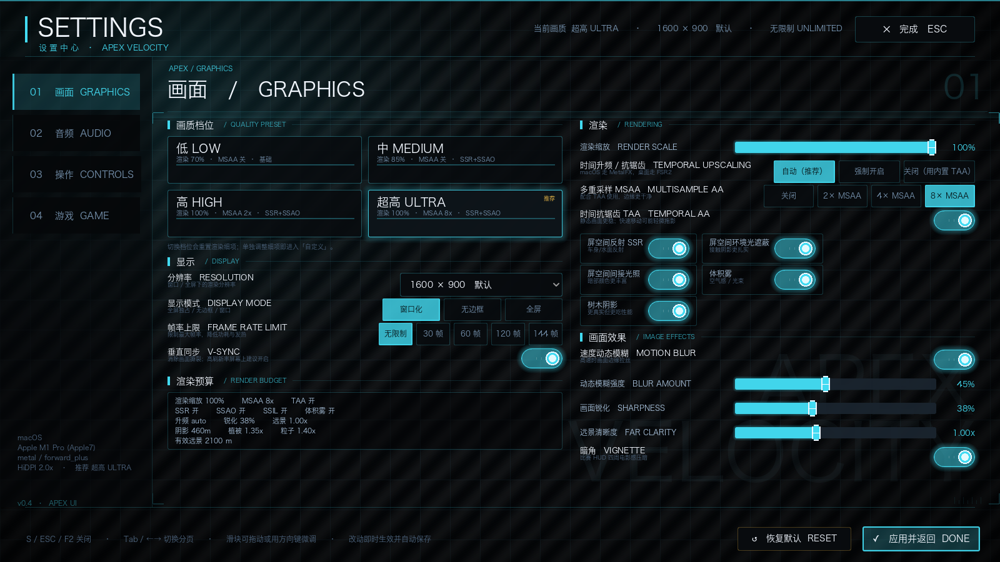

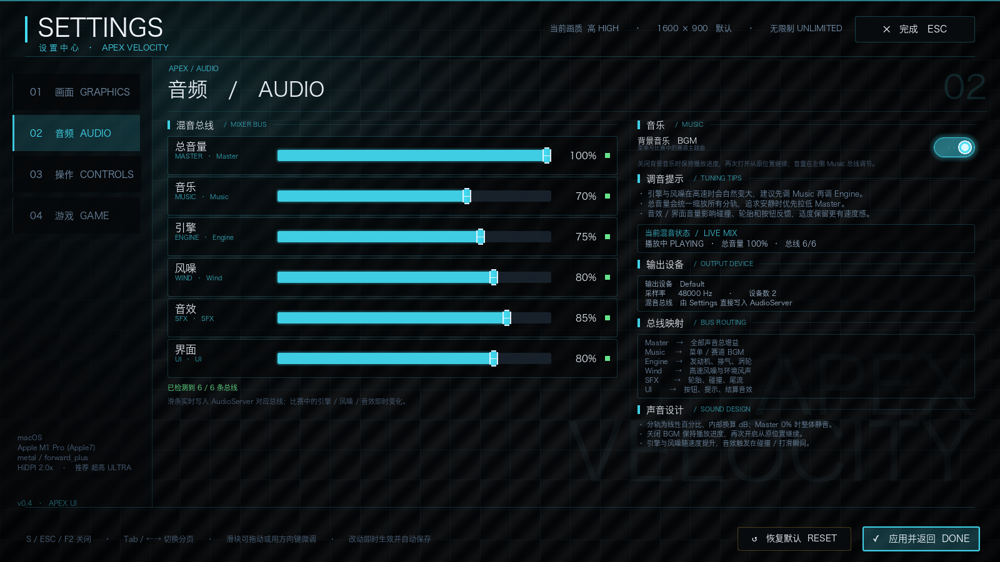

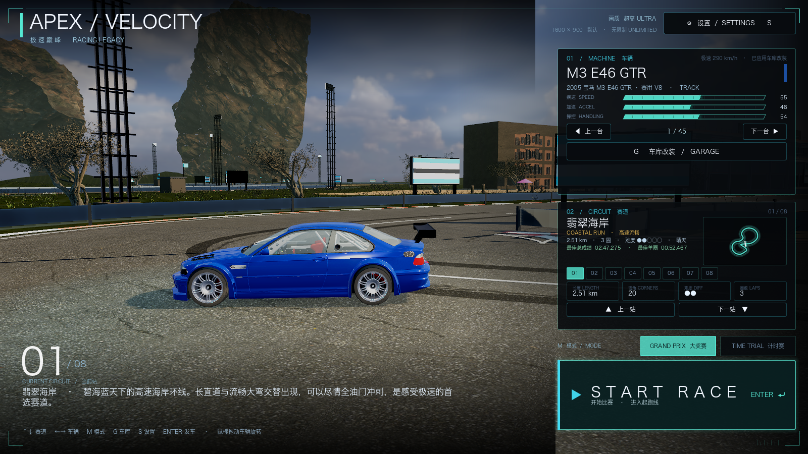

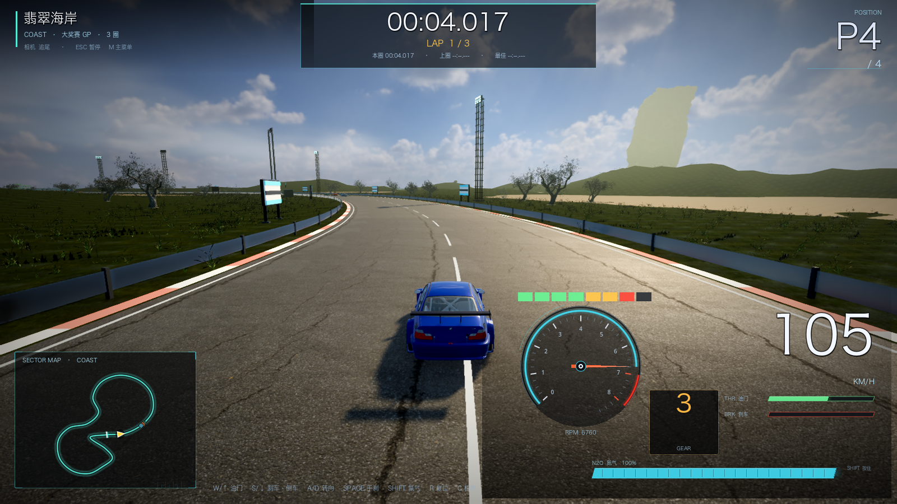

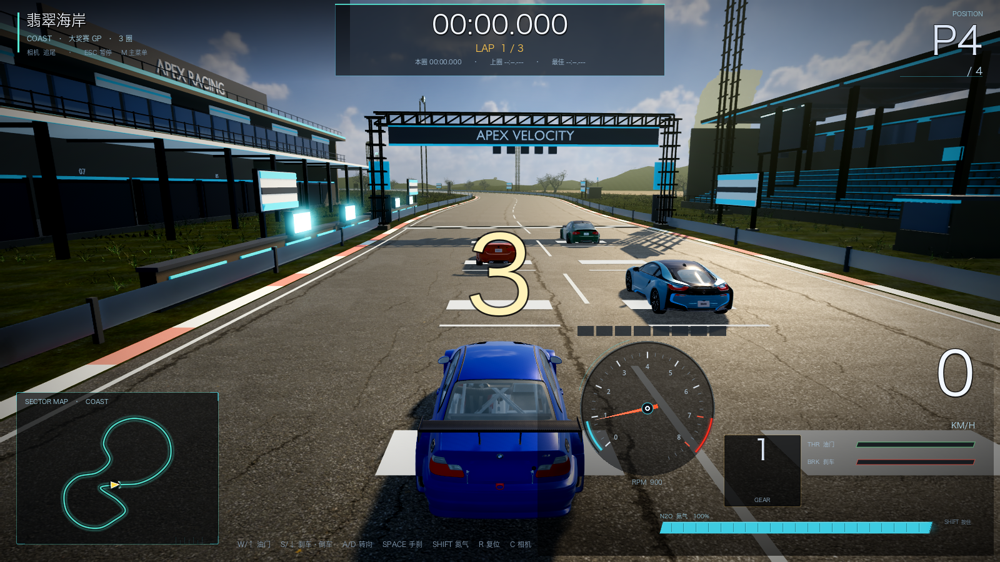 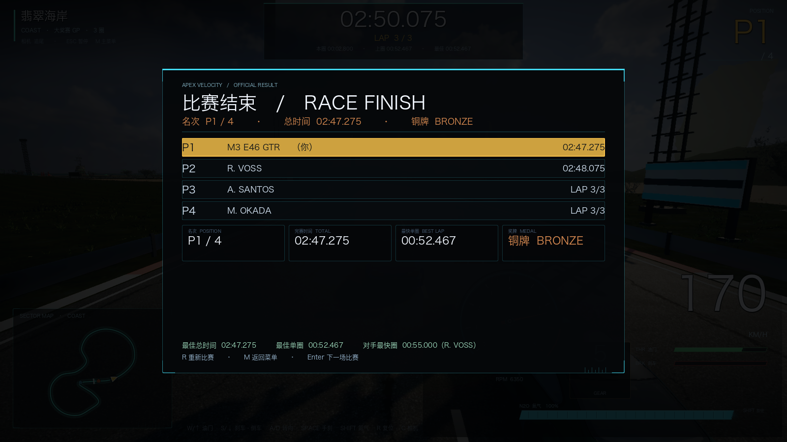

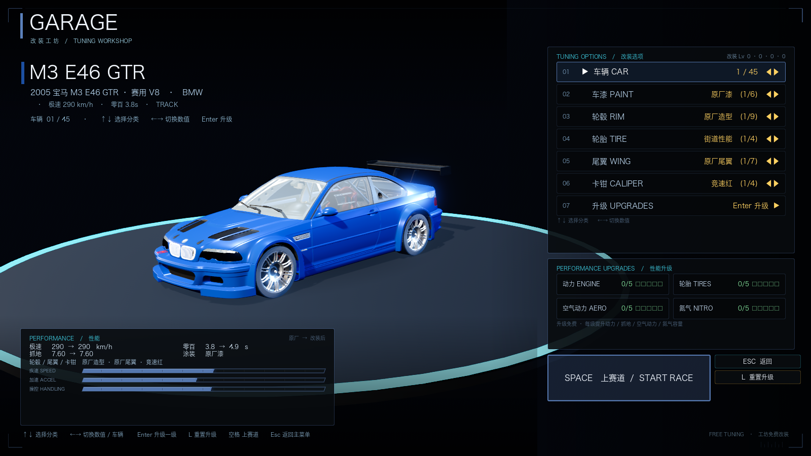 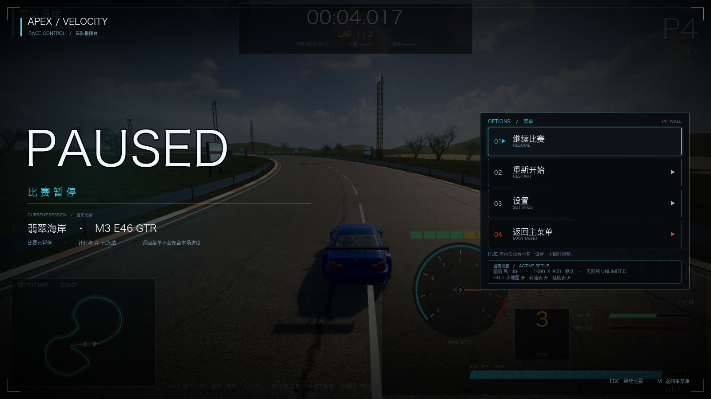

---

## 二、每张地图场景扩展 + CC0 素材替换（场景子代理）

新增 **12 个 Poly Haven CC0 模型**（下载 → Blender 减面 LOD → `assets/venues/`）：

| 资源 | 用途 | 来源 |
| --- | --- | --- |
| modular_wooden_pier | 海岸栈桥/观景台 | polyhaven.com/a/modular_wooden_pier |
| dutch_ship_large_01 | 海岸/港湾帆船地标 | .../dutch_ship_large_01 |
| fir_tree_01 | 雪山冷杉林（100k/31k LOD） | .../fir_tree_01 |
| street_lamp_01 | 城市铸铁路灯 | .../street_lamp_01 |
| fire_hydrant / utility_box_02 | 城市街道道具 | .../fire_hydrant, utility_box_02 |
| covered_car / old_tyre | 峡谷废弃车、真实轮胎墙 | .../covered_car, old_tyre |
| ocean_buoy / lateral_sea_marker | 海洋航标 | ... |
| modular_industrial_pipes_01 / barrel_03 | 工业管道、油桶 | ... |

新增 **7 套 CC0 PBR 贴图**：集装箱波纹钢、波纹铁皮、锈蚀铁皮、原木板、风化木板、黑玄武岩、雪面。
授权清单：`assets/thirdparty/polyhaven/README.md`（Poly Haven CC0 1.0）。

每张地图新增（菜单截图可见）：

- **海岸**：远景海岛群、木栈桥、帆船、防波堤礁石、航标浮标/航道标、沙滩伞/巾、棕榈、救生塔。
- **霓虹都市**：真实铸铁路灯、消防栓、配电箱、霓虹招牌/灯带、跨路霓虹门、天桥、广告牌/大屏、真实立面地标塔、窗格楼群。
- **雪山**：冷杉林（LOD）、缆车塔+缆绳、A 形木屋、雪堆、路边旗、雪山峰。
- **赤岩峡谷**：真实岩柱群、荒漠灌木、废弃车、真实轮胎墙、木棚油桶、电线杆。
- **落日港湾**：港池水面、混凝土岸壁、帆船、龙门吊、真实货柜堆场、仓库、系缆桩、浮标。
- **天际环城**：470m 高架快速路（桥面/桥墩/护栏/灯带）、广告牌/大屏、绿化带、地标塔。
- **冰川湖**：发光冰柱、远景冰墙、蓝冰面、雪堤、极地旗、雪地车残骸、冻结帆船。
- **熔岩盆地**：黑岩柱、脉动熔岩裂缝/熔岩池、废弃炼油厂（烟囱/储罐/管道/走道）、油桶。

同时修复：VenueKit 真实 CC0 材质被灰色兜底覆盖（"白树"根因）、礁石缩放成漂浮巨石、
菜单地标按真实菜单机位摆放。

 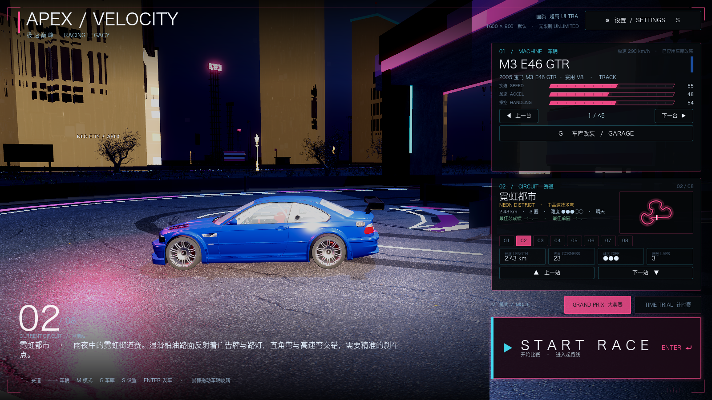

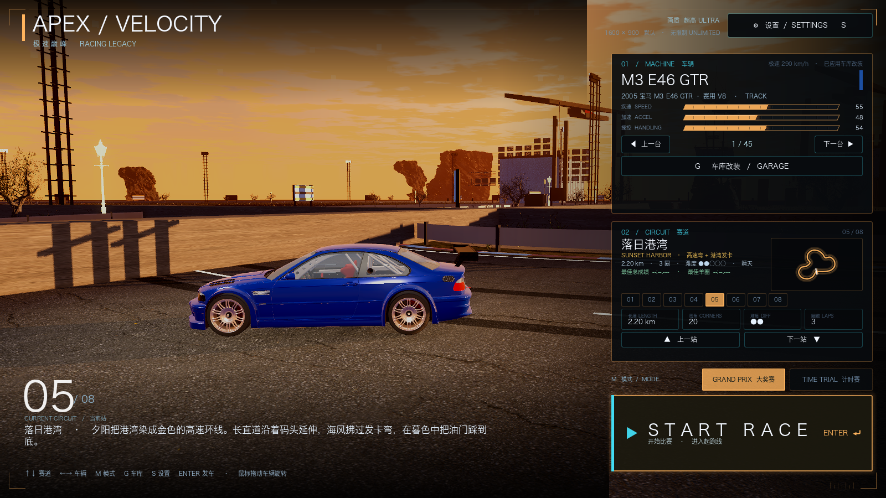 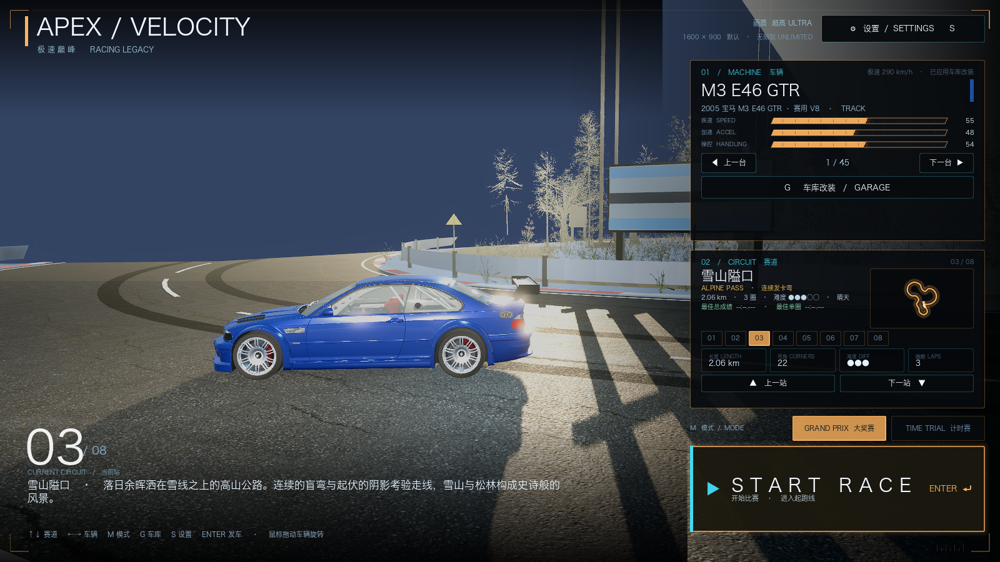

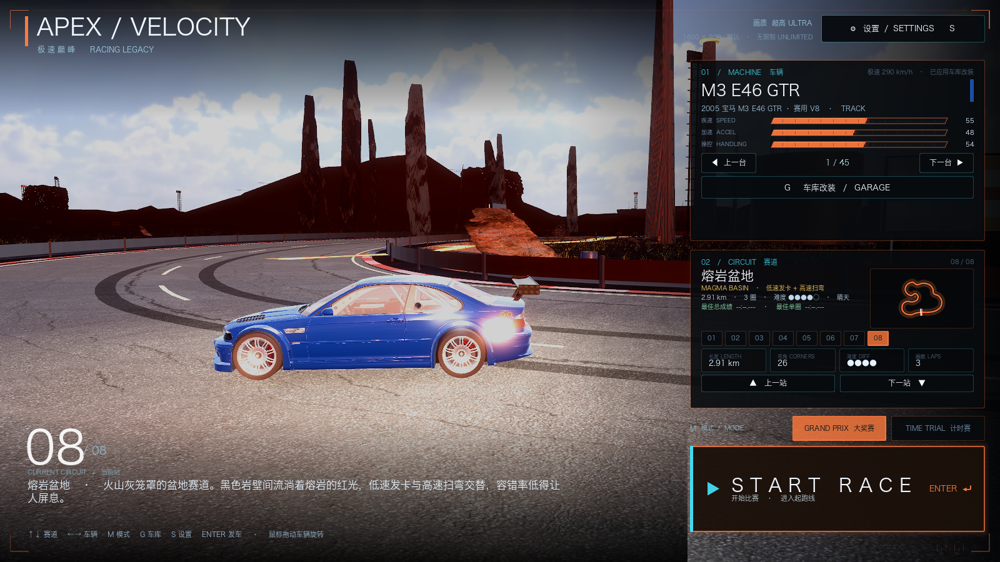

---

## 三、驾驶 / 音频 / 碰撞优化（Lead）

- **加速逻辑**：加入扭矩曲线（中段峰值、高转衰减）、换挡切断（shift cut 0.14s）、
  起步牵引力上限与轻微打滑、发动机阻力；油门响应更接近赛车。
- **引擎声**：程序化谐波叠加 + 低通排气噪声 + 涡轮啸叫 + 回火/换挡爆音；
  新增风噪（随速度）、轮胎噪声（随横向滑移）、路面/越野低频；
  全部接入 AudioServer 分轨（Engine/Wind/SFX）。
- **碰撞**：相对速度冲量（速度差大→明显减速，速度接近→不减速）、位置分离防穿模、
  被追尾不会一直被顶着走、正撞双方掉速弹开；新增碰撞火花粒子、撞击音效、
  **镜头震动**（可在设置关闭）。
- **相机**：换挡轻微震动、高速细微震动、碰撞震动，可在设置里关闭。
- **开赛流程**（延续上一轮）：START RACE 直接复用菜单 3D 世界（**301ms 就绪**），
  3 秒电影机位（起点右侧高处推近到车尾），玩家 P4 末位发车。
- **设置接入**：转向灵敏度、圈数覆盖、相机震动、分辨率/帧率/VSync/渲染缩放均由 main 实时应用。

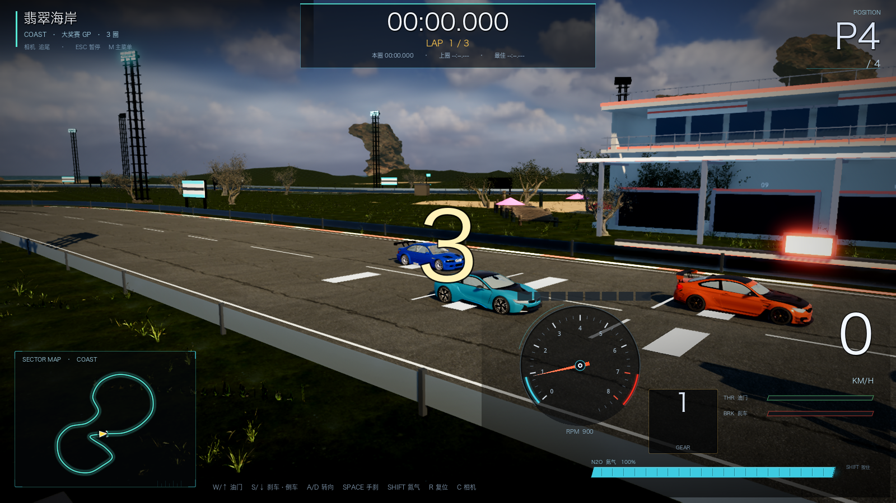

---

## 四、验证与性能

```
[VERIFY] PASS
```

| 档位 | 平均 FPS |
| --- | --- |
| 高 HIGH（推荐） | **51.2** |
| 超高 ULTRA（默认推荐，M1 Pro） | 44.5 |

- 8 张地图 scenery instances 约 20.3k~20.6k；High 档 draw calls ~1122；
- 场景与菜单场景（`.scn`）已用窗口模式重新烘焙（headless 会丢 MultiMesh 变换）。

## 五、说明 / 遗留

- HUD 氮气条当前为视觉模拟（Car 尚无氮气物理），后续接入氮气消耗/回充逻辑即可；
- Poly Haven 无 CC0 棕榈/木屋/龙门吊/高架/矿车单体：棕榈复用项目自带 Blender 资产，
  其余用 CC0 PBR 贴图做低模组合件（属基础设施/地貌，非主要建筑）；
- 预烘焙菜单场景体积变大（海岸 ~37MB），如在意启动/磁盘占用后续可做 LOD 抽稀；
- 资产库体积约 2.7GB（含 CC0 源模型/贴图），如需打包发布可另做运行时裁剪。
