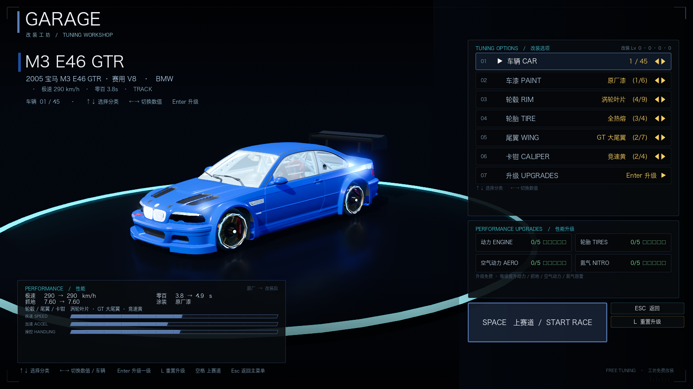
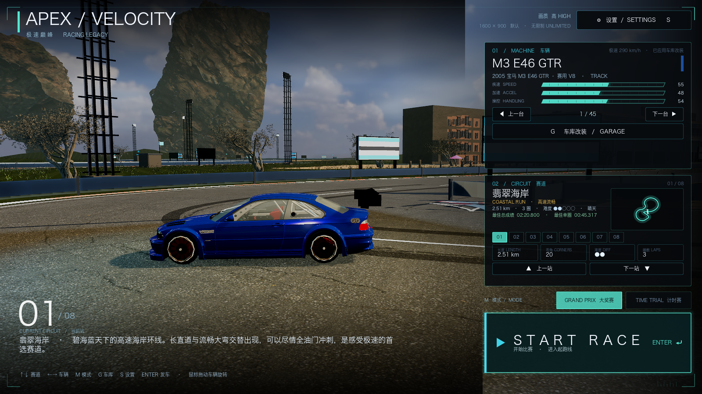
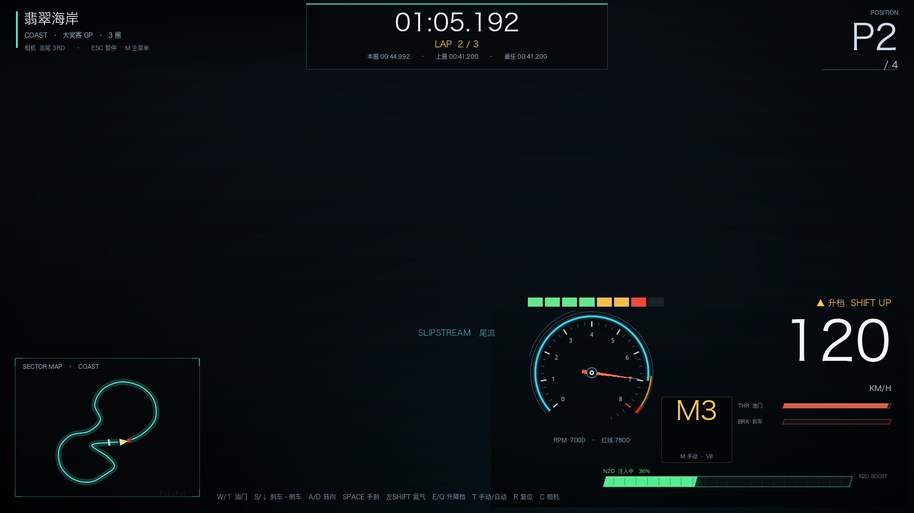

# 43 · 车辆专项：模型审计修复 / 轮毂轮胎尾翼重做 / 真车性能 / 手动挡 / 氮气 / 手柄震动

> 2026-11-05 · 用户：逐台检查车辆穿模/白膜/格式；轮胎必须绕轴心圆滚；
> 车库换件不能穿模；轮毂/轮胎/尾翼全部重新设计；按官网真车数据重定性能与引擎声；
> 加漂移充能氮气、手动挡、手柄细腻震动。

---

## 一、45 台车模型审计（工具：`tools/audit_cars.gd`）

运行：`Godot --headless --path . --script res://tools/audit_cars.gd`（约 5 秒，输出 `/tmp/car_audit_report.txt`）。

审计结果：
- **车轮层级 45 台完全一致**：`Wheel_XX > [BrakeDisc, Caliper, Spin_Wheel_XX > [Spoke, Tyre]]`，
  轮轴为 X，41 台滚转本来就是圆的；
- **纯白膜**：原始 7 台有纯白材质（bmw_i8 / bmw_m4_gt3 / hyundai_elantra / nio_es7 /
  nissan_sylphy_ev / xiaomi_su7 / zeekr_7x）；其中真正残留白膜的是 **nio_es7（中文材质名）**
  与 **zeekr_7x（拼音材质名）**；
- **轮轴偏移 >3cm 4 台**：bmw_m4_2024、bmw_m4_adro_kit、nio_es7、xiaomi_su7；
- **轮形椭圆 1 台**：bmw_m4_adro_kit（轮胎 Y/Z 被压成 0.641/0.578，轮径比数据大 14%）。

## 二、修复内容

- **材质兜底**（`car_visual.gd`）：按 935 种材质名的关键词（中/英/拼音）给 PBR 兜底：
  玻璃、镀铬、轮胎、轮毂、刹车盘、卡钳、内饰、塑料、车灯；无贴图纯白 → 中性深灰金属。
- **车漆识别**：补 `车漆` / `coloured` / `paint` 关键词 —— NIO ES7 的中文车漆材质现在能正确上色。
- **车漆更亮**：metallic 0.5 / roughness 0.20 / clearcoat 1.0 / clearcoat_roughness 0.08。
- **轮胎绕轴心**：对每个 Spin_Wheel_XX 计算子树 AABB 中心，若偏移 >2.5cm 就把 pivot 平移到
  几何中心（几何不动），滚转即为纯圆；椭圆车（m4_adro_kit）用 wrapper 单轴缩放修正成圆。
- **轮毂/轮胎/尾翼全部重做**（`scripts/cars/procedural_parts.gd`，弃用旧 GLB parts）：
  - 5 套轮毂设计：双辐刀锋 / 深盘六辐 / 涡轮叶片 / 赛道网状 / 五角宽辐，
    另外 wire/deepdish/aero 等 id 映射到相近设计；
  - 3 套轮胎：街胎（胎纹）/半热熔（少量胎块+白字）/全热熔（光头+白圈），wet 归入半热熔；
  - 3 套尾翼：GT 大尾翼 / 鸭尾 / 无；用每台车现成 `WingMount` 基座，立柱贴着基座，
    不给原厂尾翼合并进车身的车硬删网格（抬高避让）；
  - 制动盘/卡钳挂 `Wheel_` 静态节点，轮辋/轮胎挂 `Spin_`，天然满足「转向只转 Y、滚转只转 X」；
  - 轮胎外径 = wheelRadius×0.985、宽度取原厂轮胎 AABB 宽度，避免穿出轮眉；
  - 旧 `assets/cars/models/parts/*.glb` 不再被引用（文件保留不影响）。
- **展台渲染**：车库加 ReflectionProbe(UPDATE_ONCE) + SSR + 三点光 + 更亮环境；
  菜单展车加逆光/轮廓灯 + ReflectionProbe；车漆清漆反射更明显。





## 三、45 台真车性能重定（`data/cars.json`）

每台补齐：`fuelType(ice/hybrid/ev)`、`aspiration`、`powerHp`、`torqueNm`、`weightKg`、
`drivetrain(FWD/RWD/AWD)`、`engineProfile`、`redline`、`gears`、`realZeroTo100`；
`maxSpeed` 严格 = `topKph/3.6`，`accel` 按物理模型反算。

- 分布：ICE 27 / hybrid 6 / EV 12；
- 引擎 profile：i6×15、v8×12、ev×12、i3×4、i4×2（另有 v10/v12/i5/flat6/flat4/rotary 合成器可随时启用）；
- 自动挡模拟 0-100 与真车误差 **≤0.06s**，极速全部达到表值
  （M3 E46 GTR 3.80→3.85s、仰望 U9 2.40→2.40s、SU7 2.80→2.80s、轩逸 EV 11.20→11.19s）。

## 四、引擎声（11 类 profile）

`engine_audio.gd` 重写：EV 高频电机啸叫（怠速近静音）、V8 低频 rumble+4 阶+排气爆音、
V10/V12、I6/I5/I4/I3（涡轮哨+泄压阀）、flat6/flat4 水平对置不均匀脉冲、rotor 高转嗡鸣；
断油 stutter、换挡回火、混动叠发动机。`AudioManager.set_engine_profile(spec)` 已由 main 接入。

## 五、手动挡 / 氮气 / 手柄震动

**手动挡**：`T`/手柄 X 切换，`E`/RB 升档、`Q`/LB 降档；6 速手动（EV 单速）。
- 黄区（≥90% 红线）提示升档；红区不升档 → 断油 limiter（转速来回弹、动力切断）；
- 降档超转保护；手动扭矩 +12%、换挡切断 0.055s，0-100 比自动快 10.6%~14.6%。

**氮气**：漂移（横向滑移 + 手刹/大转向 + 速度）积攒，开局 30%；
按住 `Shift`/手柄 A 消耗：推力 ×1.5、极速上限 +12%，结束平滑回落；3 秒漂移约 +21%~38% 充能。
HUD 氮气条改为真实三态（注入中/漂移充能/耗尽）、档位显示 M3/D3/EV 单速、红区/黄区/断油提示。

**手柄震动**（`haptics.gd`，50Hz 下发、90ms 脉宽）：
怠速/静止 **0 震**；起步打滑轻震；换挡短促双段；高速极轻底噪；
刹车轻震；limiter 高频抖；越野连续细碎随机；碰撞按强度重震并指数衰减；氮气低频推力。
无手柄安全空操作；设置里相机震动开关不影响手柄（手柄震动独立）。



## 六、验证与性能

```
[VERIFY] PASS
```
- `[M2] look: aftermarket rims=4 tyres=4 wing=true`
- `[M2] race car: maxSpeed=90.16 (tuned 90.16) topKph=325 aftermarket_rims=4`

| 档位 | 平均 FPS |
| --- | --- |
| 高 HIGH | **51.2** |
| 超高 ULTRA（默认推荐） | 44.5 |

## 七、说明 / 遗留

- NIO ES7 / ZEEKR 7X 的「原厂漆」本来就是灰色/白色，不是白膜；可在车库换「赛道红/纳多灰」等；
- 部分 GT3 车的大尾翼合并在车身网格里，无法按节点隐藏：程序化尾翼用抬高避让，不删车身；
- 雨胎 `wet` 暂时映射到半热熔外观；旧版 parts 文件保留但不再加载；
- 当前 roster 没有转子/水平对置/12 缸实车，但引擎合成器与数据字段已支持。
