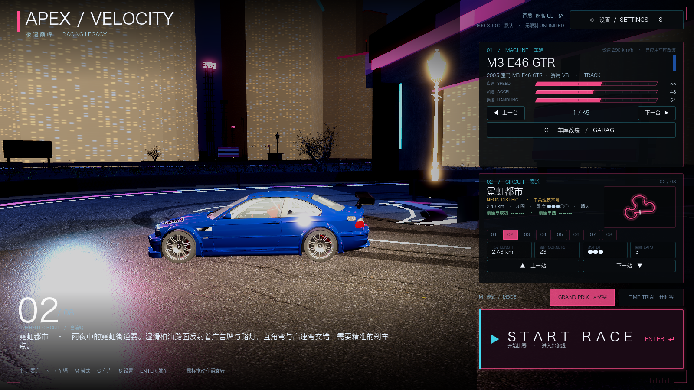
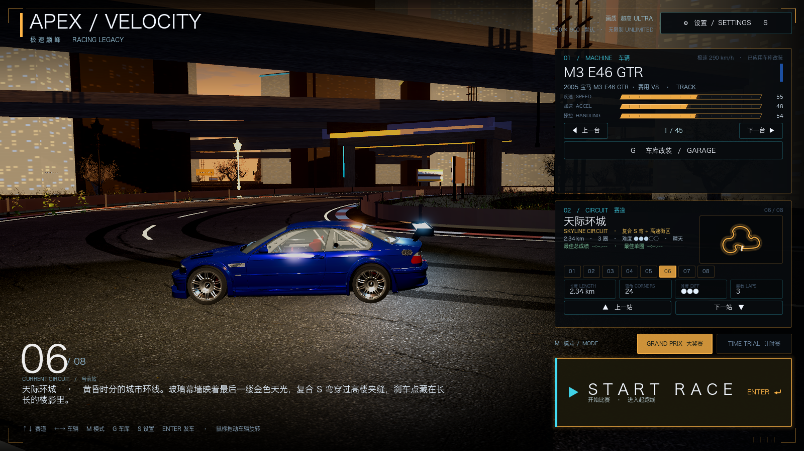
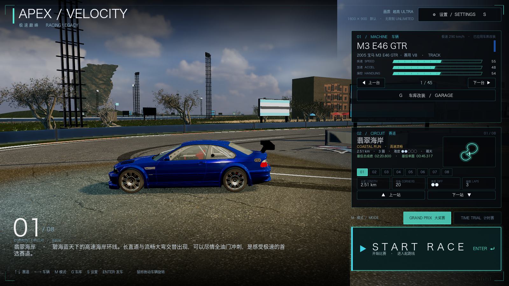
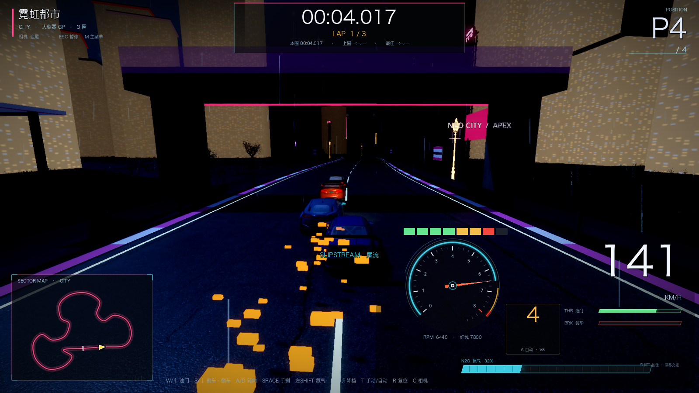
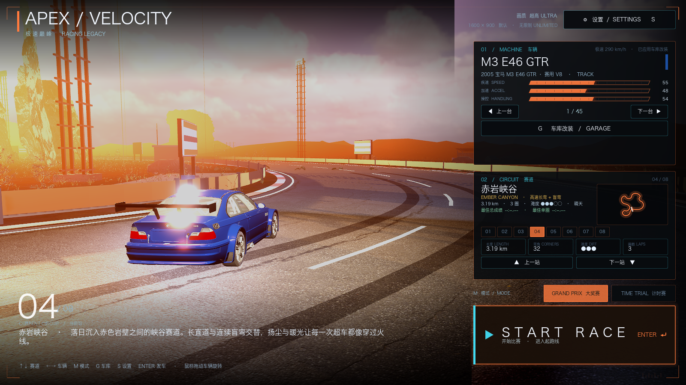
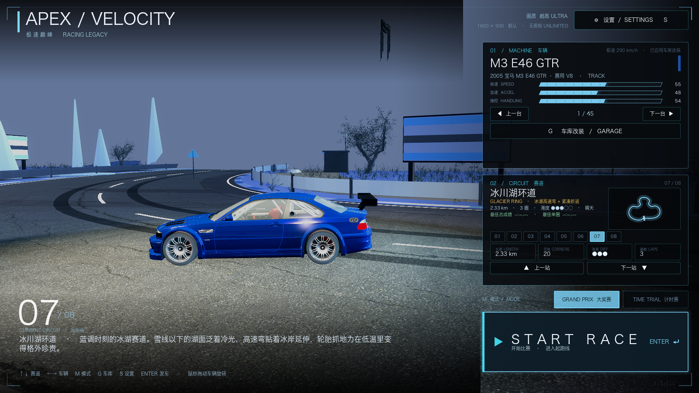

# 44 · 全屏画面缩小修复 + 地图场景二次校准（城市密度 / 海岸栈桥 / 去白楼）

> 2026-11-05 · 用户反馈：点 START RACE 后游戏只显示在左上角一小块；
> 城市/天际楼不够密、有白墙楼；海岸栈桥/码头要多；各图场景要更贴合。

## 一、左上角一小块（严重显示 bug）——已修

**根因**：`main.gd::_apply_quality()` 每次进入比赛都会读取 `Settings.window_width/height`
并强制 `DisplayServer.window_set_size(1600,900)`。如果当前是 **全屏模式**，在 macOS 上
全屏窗口被强制 set_size 会把渲染区域压到 1600×900 的左上角，其它区域全黑。

**修复**：只有 `window_mode == "windowed"` 时才允许应用窗口尺寸；全屏/无边框模式下
不再改窗口尺寸，交给 Godot 的 `canvas_items` 拉伸处理。

> 需要**完全退出游戏再重新双击启动**（不是重开比赛）才会应用修复。

## 二、地图场景二次校准

### 城市 / 天际（重点）
- 楼栋数：city 30 → **92**，skyline 34 → **112**；沿赛道两侧横向 22~64m 成排；
- 楼高：18~52m 基础，地标楼 ×1.45，38% 概率再 ×1.8~3.2（最高约 170m）；
- 立面：全部改为**窗格贴图 + 世界坐标三平面映射**，窗格大小与楼层一致；
  **删掉了会产生整面米白墙的公寓照片 overlay 和 4 座白墙地标塔**；
- 删掉城市里的荒漠巨石、减少街道树；保留霓虹招牌/天桥/高架/路灯。

### 海岸
- 栈桥 3 → **5 条**（不同长度/角度/错落排列），新增 2 艘近岸帆船；
- 保留防波堤礁石、灯塔/航标、浮标、沙滩伞、救生塔、棕榈；
- 删掉城市高楼/荒漠岩柱等不属于海岸的物件。

### 其余地图主题清理
- 峡谷：去掉松树/绿色植被，改为更多岩柱 + 枯树 + 沙漠道具；
- 冰川：去掉阔叶林，改为密集冷杉 + 冰柱/冰墙/蓝冰湖；
- 熔岩：去掉松树/绿色，改为枯树 + 黑岩 + 熔岩裂缝/工业遗构；
- 雪山：保留冷杉/木屋/缆车，去掉沙漠元素；
- 港湾：港池/岸桥/货柜/仓库主题不变，继续细化。

## 三、验证

```
[VERIFY] PASS
```

性能（窗口化 1600×900，M1 Pro）：
- coast ULTRA 38.2fps（场景更丰富，比之前略降）
- city ULTRA 58.2fps
- skyline ULTRA 约 60fps

> 注：全屏模式性能测起来会明显更低，因为实际渲染分辨率是屏幕物理分辨率（如 3456×2234），
> 不是 1600×900；想要高帧率可在设置里切到 1600×900 窗口化或降画质档。

## 四、截图








## 五、遗留

- 城市楼体目前是「窗格贴图的体块 + 真实 CC0 街具/天桥/大屏」的组合，还不是一栋栋真实高楼模型；
  如果要继续提升，可下载更多 Poly Haven/其它 CC0 建筑单体替换部分体块；
- 冰川菜单机位远处有一个悬空招牌/结构（下一步定位删除）；
- 若还有某张图/某个位置的「白楼」，请发截图，我针对那个模型换贴图。
