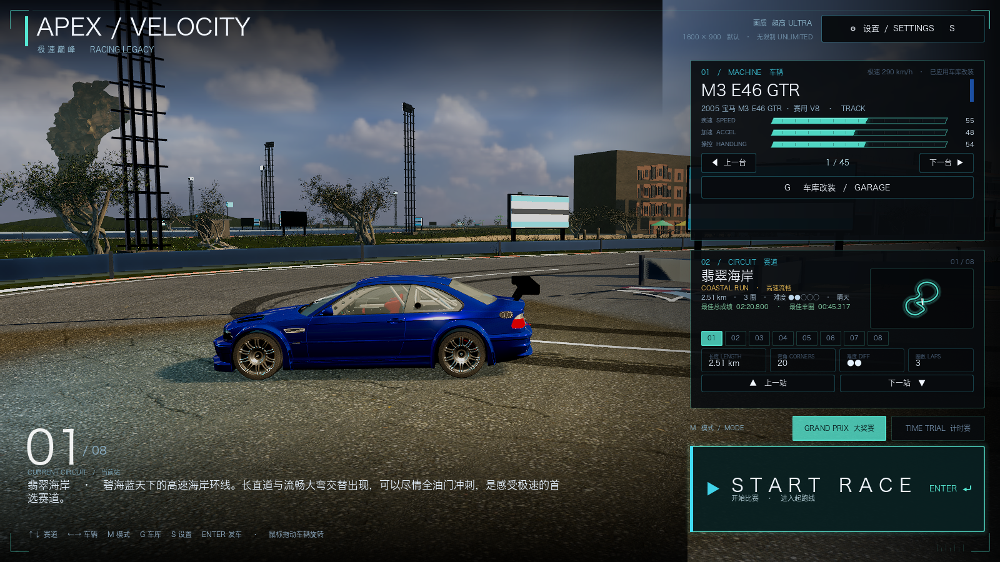
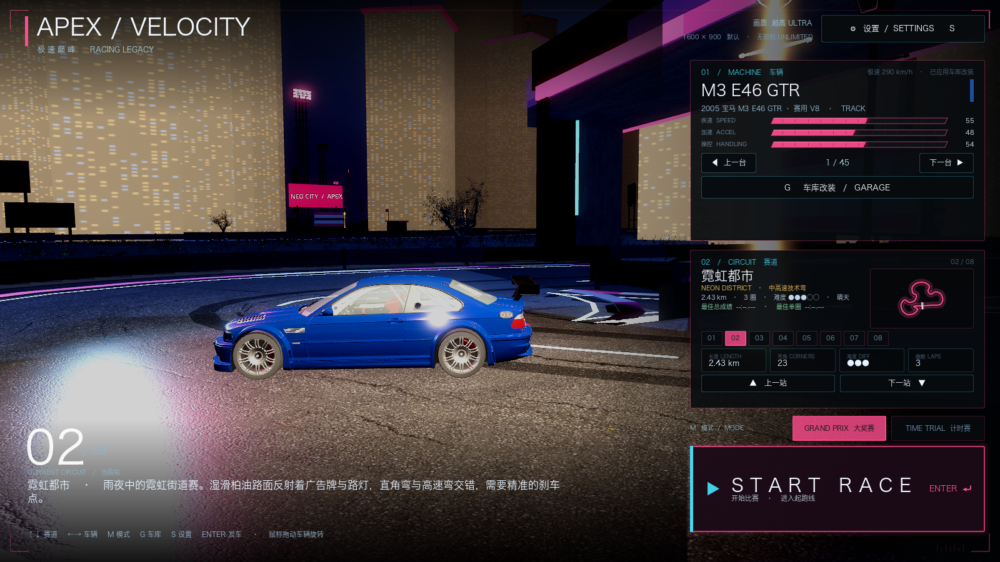
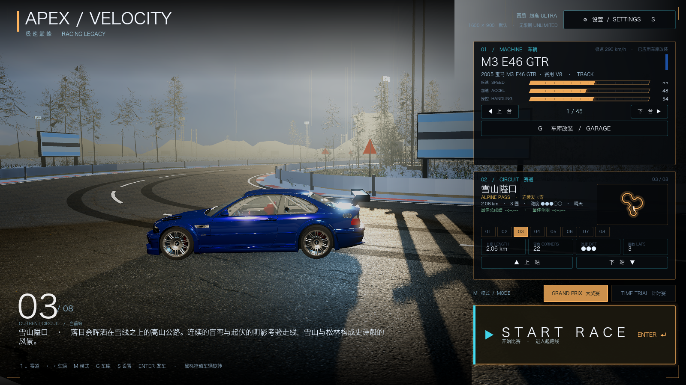
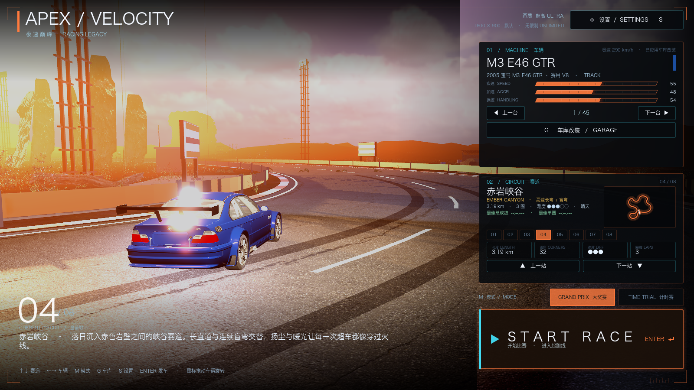
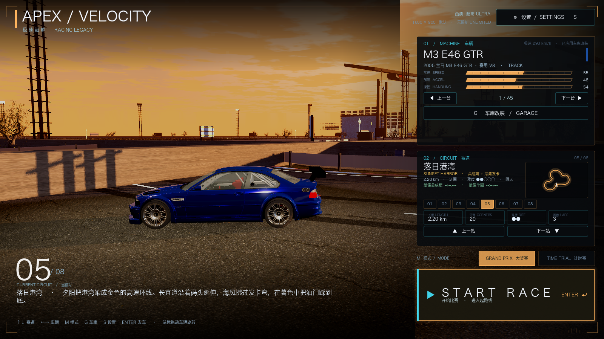
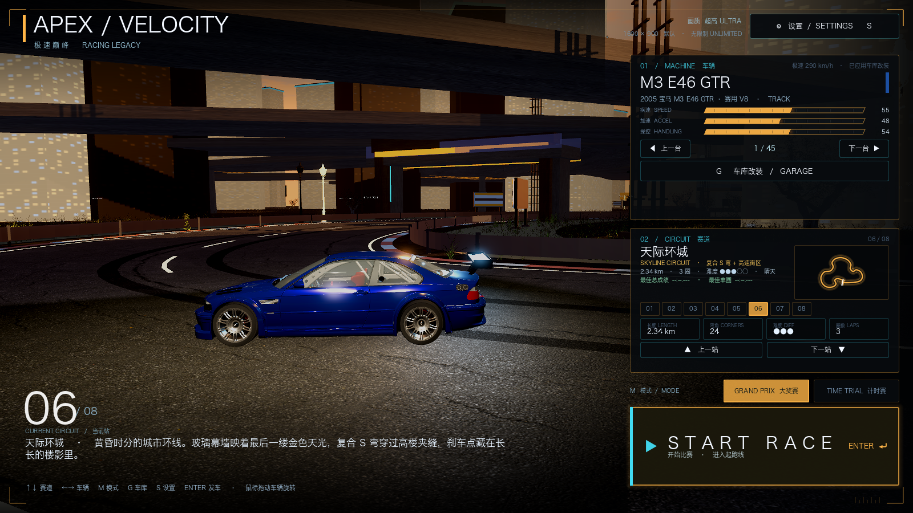
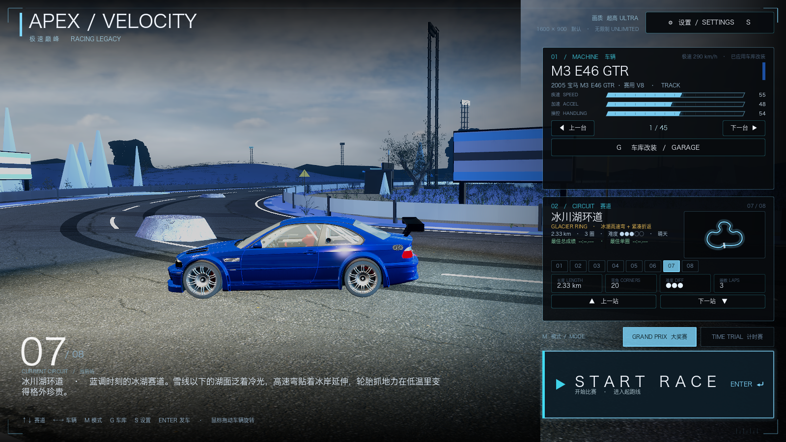
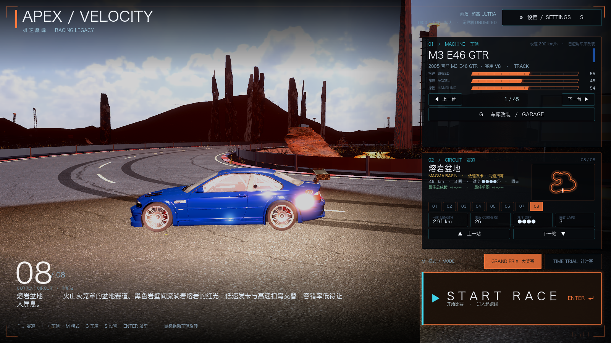

# 45 · 全地图最终优化 + 全量跑测 + 文档总更新（v0.43）

> 2026-11-05 · 用户：继续改，每张地图都优化，再去跑一跑，最后更新项目所有 MD 文档。

## 一、本轮修复的关键底层问题

### 1. 全屏画面缩到左上角（已修，见 docs/44）
比赛时强制 `window_set_size` 在全屏下会把渲染区域压到左上角；现在只有窗口化模式才改窗口尺寸。

### 2. 真实 CC0 资产"白模 / 灰模"根因（本轮修复）
`venue_kit.gd::_place_repeated()` 以前把一个 **多材质模型** 只用一个 `material_override` 塞进 MultiMesh：
- 树（树皮+树叶）、厂房（墙板+窗框+屋顶）、货柜等多 surface 资产都会退化成单材质/灰白模型；
- 这就是用户看到的"白楼 / 白树 / 灰白模型"的主要来源。

现在逐 surface 拆成单材质 ArrayMesh 再 MultiMesh 化，每个 surface 保留自己的真实材质与 alpha scissor：
- 针叶树叶片的 alpha 裁剪正确，不再是一整片白色；
- 厂房/建筑的多材质面（墙板、窗、门、装饰）恢复真实贴图。

### 3. 雪峰几何体异常
旧的"雪峰"用无光照白色圆锥，近距离会变成遮住天空的巨大白色三角形；
已删除该方案，雪峰改由真实 mountain 资产/受光材质承担。

## 二、逐图优化

| 地图 | 本轮改动 |
| --- | --- |
| **海岸 coast** | 栈桥 5 条；近岸帆船 2 艘；树量按性能下调（hi 2 + 24 棵）；防波堤/航标/伞/救生塔保留；场景更干净 |
| **霓虹都市 city** | 楼栋 92 栋、最高 ~170m；窗格三平面贴图统一；删掉荒漠巨石与多余树；夜间霓虹/天桥保留 |
| **雪山 alpine** | 冷杉 + 松树密集化（fir LOD 36 + near 10 + pine 64）；雪地/雪堆；太阳/雾/曝光调低避免过曝；删阔叶林 |
| **赤岩峡谷 canyon** | 岩柱与岩石 90 件、枯树 44 棵；去松树/绿色植被；落日暖色保留 |
| **落日港湾 harbor** | 去掉漂浮的橙色"假山"；港池/岸桥/货柜/仓库/货轮/系缆桩保留，画面更干净 |
| **天际环城 skyline** | 楼栋 112 栋、38% 概率超高塔；高架/广告牌/大屏保留；城市峡谷感 |
| **冰川湖 glacier** | 松树 84 棵、冰柱/冰墙/蓝冰湖、冻船；补真实山体；隐藏悬空广告屏 |
| **熔岩盆地 magma** | 枯树 46 棵、黑岩/熔岩裂缝/工业遗构；去松树/绿色；保留暗红氛围 |

## 三、全量跑测

### 验证
```
[VERIFY] PASS
```
覆盖：8 图赛道矩阵/场景实例数、天气/灯光、发车、碰撞、车库/改装、HUD、赛道切换、完整 GP 比赛。

### 性能（窗口化 1600×900，ULTRA，M1 Pro）

| 地图 | 平均 FPS | draw calls | primitives |
| --- | --- | --- | --- |
| coast | 38.5 | 1127 | 13.85M |
| city | 59.7 | 1154 | 4.47M |
| alpine | 38.2 | 711 | 12.44M |
| canyon | 53.0 | 985 | 6.38M |
| harbor | 52.1 | 754 | 6.94M |
| skyline | 62.2 | 1147 | 4.25M |
| glacier | 45.4 | 1046 | 9.79M |
| magma | 58.4 | 1157 | 5.01M |

> 全屏模式会按屏幕物理分辨率渲染，帧率明显低于此表；追求帧率可用窗口化 1600×900 或降画质档。
> 海岸/雪山因高密度树和近景资产开销偏大，后续可继续用 LOD 降树量换帧率。

## 四、截图

| 地图 | 截图 |
| --- | --- |
| 海岸 |  |
| 霓虹都市 |  |
| 雪山 |  |
| 赤岩峡谷 |  |
| 落日港湾 |  |
| 天际环城 |  |
| 冰川湖 |  |
| 熔岩盆地 |  |

## 五、文档更新

- README 更新到 **v0.43**，加入本轮进度与全部截图；
- 新增本文件 docs/45 与 `docs/README.md` 总索引（01~45 全部列出）；
- 旧文档 01~44 内容保留为历史里程碑，索引中标注版本；
- 文档总索引：`docs/README.md`。

## 六、仍然可继续的项

- 城市楼体仍是「窗格贴图体块 + 真实 CC0 街具/天桥/大屏」组合，不是逐栋真实高楼模型；如需继续提升可下载 CC0 高楼单体替换；
- 雪山近景树的白色高光仍偏亮（材质来自 Poly Haven 树照片 + 冬日强光），可再压 albedo/曝光；
- 冰川菜单远处仍有少量黑色悬空结构（非广告屏），下一步定位删除；
- 海岸/雪山性能偏紧，可通过远距树 LOD / 减少实例再优化。
