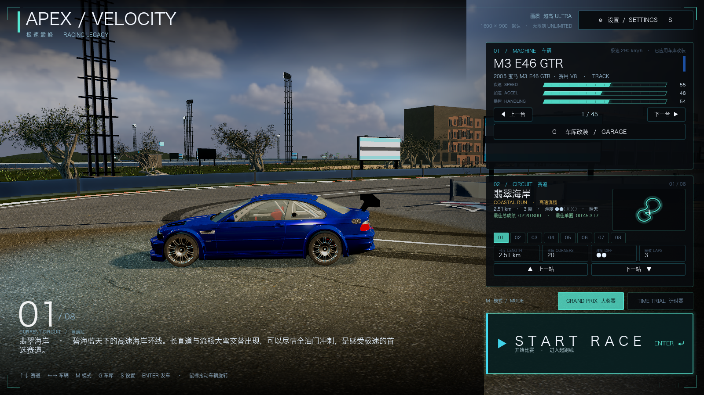
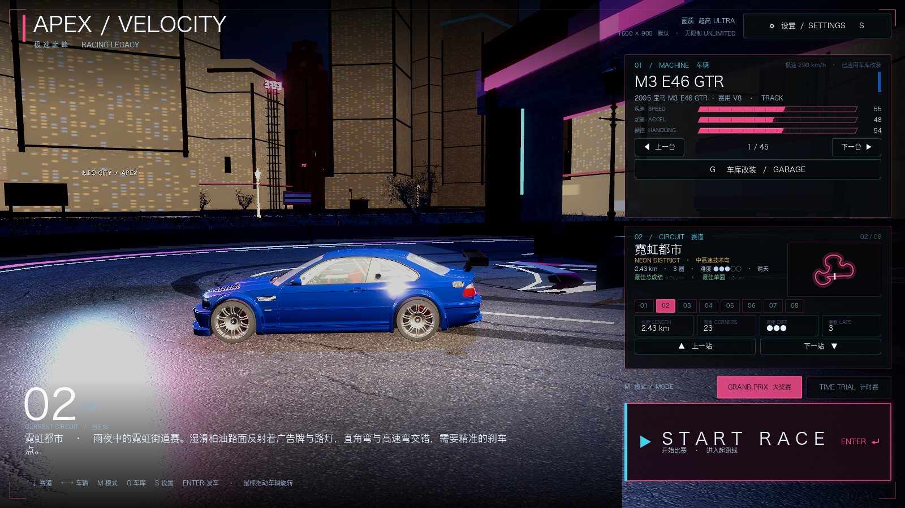
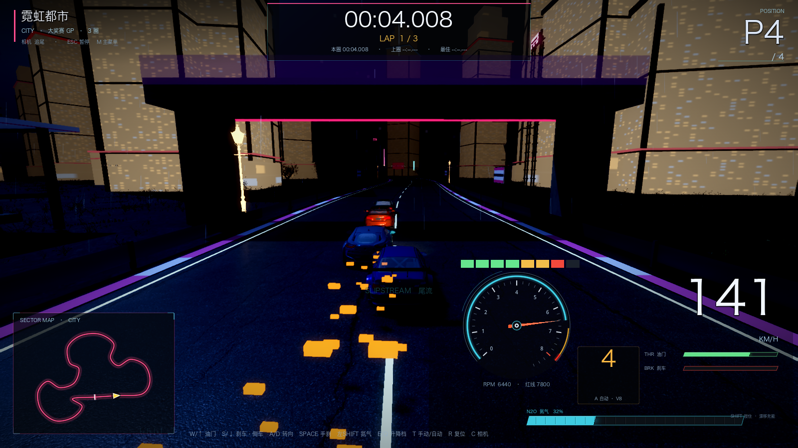

# 46 · 场景反馈修复：海岸孤立巨石移除 + 城市楼体细节加强（v0.44）

> 2026-11-05 · 用户反馈：远处巨石很怪，要么连成一片要么不要；目前只有一段有石头；
> 城市楼体可以更细节。

## 一、海岸：孤立巨石 / 巨岛全部移除

追查发现三处来源：
1. `CoastIsland_*`：7 座从 Poly Haven 山体缩放成的远景海岛，随机半径 980~1750m，
   从某些赛段看只有两三座露出来，像孤零零的巨石；
2. `_build_shore_rocks`：16 颗随机分布在 530~660m 海面的巨型礁石；
3. `_build_cc0_boulders` 与防波堤巨石堆。

已全部移除。海岸现在保持干净海平线，只保留：
- 5 条真实栈桥、帆船/游艇、防波堤低石、航标浮标、沙滩伞/救生塔/棕榈；
- 近岸小礁石不再放大成岛。

## 二、城市楼体细节加强

在原有 92/112 栋窗格楼体基础上，每栋楼增加：
- **裙楼**（底部加宽的 podium，7% 概率省略）；
- **顶部退台**（h>34m 加一层收窄 20% 的塔冠，h>64m 再加第二层）；
- **四角竖向金属柱**（0.65m 宽，贯穿楼高，提升近景细节）；
- **层间线脚**（近轨楼每 12m 一圈 0.28m 线脚，最多 6 圈）；
- **入口/裙楼霓虹灯带**（55% 概率，品牌色）；
- **高塔尖顶/天线**（h>72m）。

地标塔（4 座）也加裙楼、退台、四角柱、线脚，并压暗立面/降低自发光，避免一整面米白墙。

## 三、验证 / 性能（窗口化 1600×900，ULTRA）

```
[VERIFY] PASS
```

| 地图 | 平均 FPS |
| --- | --- |
| 海岸 coast | 34.1（干净海平线，帧率随机器温度波动） |
| 霓虹都市 city | 69.2（楼体细节增加后仍高于之前） |

## 四、截图





## 五、关于"技能包"

用户提供的截图是 Codex 的技能市场（game-generation / game-engine / game-feel /
game-ui-design / game-ui-ux / game-design-theory / multiplayer-game / threejs UI 等）。
当前 DeepSeek Harness 环境没有安装这些 Codex 技能包，无法直接调用；其方法论已部分应用：
- **game-feel**：手柄细腻震动、碰撞火花/镜头震动、换挡回弹、氮气推力反馈；
- **game-ui-design / ux**：设置分 Tab、HUD 真实氮气/手动挡、车库展台；
- **game-design-theory**：大奖赛/计时赛/奖牌/最佳圈速数据。

真正可落地的新方向：
- **本地双人分屏**（Godot 单机内可行）；
- **在线联机**（需要网络同步/服务器，是独立大工程）；
- **game-feel 二次打磨**（hit-stop、轮胎烟、音频 ducking、过弯镜头）；
- **成长/成就系统**（奖牌、涂装解锁、圈速排行）。
