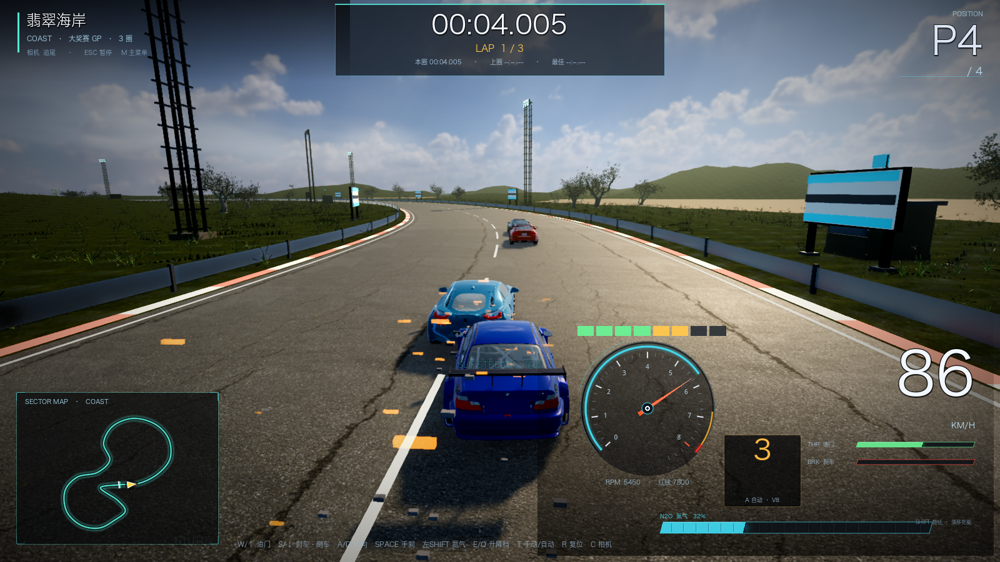
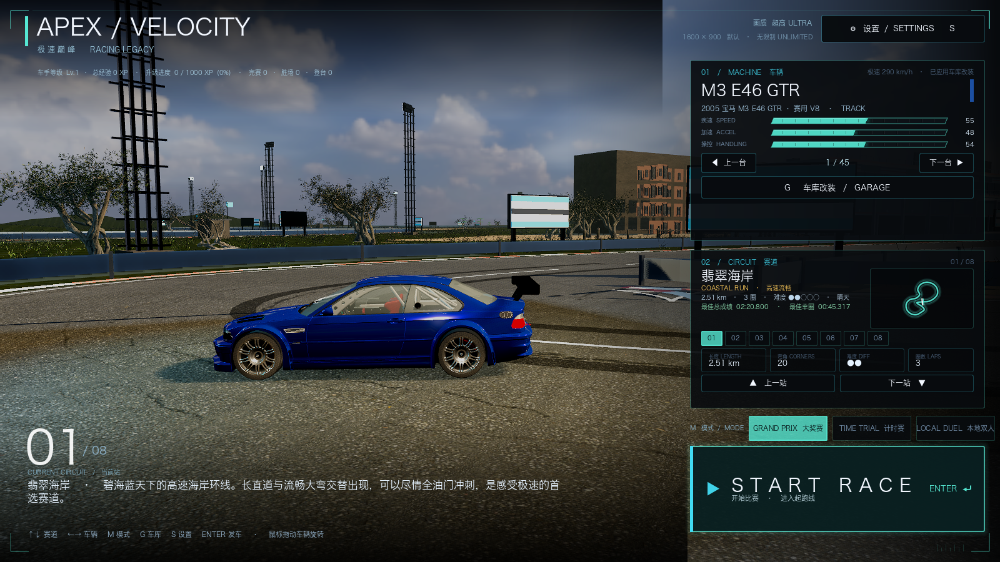
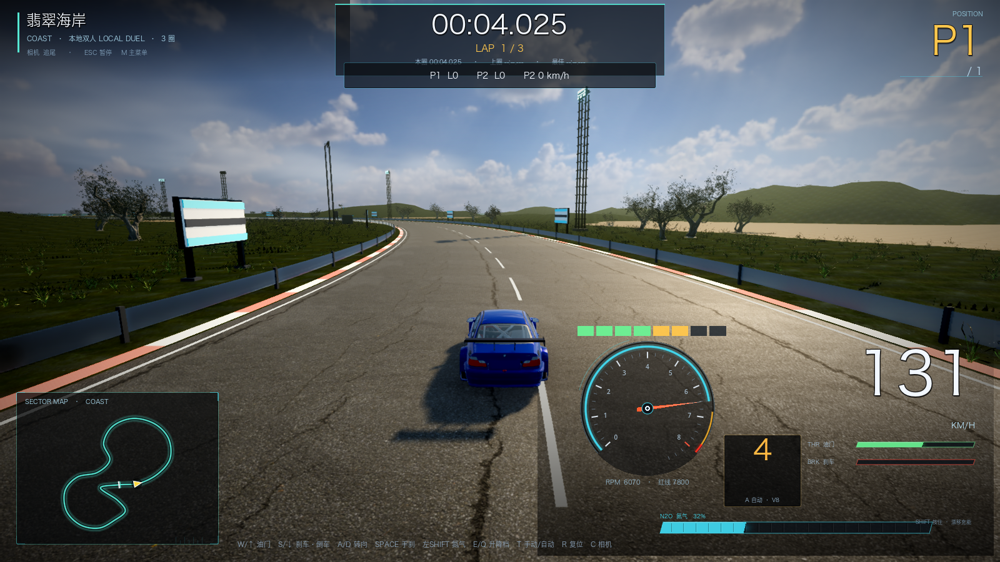

# 47 · Game Feel 二次打磨 + 车手成长/成就 + 本地双人（v0.45）

> 2026-11-05 · 用户：先做 1（game-feel）、2（成长/成就）、3（本地双人）。

## 一、Game Feel 二次打磨

新增 `scripts/fx/game_feel.gd`，main 每帧调用；同时增强 `chase_camera.gd` 与 `audio_manager.gd`：

- **Hit-stop**：重撞时 `Engine.time_scale` 短暂 0.35（按撞击强度 0.05~0.10s 真实时间），结束自动恢复；
- **碰撞碎片/火花**：CPUParticles one-shot，灰色碎片 + 橙色火花，0.9s 自动清理；
- **轮胎烟**：漂移/打滑/手刹/越野时后轮持续冒烟，随车速和滑移量变化；
- **氮气尾焰 + FOV 推力**：氮气激活时车尾喷射粒子，镜头 FOV 短暂拉大，松开平滑回落；
- **过弯视线**：镜头 look 目标按横向滑移/转向向弯内偏移，高速更明显；
- **音频 ducking**：撞击瞬间 Music 总线临时压 -6~-10dB，0.5~0.9s 平滑恢复，不破坏设置音量；
- **换挡顿挫**：GameFeel 统一处理短 shake + FOV 回弹（删除了 main 里重复的一处 shake）。

## 二、车手成长 / 成就 / 圈速排行

新增 `scripts/core/profile_store.gd`，存档 `user://profile.json`：

- 经验/等级：`xp_to_next = 1000 + 250×(level-1)`；L2=1000、L3=2250、L4=3750…L10=18000；
- **15 个成就**：首次完赛/登台/夺冠、金/银/铜牌、极速 250/300、氮气 10 次、漂移 10s、3 条赛道、单圈 1:30、累计 100km、10 场、Lv10；
- **圈速排行**：按 赛道→车→前 5 快圈 保存，`leaderboard()` 读取；
- **奖牌目标**：`medal_targets(track,laps,mode,difficulty)`，8 张图与 RaceManager 实际发牌完全一致；
- 结算面板显示：本场 +XP、等级变化、成就解锁、该车最快圈、奖牌目标；
- 主菜单左上显示车手徽章：等级 / XP / 战绩 / 成就数 / 累计里程；
- 本场统计：氮气使用次数、漂移秒数、本场最高时速（用于成就判定）。

## 三、本地双人（同屏）

- 菜单第三模式 **LOCAL DUEL / 本地双人**；
- 两辆车同场同屏，共享追尾镜头；
- 操作：
  - **P1**：方向键转向/油门/刹车，右 Shift 氮气，空格手刹，E/Q 升降档，T 手动；
  - **P2**：WASD，L 氮气，K 手刹，O/P 升降档，I 手动；
- HUD 顶部显示 `P1 Lx / P2 Lx / P2 速度 / 胜者`；
- 先完成圈数者获胜，结算显示双方用时与胜者。

⚠️ **当前是"同屏双人"，不是左右分屏**：本项目 3D 世界直接渲染在根视图，真正分屏需要把世界拆到两个 SubViewport + 世界双实例同步，属于下一轮大改；本轮先把双人玩法跑通。需要真正分屏的话告诉我，我继续做。

## 四、验证

- `[VERIFY] PASS`；
- ProfileStore 后端自测 **289 checks / 0 failures**（等级边界、15 成就、存档 roundtrip、前5圈、坏档、8图奖牌目标 vs RaceManager 8/8）；
- 双人模式截图、菜单徽章截图、Game Feel 比赛截图已保存 docs/m44；
- 修复：Game Feel 粒子在退出时 cast freed object 的报错、每场重复创建未清理、换挡双 shake。

## 五、关于技能包

抖音截图里的 Codex 技能（game-feel / game-ui-design / game-design-theory 等）本环境未安装，无法直接调用；
本轮按它们的**方法论**落地了 game-feel 细化、成长/成就循环、双人模式。剩余可做：
真正分屏、在线联机、成就墙 UI、涂装解锁、hit-stop/轮胎烟参数细调。
