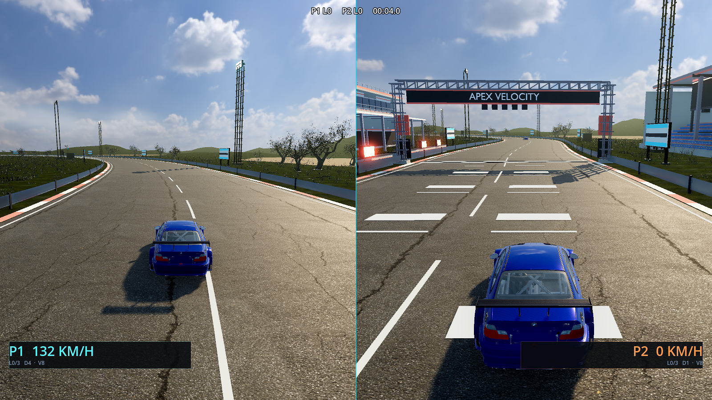
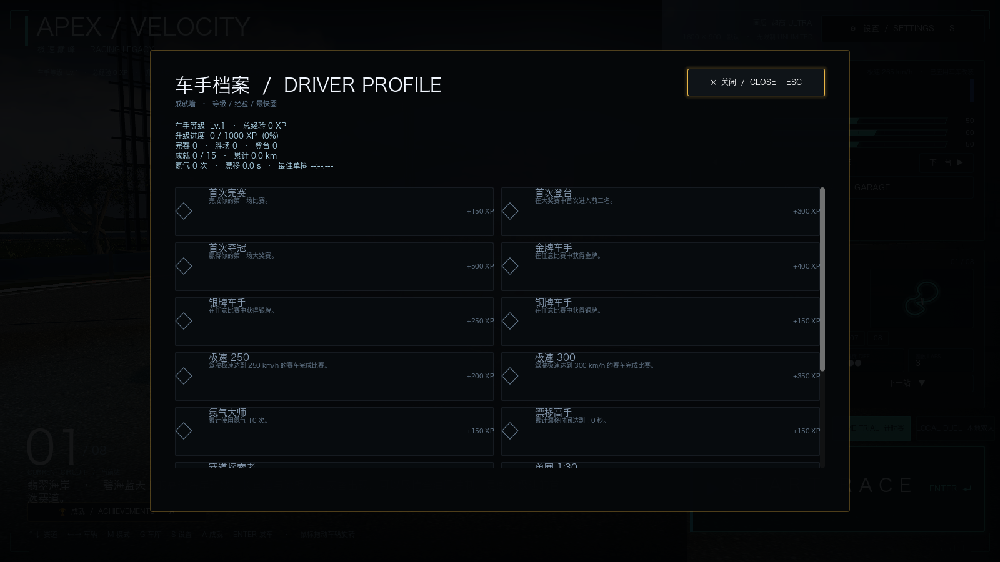
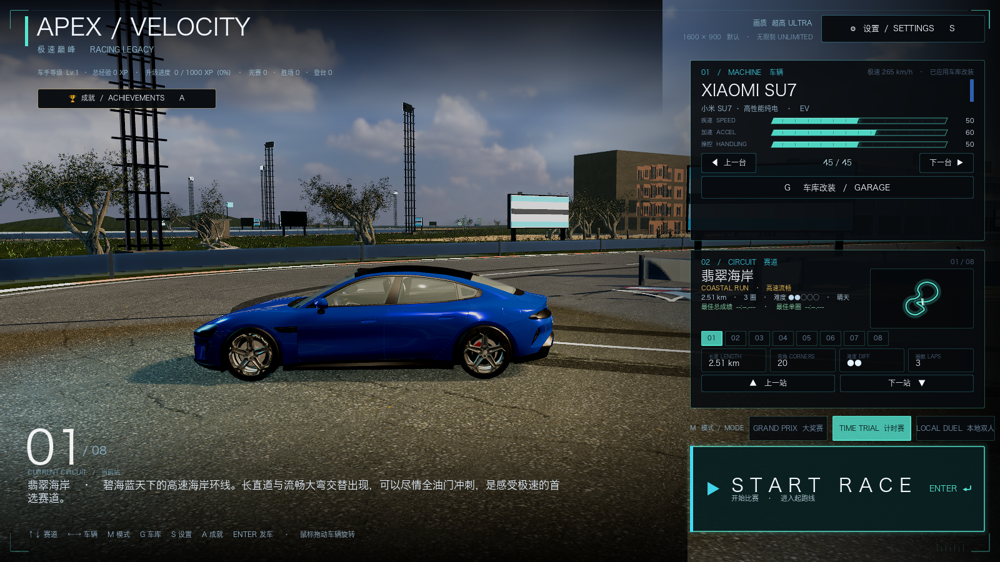
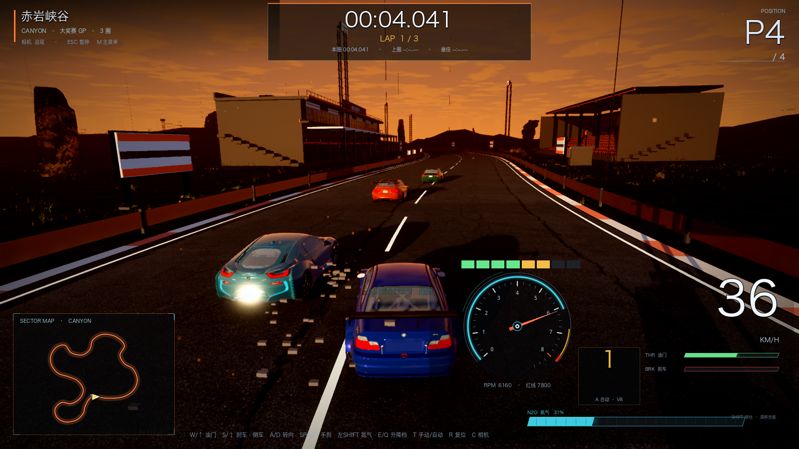

# 48 · 喷气/漂移特效重做 + 真·分屏双人 + 成就界面（v0.46）

> 2026-11-05 · 用户：喷气/漂移特效不好；本地双人要做真分屏；成就界面找不到；前端有问题。

## 一、喷气 / 漂移特效重做

旧版是**无贴图的纯色 quad 粒子**，所以看起来像色块。本轮替换为：

- **纹理化烟雾**：程序生成 128×128 的软烟贴图（噪声 + 径向衰减 + mipmap），
  漂移/打滑/手刹/越野时从后轮喷出，粒子尺寸/透明度/存续时间重新调；
- **氮气尾焰**：程序生成 96×192 的火焰贴图（蓝白核心 → 橙红外焰），
  两个排气口各一个 **加法混合 billboard 尾焰** + 小粒子，按 RPM/氮气强度闪烁；
- **氮气后视光效**：排气处 blue glow，取代之前奇怪的黄色柱状几何体；
- **漂移胎痕**：`GameFeelSkidMarks` MultiMesh 环形缓冲（最多 260 段），
  打滑时在后轮位置持续留下深色胎痕；
- **碰撞碎片/火花**保留并和轮胎烟分开。

> 说明：没有找到和本作写实夜景风格匹配的现成 CC0 喷气序列帧，因此改用
> **程序化噪声贴图 + 加法混合焰片**；如果你有具体参考图/视频，我可以照着调色。

## 二、本地双人：真·分屏

`scripts/core/split_screen.gd`：

- 左右两个 `SubViewport`，各渲染一套世界：
  - 左：真实物理世界 + P1 追尾相机；
  - 右：烘焙赛道副本 + P2 追尾相机 + 两辆车的视觉镜像（每帧同步车身/前轮转向/轮子滚转）；
- 两个视口各 800×900，中央 2px 高光分隔线；
- P1 视角数据（速度/挡位/圈数）左下，P2 右下；顶部显示双方圈数和计时；
- 倒计时与 GO! 显示在分屏中央；
- 双车之间有简单防穿模；
- 分数/结算仍由 RaceHUD 在 RESULTS 时显示。

性能：分屏要渲染两套世界，帧率约为单屏一半（M1 Pro ULTRA 约 20~30fps），
可在设置里降画质档或窗口化。

## 三、成就界面（之前找不到入口）

新增 `scripts/ui/achievements_screen.gd`：

- 车手档案：等级 / XP / 升级进度 / 完赛/胜场/登台 / 成就数 / 里程 / 氮气/漂移/最佳圈；
- 15 个成就两列卡片，锁定的灰显，解锁的金色；
- 入口：
  - 主菜单 **A 键**，或左下角「🏆 成就 / ACHIEVEMENTS」按钮；
  - 关闭：ESC / 右上角按钮。

## 四、前端修复

- 主菜单成就按钮移到左上（原位置压住赛道简介）；
- 主菜单增加车手徽章（等级/XP/战绩）；
- 双人模式共享 HUD 会在分屏时隐藏，改用左右两侧轻量 HUD；
- 成就列表摘要改为多行，避免被裁切；
- 成就界面进入/关闭的输入事件已处理。

## 五、验证

- `[VERIFY] PASS`；
- 分屏截图、成就界面截图、主菜单截图已保存 `docs/m45/`；
- 修复：GameFeel `dt` 未声明、退出时 freed object 报错、双人双相机、HUD 重叠。

## 六、遗留

- 分屏性能约为单屏一半，后续可给 P2 视口降分辨率/关闭部分后处理；
- 喷气特效当前是程序化贴图 + 加法焰片，仍可继续加：热浪扭曲、排气火星、车尾蓝色补光；
- 成就墙可再加"未解锁进度条"和一键分享。

## 七、手柄震动增强（v0.46.1）

用户反馈手柄震感不明显。已重写 `Haptics.update_state`：

- 全局强度默认 **1.35×**（旧版约 1.0），`clamp` 上限仍是 1.0；
- **路面反馈**：速度平方 + 38/91Hz 复合噪声，持续高频颗粒感，速度越快越明显；
- **越野**：更强的连续颠簸（0.26/0.22 振幅 + 随机强弱交替）；
- **起步打滑**：低速大油门额外高频抖动；
- **刹车**：明显脉冲（44Hz ABS 感），踩下瞬间额外 0.30 冲击，随车速增强；
- **漂移/手刹**：按横向滑移量叠加持续撕扯感（最高约 0.7），漂移开始瞬间再补一记；
- **换挡**：clamp 后 0.62 / 0.34 的 clunk；
- **碰撞**：weak 0.95 / strong 1.00，衰减时长 0.30~0.85s；main 传入碰撞强度改为 `impact/16`（最低 0.25），轻微碰墙也能感觉到；
- 怠速/静止仍为 0；无手柄/headless 安全空操作。

## 八、赤岩峡谷过亮修复（v0.46.2）

用户截图反馈赤岩峡谷一片白/过曝。原因与修复：

- 峡谷原来使用 **HDRI 全景天空**，其中的太阳盘 + 雾 + 高光在 ACES 下发白；
  已把 canyon 从 HDRI 列表移除，改用主题程序化天空（可控日落色）；
- 主题重新调色：exposure 1.06→1.22（但去掉 HDRI 后整体不再过曝）、
  sunPower 4.8→4.4、hemiIntensity 1.06→1.0、fogColor 变暖灰、
  ground/roadTint 压暗，glow 强度降低；
- 重新烘焙 8 张菜单场景，菜单与比赛共用新光照；
- 顺带把碰撞碎片从方块改成小石粒，避免地上一片"橙/灰色方块"。

验证：`[VERIFY] PASS`。
