# 50 · 车模高清重导与游戏内光影（v0.51）

> 2026-11-05 · 用户：「游戏里这赛车表现的不是很好。这个 blend 文件里面是我所有赛车的原文件，
> 你重新给我跑一下渲染，就是要求它的光影效果跟游戏里面是符合的。」
> 补充：「不用给我出图，我在游戏自己看。现在这个模型在游戏里面精度不够，
> 之前的 GLB 模型完全只是为了应付网页的游戏。」
> 追加验收四条：① 玻璃要半透、不要发白；② 轮子转动要正常；③ 转向时前轮要转；④ 配件库（轮胎/轮毂/尾翼/车漆）要能用。

## 一、问题定位（升级前审计）

旧车模库 `assets/cars/models/*.glb`（45 台）是**网页 three.js 版**的产物，为 Web 性能/渲染差异做了大量妥协；
迁移到 Godot 后这些妥协全部变成「看起来精度不够」的根因。`tools/car_audit/audit_car_models.gd` 的升级前基线：

| 项目 | 升级前状态 | 后果 |
| --- | --- | --- |
| 车漆 | 运行时 `CarVisual.apply_paint` 一律用调色板纯色覆盖、清空 albedo 贴图 | 原厂拉花/赛车涂装/车漆细节全部丢失，车像纯色塑料模型 |
| 清漆 | 源 GLB 有 408 个 `KHR_materials_clearcoat` 材质，**Godot 4.7.2 导入后 clearcoat_enabled 全为 0** | 车漆没有清漆层，高光是糊的 |
| 玻璃 | 403 个 surface `transparency=4 ALPHA_DEPTH_PRE_PASS`，材质偏亮偏白 | 车窗发乳白，看不清内饰 |
| 轮组材质 | 网页版把轮胎/轮毂/刹车压成纯色 `Tyre/RimFace/BrakeDisc/Caliper` | 轮毂纹理、金属层次、卡钳细节丢失 |
| 结构 | 22 万面的 i8 导出成 787 网格 / 1300+ 节点 | draw call 高、合并优化空间浪费 |
| 导出取向 | 非玻璃强制不透明、侧窗压暗成「隐私玻璃」、透射被杀 | 与原件 PBR 表现不符 |

## 二、新管线：从 .blend 原件重导 Godot 车模

### 2.1 数据流

```
车辆模型_拆分版_待审查/blend/<车型>.blend
        │  tools/car_export/export_godot_car.py（Blender 5.2 无头，批量 tools/car_export/run_batch.py）
        ▼
/tmp/car_export_out/<slug>.glb + <slug>.report.json + batch_report.json
        │  按 data/car_manifest.json 的 model 文件名安装（assets/cars/models/）
        ▼
Godot 导入 → CarVisual / GarageLook 运行时装配 → 车库 / 菜单 / 赛道
```

### 2.2 导出器做了什么

1. **拍平原件坐标**：拆分版 blend 的 `车辆根节点` 带 96x / 0.25x 父级缩放，导出器把变换烘进网格顶点；
2. **归一朝向/原点**：车头朝 glTF +Z、左前轮在 +X、X/Z 居中、车轮落点 y=0（与旧游戏 GLB 约定一致）；
3. **轮组重构成游戏契约**：
   ```
   CarRoot
   ├─ Wheel_FL/FR/RL/RR          ← 转向枢轴（直接子节点挂刹车/卡钳）
   │   ├─ BrakeDisc_Wheel_XX
   │   ├─ Caliper_Wheel_XX
   │   └─ Spin_Wheel_XX          ← 滚转枢轴
   │        ├─ Tyre_Wheel_XX
   │        └─ Rim_Wheel_XX
   ├─ SteerPivot                 ← 方向盘枢轴（源模型有则生成）
   ├─ WingMount                  ← 程序化尾翼挂点（与原厂尾翼包围盒对齐）
   └─ 车身/玻璃/尾翼（按材质合并后的网格）
   ```
   关键节点名强制精确（不允许 `.001` 后缀），保证 `find_child("Spin_Wheel_FL")` 稳定命中；
4. **轮组分类/合并/裁剪**：拆分版 blend 每角最多 200 个碎片（i8），导出器按「材质名 + 几何（径向带）」归成
   胎/毂/盘/卡钳，同类合并成一个网格；用**旧游戏模型的车轮包络**（`/tmp/old_wheel_ref.json`：45 台旧 GLB
   的 Spin 子树实测 ctr/radius/width）作为期望轮柱，两遍裁掉误收进轮组的轮眉/翼子板/悬挂面（裁下的面挂回
   车身静止件 `Trim_Wheel_XX`，不删除）；轮轴用点云 PCA 校准到 X、滚转枢轴放轮心；
   碎片 >12 个/角的车（i8/Urus 等）只分胎/毂、全部挂 Spin，避免碎片被误判成卡钳而「缺胎皮」；
5. **材质 Godot 取向**：
   - 保留 Blender 原件的贴图/法线/金属度/粗糙度/清漆权重（GLB 里 `KHR_materials_clearcoat` 保留，引擎不认，
     运行时由游戏补开）；
   - 车窗玻璃转 alpha blend（深色半透、低粗糙度、双面、不投影）；有颜色的灯罩保持不透明原色；
   - 其余材质强制不透明（避免 GLB 的 BLEND 让 Godot 走透明管线）；
   - 车轮材质按类加前缀（`Tyre_* / Rim_* / BrakeDisc_* / Caliper_*`），车库换装/改色仍按材质名匹配；
   - 车漆兜底：车身最大不透明材质若名字无 paint 语义，复制为 `CARPAINT_<原名>`（修好 GT4/M6 GT3/M8 敞篷 3 台）。

### 2.3 全量结果

- **43 台导出成功、0 失败**；装车 **42 台新模型**（`byd_yangwang_u8` 因源轮组异常保留旧版），
  保留旧模型 3 台：`hyundai_elantra`（骨骼蒙皮，车轮未拆分）、`bmw_m4_adro_kit`（源 blend 轮组重复几何/前后轮径不一致）、
  `byd_yangwang_u8`（源轮组尺寸异常，measured_r 与旧模型差 13.9%）；
- 三角面：旧库 **9,622,827** → 新库 **9,920,590**（+3.09%）；43 台导出 tris 与上一轮审查包 GLB 偏差 ≤0.255%（多数 0.0%）；
- 结构：4×`Wheel_/Spin_Wheel_*` 45/45 台齐全且无后缀；AABB 全部 X/Z 居中、Y min=0；
- 新模型全部内嵌贴图（Godot 按 glb.import 提取），15/43 台带原厂拉花贴图（M3、i8、M2 等 livery 全部保留）。

## 三、游戏侧改动（让原件材质在游戏灯光下正确显色）

### 3.1 车漆：原厂漆保留拉花 + 运行时清漆

- `scripts/core/garage_store.gd`：新增 `paint_is_factory()` / `paint_is_matte()`；
- `scripts/cars/garage_look.gd`：车漆选项 0（原厂漆）不再覆盖纯色，交给车模自带贴图；原厂漆无贴图时用调色板原厂色兜底；
- `scripts/cars/car_visual.gd`：
  - 原厂漆 → 保留 albedo 贴图/拉花，metallic 夹到 ≤0.45、roughness 夹到 0.10~0.35，
    **运行时补开 clearcoat 1.0 / clearcoat_roughness 0.03**（glTF 扩展引擎不认）；
  - 换色车漆 → 调色板纯色覆盖但保留清漆；哑光车漆 roughness 0.62 / 无清漆；
  - 材质兜底只处理真正的空材质，不再误伤有贴图的材质；
  - 轮胎贴图是「白底胎纹」的 3 台比亚迪（海豹/海豹06GT/海狮）自动乘暗成橡胶色，避免白轮胎。

### 3.2 玻璃（用户验收项 ①）

- `_prepare_car_materials()`：玻璃统一 `TRANSPARENCY_ALPHA`、深色 tint (0.045,0.055,0.065)、alpha 0.17、
  roughness 0.13、metallic_specular 0.16、双面、全玻璃 MeshInstance 关阴影；
- 结果：车窗深色半透，能清楚看到防滚架/座椅/内饰；45 台车库/menu/race 截图逐台检查 **0 台发白/发雾**。

### 3.3 轮子滚动（用户验收项 ②）

- 导出侧已把轮轴 PCA 校准到 X、滚转枢轴放轮心；
- 运行时 `_center_spin_wheels()` 修正：把滚转枢轴挪到轮子 AABB 中心时**同时反向补偿子节点**
  （几何在世界里不动、旋转中心变轮心）；椭圆轮按轮胎包围盒单轴缩正；
- 结果（`/tmp/car_after/wheel_roll_check.txt`）：新装 42 台胎体 PCA 轴偏 **<3°**、轮心偏移 **≤0.0005m**、
  胎体 y/z 尺寸比 0.99~1.03；仅保留旧版的 `bmw_m4_adro_kit` 因旧模型本身轮轴歪（20.4°）列遗留问题。

### 3.4 前轮转向（用户验收项 ③）

- 45/45 台 `Wheel_FL/FR` 绕 Y 旋转 0.35 rad 后轮组 AABB 明显摆动（front_ok=2/2），
  后轮 Spin 挂在前轮 steer 下 **0 台**；新模型层级 `Wheel_FL(转向) > Spin_Wheel_FL(滚动)` 与游戏代码完全匹配。

### 3.5 配件库（用户验收项 ④）

- 运行时逐台（内存配置 paint=1 / wheel=2 dish6 / tire=2 race / wing=1 GT / caliper=1）走真实 `GarageLook.apply`：
  **45/45 台通过**——程序化轮 4/4 装上、原厂轮全部隐藏、GT 尾翼挂到 `WingMount`、原厂尾翼隐藏、
  程序化轮宽与轮几何偏差 <15%；
- 实拍 4 台车 × 7 组合（原厂/黑漆/白漆/深盘六辐/热熔胎/GT 尾翼/黄卡钳）= 28 张：
  改色 + 清漆反光正常、换轮毂/轮胎无原厂件残留、尾翼位置正确、卡钳变色可见；用户存档 trap 还原并 sha256 校验一致。

### 3.6 车库影棚打光（`scripts/ui/garage_world.gd` 重写）

- 程序化 HDR 天光：4 条长条柔光箱（方位 45°/135°/225°/315°，HDR 峰值 30）只做反射/环境光、
  背景仍是纯色暗场 → 任何转台角度车漆都有长条高光，且不占实时灯资源；
- AGX tonemap + exposure 1.18、ambient SKY 0.30、glow 0.04、SSR 64、SSAO 1.6、depth fog 只淡出远地面；
- 5 盏实时灯（4 方向 + 1 顶部 Spot 地面光池，2 盏投影），暗色地面 + r3.15 金属展台 + 品牌青环；
- 相机压低到 1.42m / fov34，并按车模 AABB 长度自适应（GL8 5.24m、X5M/Urus 验证不切边）；
- 过曝量化（车区 min(RGB)>0.97 占比）：M3 0.47% / i8 1.10%（旧版 18.5%）/ SU7 0.12% / Urus 0.08% / GL8 0.24%，全部 <5%。

## 四、验证

| 项目 | 结果 |
| --- | --- |
| 安装 | 42 台新模型 + 3 台保留旧版；sha256 逐台校验；`--editor --quit` 0 import error / 0 SCRIPT ERROR |
| 静态审计 | 45 台加载 0 失败；Wheel/Spin 节点 0 缺失；三角面 9,920,590；透明材质 168 surface/44 台（全玻璃） |
| 运行时 | CarVisual 加载 45/45；材质 fallback 0 台；运行时 clearcoat 45/45；steer 异常 0；配件预警 0 |
| 截图 | `/tmp/car_after/`：车库 45 + menu 6 + race 6 + 配件 28 + 新旧拼图 6；最终版另存 `/tmp/final_shots/` |
| 性能 | 与升级前同机同场景对照：fps 21.9→22.1，draw_calls **1115→777（-30%）**，primitive 8.425M→8.416M |
| 回归 | `--verify` PASS；旧模型 3 台行为不变 |

> 性能对照方式：用 20:13 冻结的升级前项目副本 `/tmp/proj_oldlight`（旧模型+旧脚本）与当前项目，
> 在同一台机器、同一 `--perf-test --track=coast --car=bmw_m3_e46_gtr`、无其它负载的情况下各跑一次。
> 项目当前 primitive 比 README 早期记录的 5.07M 高（此前里程碑加入的真实场景资产），与本轮车模无关；
> 本轮车模升级的贡献是 **draw call 降 30%、三角面 +3.1%、帧率持平**。

## 五、实拍（`docs/m46/`）

车库暗调影棚（新模型，原厂漆/拉花/半透玻璃）：

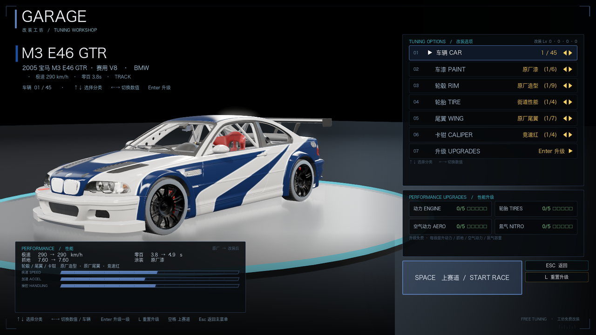

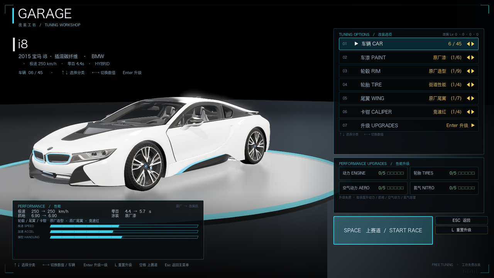

玻璃半透（别克里 GL8，能看清米色内饰）：

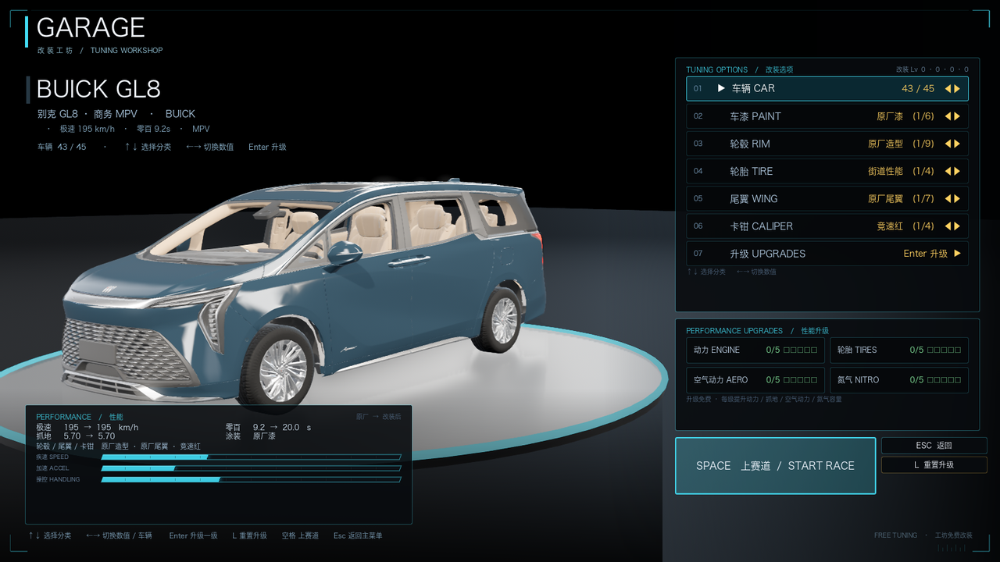

换装/改色（深盘六辐轮毂、GT 尾翼、黑色车漆）：

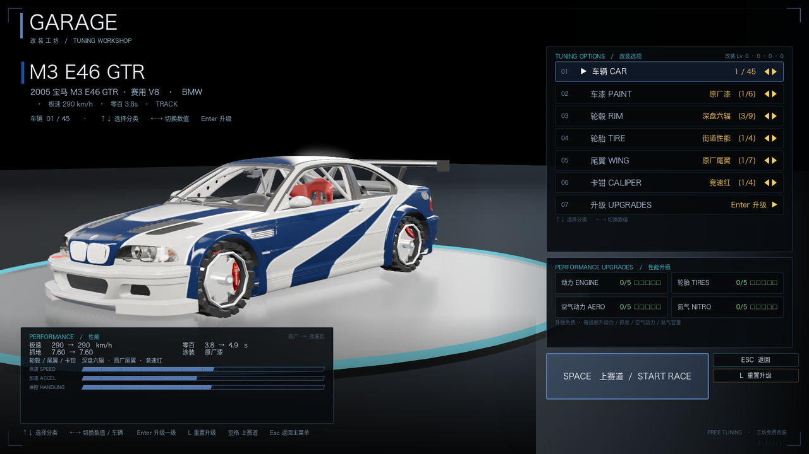

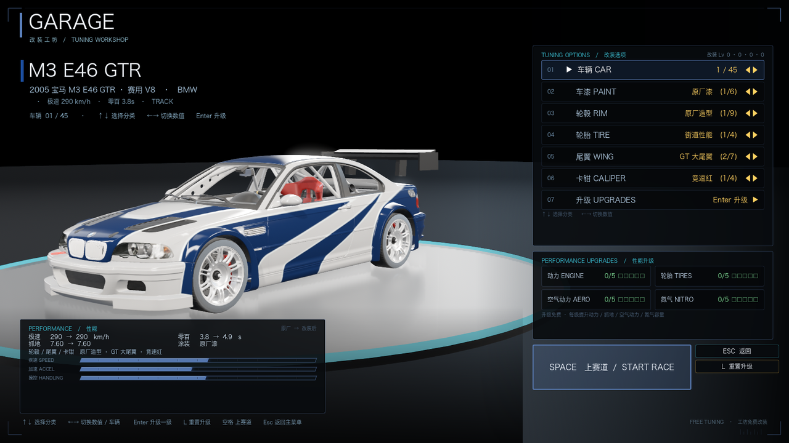

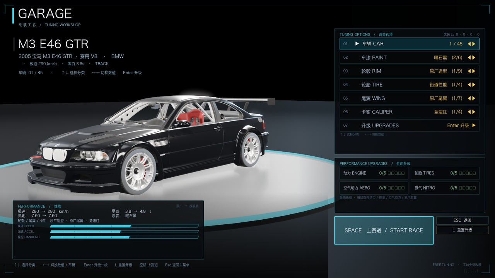

小米 SU7（合并网格轮组已按胎体重新定心定轴；源模型无玻璃件）：

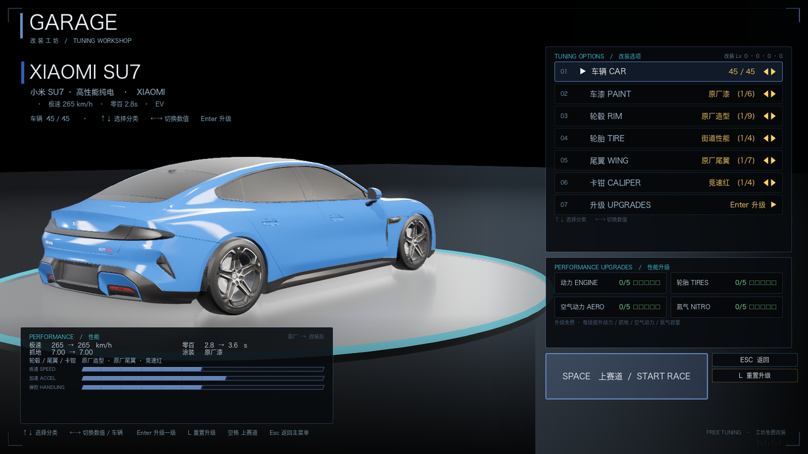

比亚迪海豹 06GT（白底胎纹贴图已乘暗成橡胶色）：

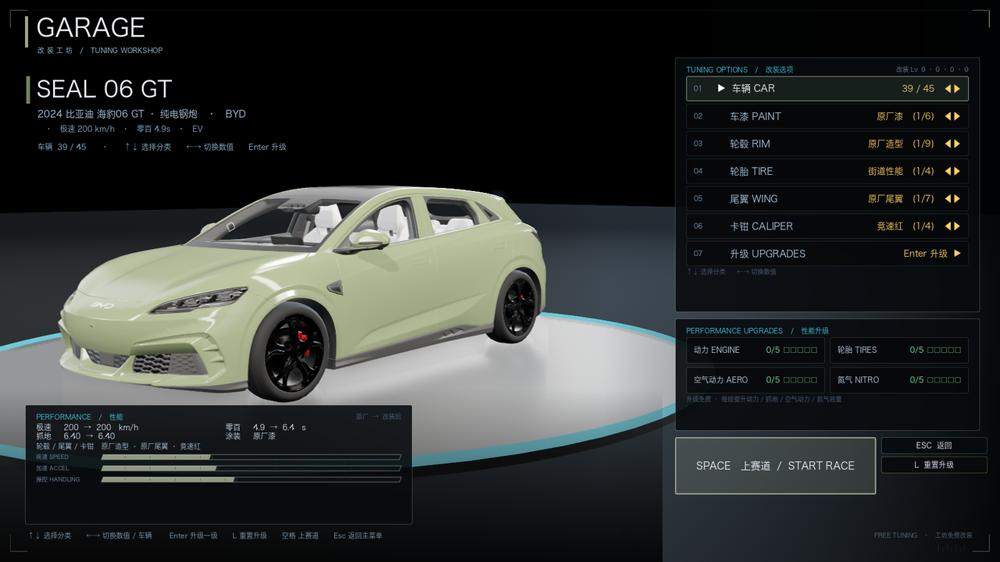

升级前后对照（左旧右新）：

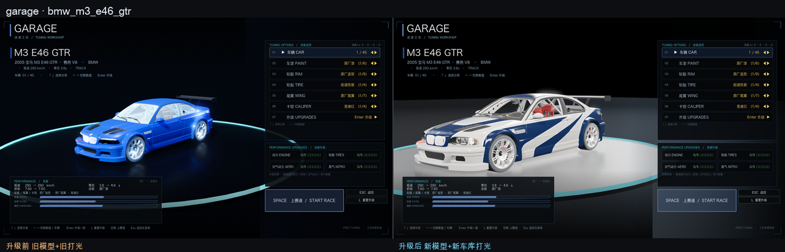

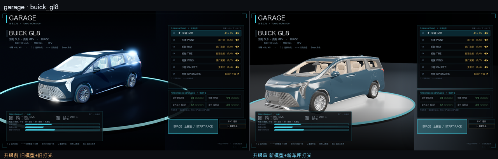

比赛与菜单：

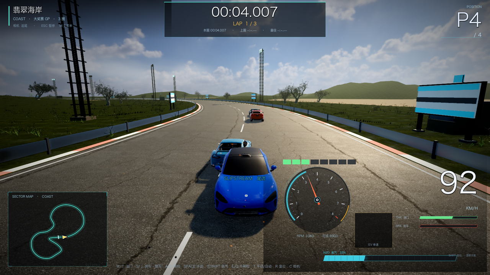

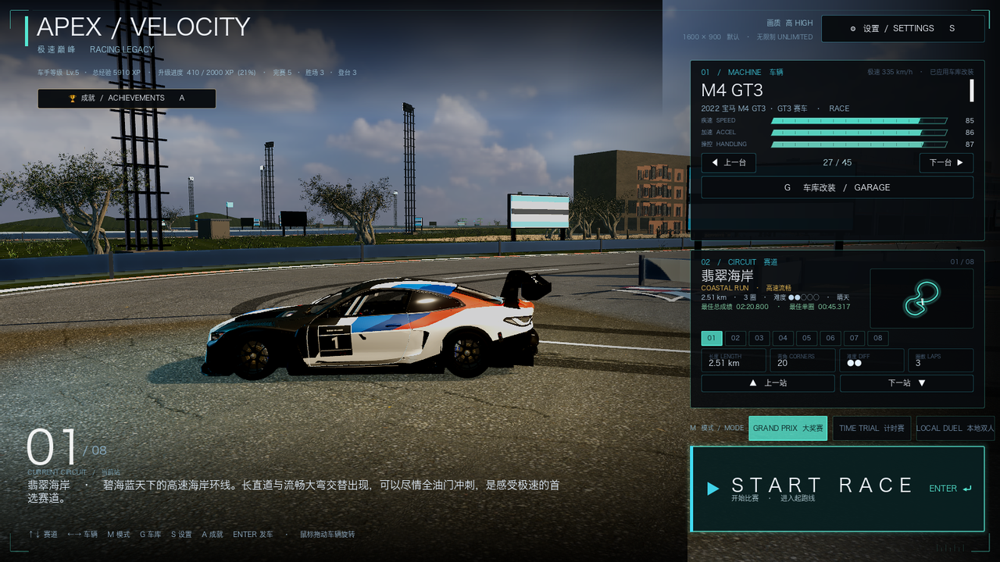

## 六、已知限制与后续

- **`bmw_m4_adro_kit`、`hyundai_elantra`、`byd_yangwang_u8` 仍是旧模型**（源 blend 轮组/骨骼问题），
  其中 adro_kit 旧模型轮轴本身歪（滚动会晃），需要单独人工修源文件；
- `SteerPivot` 缺失 3 台（`bmw_m3_e92` / `bmw_m6_gt3` / `zeekr_7x`）：游戏代码零引用，不影响转向/驾驶；
- 8 台车轮宽比旧网页版模型宽 5~20%（源 blend 轮组保护带内残留），放大截图抽查无穿轮眉，保持现状；
- 部分源模型本身没有车窗玻璃件（小米 SU7、仰望 U9 等），是源资产限制；
- 部分源车漆材质无贴图（25 台），原厂色用调色板颜色兜底（没有拉花可保留）；
- 车漆换色仍会丢失原厂拉花（旧行为），后续可做「拉花层保留 + 底色 tint」。
