# 51 · 前端美化 + 模拟键盘输入 + 地图主题化 + 改装精简 + 碰撞箱修正（v0.52）

> 2026-11-05 · 用户：「前端布局还不错，但是美化不是很好，把前端整体再美化一遍。」「键盘键位也改一下：
> 普通薄膜键盘正常走；磁轴键盘因为磁力不同，读到不同按下深度也可以控制不同的左右转弯角度、前后加速和油门开度。」
> 「地图需要再改一改：所有地图只在车道左右两边放东西，离车道太远的地方不用放；山用雾化处理；
> 戈壁图应该全是戈壁、城市图赛道两边全是楼、山谷、海边把海放到车道旁边；赛道里车模/摆放问题都要改。」
> 「改装工厂只保留改装车身的外观颜色，其他全都删掉，保留升级功能。」「车辆碰撞箱体积比车大，要和车体积相符。」

本轮共 5 条工作流：①前端 UI；②模拟键盘输入；③全部地图主题化；④改装工厂精简；⑤车辆碰撞箱。
各自有独立设计与验证，最后统一回归（`--editor --quit` 0 error、`--verify` PASS、`--race-test` 正常、截图+性能）。

---

## 一、前端 UI 整体美化（设计系统 v2）

### 1.1 设计语言

- **品牌青 `#55e7d2` 升级为全局主色**（不再跟着赛道主题色跑）；赛道主题色只保留在
  激活站次 chip / 小地图线 / 赛道标题短强调线，三处小面积点缀；
- 卡片改为**深色玻璃圆角面板**（R=11、半透明深底、1px 青色低透明描边、顶部左亮右隐青色高光条，
  底部渐隐），替代原来的直角黑块；
- **字体层级**：英文标题/车名/大数字用系统 DIN（DIN Alternate Bold / DIN Condensed，缺字自动回
  Hiragino CJK，无外部字体依赖）；kicker/分区标题拉字距；数据值统一琥珀黄 DIN；中文正文 Hiragino；
- 统一组件：5 态按钮（normal/hover/pressed/focus/disabled）、键帽式快捷键、序号徽章 `01/02/03`、
  圆角 chip、细描边数据格、主题化滚动条、Tween 悬停放大/辉光/按下回弹；
- 所有样式集中到 `scripts/ui/ui_style.gd`（token 化），各屏不再散落硬编码色值。

### 1.2 覆盖屏幕

主菜单 menu.gd、车库 garage_screen.gd、设置 settings_screen.gd（画面/音频/操作/游戏 4 页）、
比赛 HUD race_hud.gd（+gauge/minimap，读性优先重绘）、暂停 pause_screen.gd、结算、加载 loading_screen.gd、
启动 boot_screen.gd、成就 achievements_screen.gd。**布局骨架、键位、流程全部保持原样**，只提升视觉与交互质感。

### 1.3 车库精简（与 §四 一起）

车库右侧从 7 行缩为 3 行：`01 车辆 CAR / 02 车漆 PAINT / 03 升级 UPGRADES`，
其中车漆保留 6 色色板（原厂漆/曜石黑/珍珠白/赛道红/纳多灰/哑光石墨，可点击/←→/Enter），
升级保留动力/轮胎/空气动力/氮气 4 项。轮毂/轮胎/尾翼/卡钳/拉花入口与逻辑全部删除。

### 1.4 验证

- 前后对比图：`/tmp/ui/compare_*.png`（11 张，含车漆切换验证）、改后单屏 `/tmp/ui/after/`（15 张）
- 关键界面实拍：`docs/m52/`（车库 3 行 / 设置 ANALOG / 结算 / 比赛 HUD）
- `--editor --quit` 0 SCRIPT ERROR；`--verify` PASS；`--race-test` 正常
- 全 UI 动画走 Tween，无每帧重建 Control，无实时模糊 shader，性能与原版同量级

---

## 二、键盘输入：普通键盘照常 + 磁轴键盘按深度模拟

### 2.1 现实约束

macOS **没有系统级「按键深度」API**，Godot 也拿不到键程；Wooting Analog SDK 主要面向 Windows，
Razer 模拟轴同样依赖 Windows 驱动。所以采用「**本机 UDP 模拟输入桥**」：

```
磁轴键盘/任意模拟设备 → 厂商软件 / HID 读取 / 自写程序 → UDP 127.0.0.1:48255 → 游戏
                                                           ├ steer    -1..1 → 转向角
                                                           └ throttle  0..1 → 油门开度
```

### 2.2 游戏端实现

- 新增 `scripts/core/analog_input.gd`：UDP 收包（JSON / `s=..;t=..` / `0.4,0.8` 三种格式）、
  死区 + 幂曲线映射（`map_steer` / `map_throttle`）、约 25ms 平滑、**380ms 没包自动回退**、自检函数；
- `scripts/core/input_setup.gd`：`read_drive_input()` 在键盘/手柄之后合并模拟输入——
  有磁轴/桥接数据时用连续深度，否则完全走原来的数字输入（普通薄膜键盘行为不变）；
- `scripts/core/settings.gd`：新增 5 个持久化字段并在设置页「操作 / ANALOG INPUT」暴露：
  `analog_input_enabled`、`analog_udp_port`（默认 48255）、`analog_deadzone`（0.03）、
  `analog_curve_steer`（1.35）、`analog_curve_throttle`（1.15）；
- `tools/analog_input/`：桥接工具 + 协议说明 + HID 配置示例：
  - `analog_bridge.py --test`：不用任何硬件，发正弦转向+呼吸油门验证游戏链路；
  - `--stdin`：任何程序/厂商 SDK 把深度写到 stdin 即可；
  - `--hid config.json`：`pip3 install hid` 后按磁轴键盘原始报告格式直读（需按品牌改字节映射）；
  - 另一条最省事的路径：厂商 macOS 软件若支持「模拟手柄」，游戏原生支持手柄模拟量，无需桥接。
- 验证：
  - `--analog-test`（独立 CLI）：真实 UDP 端到端，桥接发 150Hz → `packets=294 active=true`；
  - `--verify` 内置：解析/映射自检、关闭时回退数字为零、注入深度 0.60/0.80 →
    `read_drive_input()` 得到 steer=0.60 / throttle≈0.70 的连续量（不再只有 0/±1）。

---

## 三、车辆碰撞箱：按 manifest 实测车宽/车长做 OBB

旧实现：车-车碰撞用**固定圆**（半径 2.1m，两车中心距 4.2m 才算碰）——
侧向比车宽（1.86m）大 1 倍多，玩家会觉得「看不见的墙」比车大一圈。

新实现（`scripts/core/main.gd`）：

- 每台车用 `data/car_manifest.json` 的 `contact=[宽, 长]` 生成**带朝向矩形 OBB**（半宽/半长），
  与车模实际体积一致（例：M3 E46 = 1.86 × 4.49m，GL8 = 2.29 × 5.24m）；
- 车-玩家：2D SAT 求最小分离向量（MTV），位置各让一半；冲量沿碰撞法线，手感保留；
- AI-AI：按各自车宽/车长投影到赛道坐标（横向 offset / 纵向 dist）分离，不再固定 4.2m；
- 验证（`--verify` 新增）：M3/GL8 contact 尺寸断言、4 个 OBB 探针
  （并排 1.78m 判碰 / 2.00m 判不碰、追尾 4.40m 判碰 / 4.70m 判不碰）全部符合预期；
  原 M3 强制重叠测试分离距离 1.95m（≈车宽）通过。

---

## 四、改装工厂：只留车漆 + 性能升级

- UI：车库 3 行（见 §1.3）；
- 运行期 `scripts/cars/garage_look.gd` 精简为 **只应用车漆**（原厂漆保留车模拉花贴图 /
  换色纯色 / 哑光无清漆），旧轮毂/轮胎/尾翼/卡钳程序化挂载逻辑全部删除；
  `GarageLook.apply()` 仍保留返回结构以兼容调用方；
- 性能升级全部保留：`GarageStore.effective_spec()` 的 engine/tires/aero/nitro 逻辑未动
  （极速/加速/抓地/氮气容量仍生效，`--verify` M2 升级断言通过）；
- `--verify` M2 断言同步更新：不再要求 aftermarket rims，改为校验「只应用车漆 + 车漆颜色确实生效 +
  比赛车无 AftermarketRim 节点」。

---

## 五、全部地图主题化重做

> 8 张地图按 4 类主题家族重做：戈壁（赤岩峡谷/熔岩盆地）、城市（霓虹都市/天际环城）、
> 山谷雪山（雪山隘口/冰川湖环道）、海边（翡翠海岸/落日港湾）。
> 核心规则：**只在赛道左右两侧布景**（横向 ≤ 90m 内），远处不放详细物件；
> 远山做成**低面数剪影 + 雾化**；赛道内零道具、不悬空/不穿模。

### 5.1 四类主题家族

| 家族 | 地图 | 做法 |
| --- | --- | --- |
| 戈壁 / 荒漠 | canyon 赤岩峡谷、magma 熔岩盆地 | 全域沙地，两侧红岩台地山壁（前坡+山脊+背坡，顶点色岩层）+ 孤峰台地；删除全部树/草；magma 只保留少量热裂缝 + 废弃炼油厂，不再到处铺熔岩湖 |
| 城市 | city 霓虹都市、skyline 天际环城 | 两排楼贴着赛道夹道：近排临街面距路肩 6~13m、后排 30~62m，形成城市峡谷；保留湿沥青反光、路灯、霓虹招牌、跨路天桥；删掉城市里所有树/草 |
| 山谷 / 雪山 | alpine 雪山隘口、glacier 冰川湖环道 | 两侧带体积的雪岩山壁（峰高 100~160m，急弯按曲率收窄防翻折）+ 冷杉/松 + 木屋/缆车/冰柱；远景改两圈雾色剪影山脊 |
| 海边 | coast 翡翠海岸、harbor 落日港湾 | Terrain 新增海岸模式：海面从路肩外 8m 开始下坡、44m 内沉到海床，**海直接贴赛道一侧、岸线平行于路**；coast 沙岸+棕榈+栈桥/帆船/救生塔，harbor 货柜堆场+龙门吊+仓库+货轮 |

### 5.2 硬性规则

- **只在赛道左右两侧**：所有可玩细节横向 `half_width + 0~90m`，按资产尺寸加净空（大石头/大树的边缘也不压路）；
  横向 >90m 的详细物件全部删除（旧海岸远栈桥、旧雪山高模、旧远景树、旧 `_build_hills` 等）。
- **远山雾化**：远景只保留 3 类低模剪影——连续山脊环（约 160 段×2 三角）、远岛/远台地（每座 8 三角）、
  近处带贴图山壁；颜色取雾色系 + unshaded，8 图雾距离按主题收近，让 600~1500m 外的山体融进雾里。
- **主题纯度**：每张图只出现该主题物件（戈壁无树无草、城市无绿化、雪山无城市楼、海边有海）；
  场馆区（起跑主直道）两侧不摆楼/山壁/树，发车视野干净。
- **摆放修复**：所有道具统一走净空检查 + 贴地（地形高度），赛道路面/路肩零道具；
  修掉旧版海岸栈桥/帆船在海里 500m+、沙漠枯树插坡、城市楼群压看台、雪山远景浮空等问题。

### 5.3 菜单与烘焙

- 8 张赛道改了之后**菜单预烘焙场景必须重烘**（否则正常启动仍显示旧地图）：
  `Godot --path . --rendering-driver metal -- --bake-menu`，8 张全部 `err=0`，`assets/menu_scenes/*.scn`
  体积从合计 ~225MB 降到 ~53MB（远山/远景简化）；
- 城市两张的菜单展示点改成「中段直道 + 车后低机位」，避免旧「最大曲率点+外侧机位」正对楼背面/大招牌；
- `data/decor/coast.json` 里 60 条旧海岸装饰（48/60 超出 90m 规则、部分落在海里）已停用并备份为
  `data/decor/coast.json.bak_oldmap_2026-11-05`，避免装饰覆盖把旧物件加回来。

### 5.4 性能（`--perf-test --track=coast --car=bmw_m3_e46_gtr`，1600×900，ultra）

| 指标 | 改前 | 改后 |
| --- | --- | --- |
| fps avg | 18.2（min 3.0） | **22.4 → 24.6**（重复测稳定 24.6/24.7，min 23） |
| draw_calls | 779 | **685** |
| primitives | 10,696,464 | **1,063,832（-90%）** |

其他图：city 24.2fps / 829 draws / 1.04M；alpine 48.1fps / 457 / 1.92M；canyon 23.6 / 636 / 1.38M。

### 5.5 实拍

菜单（8 图，重烘后）：

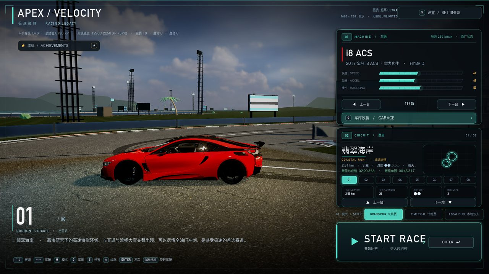
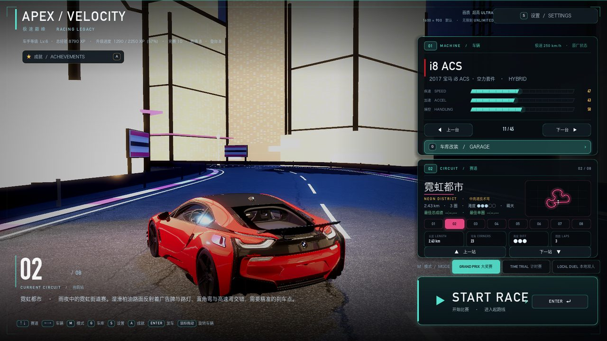
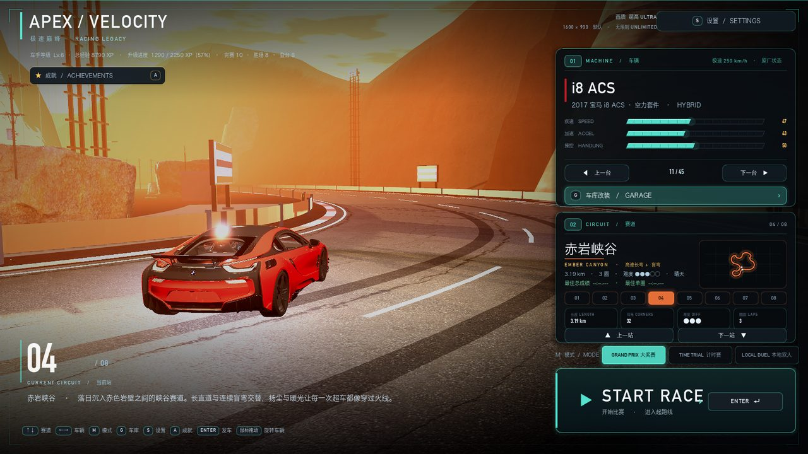
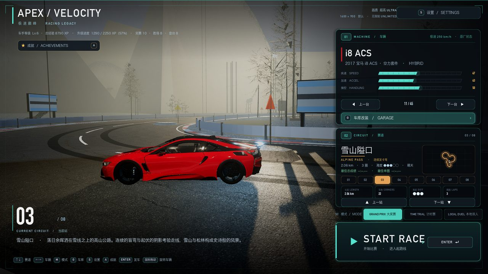
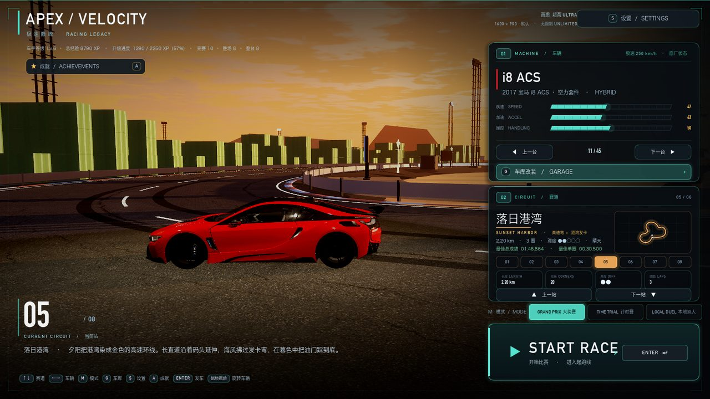
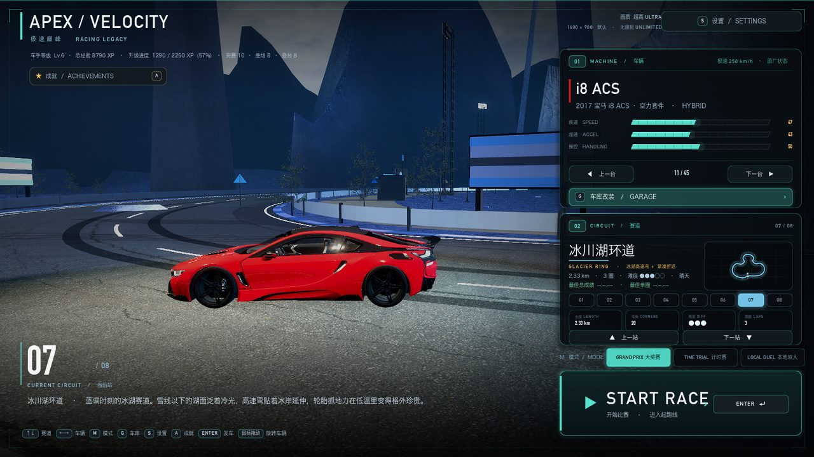
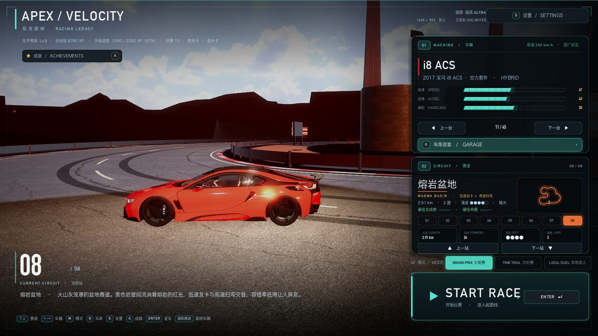
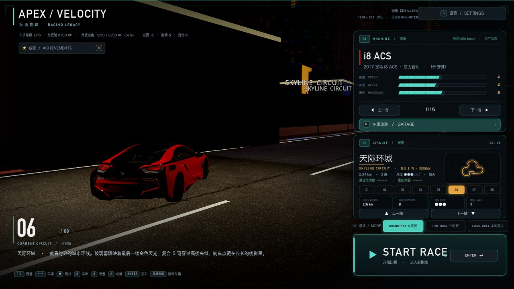

比赛（赛道两侧布景 + 主题纯度）：

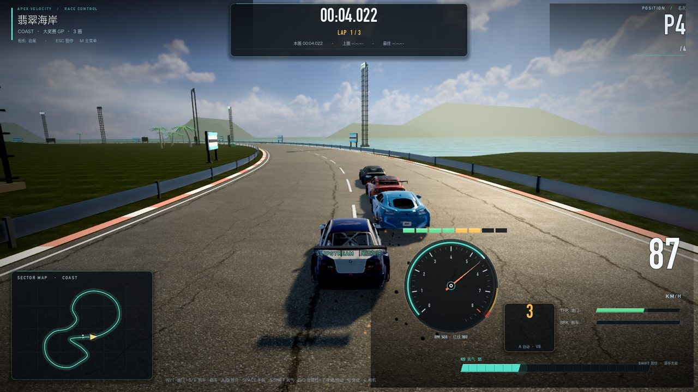
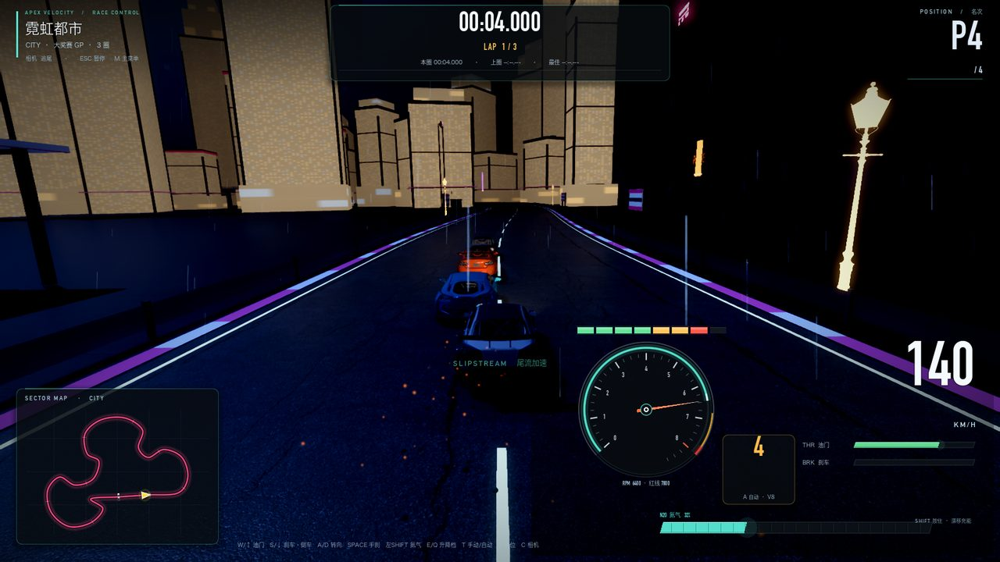
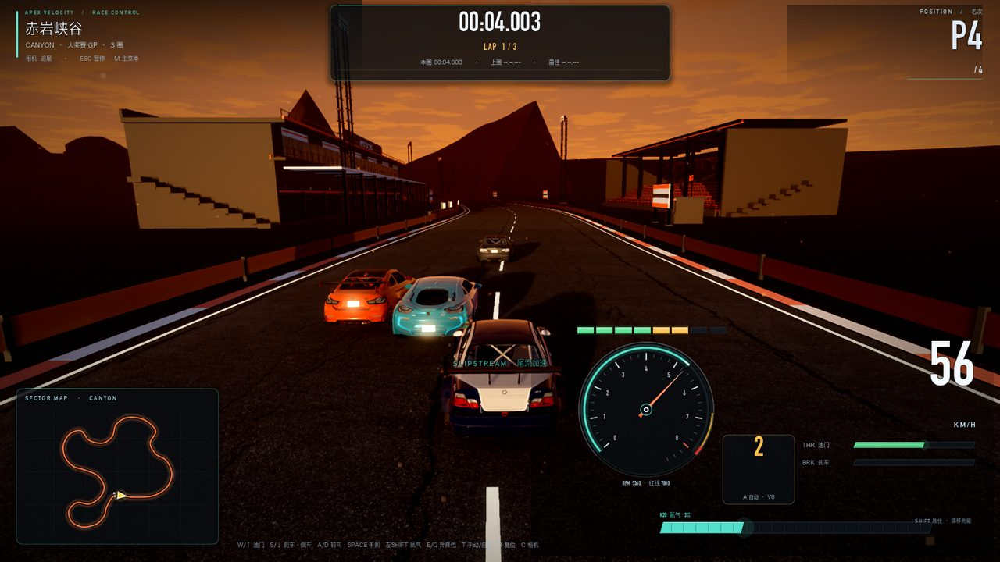
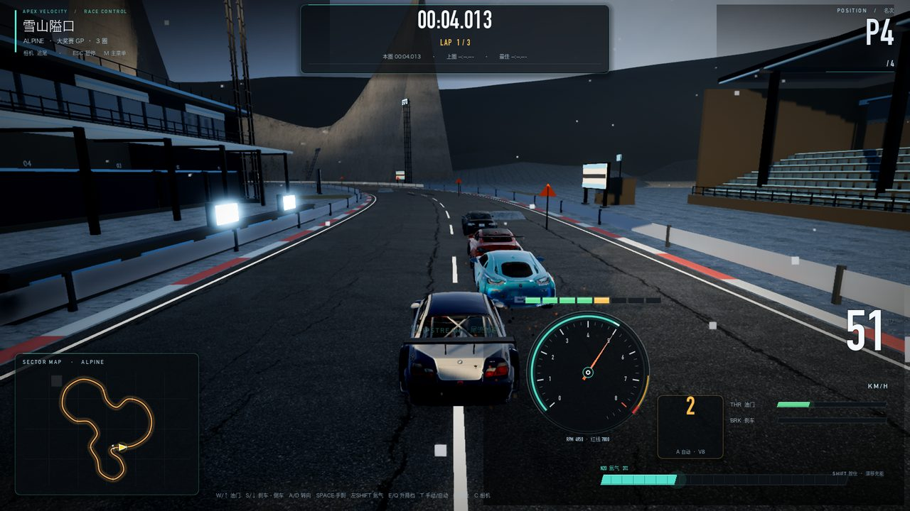
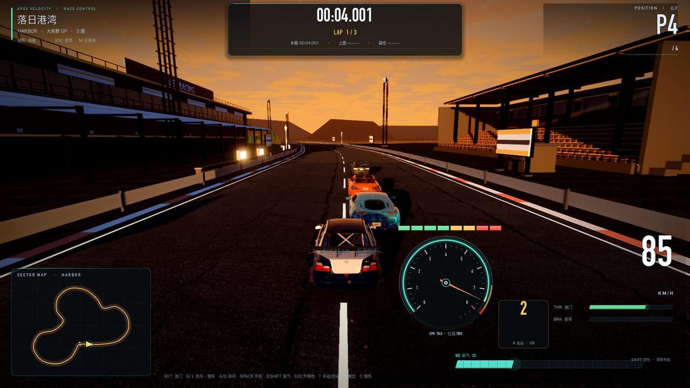
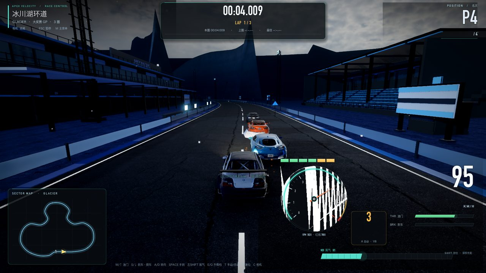
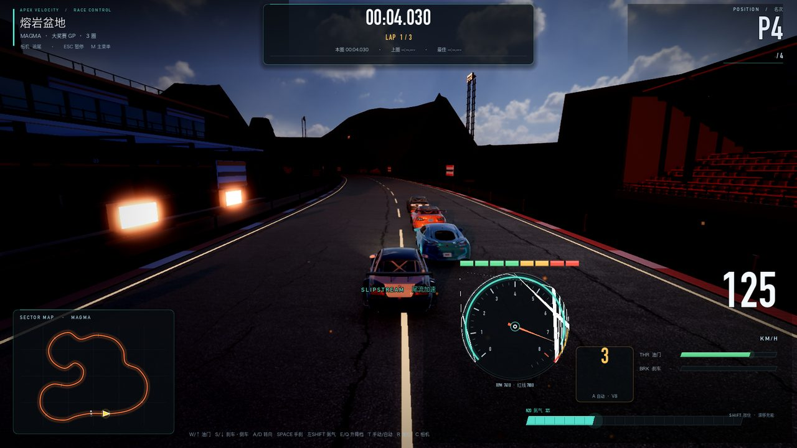
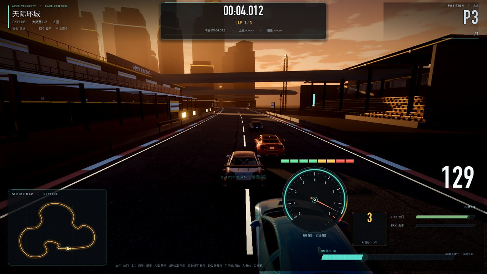

---

## 六、验证汇总

| 项目 | 结果 |
| --- | --- |
| 编译/导入 | `--editor --quit` 0 SCRIPT ERROR / 0 Parse Error |
| 自检 | `--verify` PASS（M1 全 GP、M2 车库/升级/车漆、M3 夜景/天气、M4 场景 + 新增模拟输入/碰撞箱断言） |
| 菜单→开赛 | `--race-test` 正常（ready ~0.4s，intro 截图，countdown） |
| 模拟输入 | UDP 端到端 294 包 active；深度→steer/throttle 连续量；无设备自动回退 |
| 碰撞箱 | OBB 探针 4/4 符合车宽/车长；强制重叠分离 1.95m |
| UI | 11 张前后对比 + 15 张改后单屏；性能同量级 |
| 车库 | 3 行界面 + 车漆切换截图验证 + 4 项升级保留 |
| 地图 | 8 图主题化重做：横向 ≤ half_width+90m、远山剪影+雾化、海边贴路、城市两排楼；primitive -90%、fps 18.2→24.6；菜单场景已重烘 |

## 七、已知限制

- **磁轴键盘**：macOS 无系统级键程 API，必须走厂商软件/桥接；`--hid` 需按具体键盘型号适配报告格式。
  普通键盘/手柄完全不受影响。
- **地图**：城市楼体窗格夜间偏「金色蜂窝」可再压暗；雪地松林 60~70 棵/图偏稀；海岸沙滩在低视角下略窄；
  `skyline` 发车 4s 偶见 AI 车贴近相机（AI 行为，非场景）；8 张地图的细节都只在赛道两侧 90m 内，远处为雾化剪影。
- **车库**：旧存档里的轮毂/轮胎/尾翼/卡钳配置仍保存在 `user://garage.json`（不再生效），
  仅作兼容；`assets/cars/models/parts/*.glb` 文件保留但不再被引用。
- **碰撞**：OBB 是平面矩形，未建模车顶/后视镜/尾翼的立体突出；倒车/腾空等极端情况仍走原物理。
