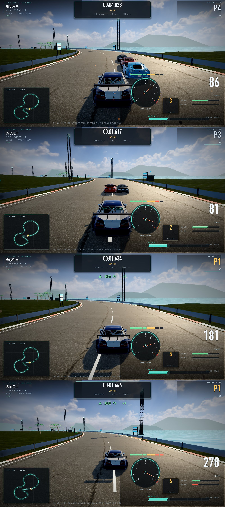

# 52 · 追尾机位：加速时缓慢升高，但不把车拉小

> 2026-11-05 · 用户：「没有加速的时候是车屁股往前看的平时视角，跑起来之后慢慢往上伸，
> 不要拉太远，线拉太远了，车太小了。」
> 定稿追加：「现在这个高速的时候，这个视角作为咱们初始的视角；然后高速视角向后一个车的位置。」

## 一、问题

旧追尾机位（`scripts/cars/chase_camera.gd`）：

- 距离：静止 6.4m → 高速 6.4 + 1.6×speed01 = **8.0m**；
- 高度：3.45 → 3.8m；FOV：60° → **82°**；
- 相机是「指数平滑跟随」，但目标点只按车当前位置算，**没有速度前馈**，
  高速时相机天然滞后约 `v/平滑系数`（280km/h ≈ 6m）。
  两者叠加，280km/h 时相机实际离车 **11~14m + 82° 广角**，车只有很小一块。

## 二、定稿机位

**初始/基础视角 = 上一版「高速升高后的机位」**，全速段都从这里出发：
距车 5.75m、高 2.60m、注视点前移 7.0m、FOV 58.5°（不再有贴地车屁股视角）。

**速度起来后，镜头向车后方向退一个车身长度（≈4.5m）**，用平滑曲线过渡：

| 参数 | 初始/低速 | 高速（≈280km/h） |
| --- | --- | --- |
| 相机距车 | **5.75m**（原低速 4.95m 贴地视角删除） | **10.25m**（= 初始 + 一个车身 4.5m） |
| 相机高度 | 2.60m | 3.05m（随后退微升） |
| 注视点前移 | 7.0m | 7.0m |
| FOV | 58.5° | 58.5° |

曲线 `smoothstep(0.05, 0.85, speed01)`：起步 → 中速缓慢后退 → 顶速退满一个车身。

另外两处关键修正：

1. **速度前馈**：目标点加 `target.vel / follow_rate`（follow_rate=14），抵消指数平滑在高速下的滞后；
   稳态时相机正好停在设定距离上（实测 80/180/280km/h 相机距车 5.27~6.06m，修正前 6.89/9.04/10.99m）；
2. **后退曲线**：`smoothstep(0.05, 0.85, speed01)`，速度越高中速越倒，顶速退满一个车身，
   过渡平滑不突兀。

## 三、效果 & 验证

同一场景（coast 起步直道）固定速度拍摄对比：86 / 81 / 181 / 278 km/h（初始视角 + 随速度后退一个车身）。

- `--editor --quit` 0 SCRIPT ERROR；`--verify` PASS；`--race-test` 正常（菜单→开赛 373ms）；
- 新增调试参数 `--shot-speed=<kph>`：拍摄时把车固定在指定速度，便于以后对比机位/车体比例。

## 四、可继续调的地方

所有参数都在 `chase_camera.gd` 的 `_rig_params()` 一处：
基础 `distance=5.75` / `height=2.60` / `look_ahead=7.0` / `base_fov=58.5`；
高速后退量 `push_back = smoothstep(0.05,0.85,speed01) * 4.5`。
如果觉得高速退得太远，把 4.5 改成 2.2（半个车身）或 0（不后退）即可，其它不用动。
