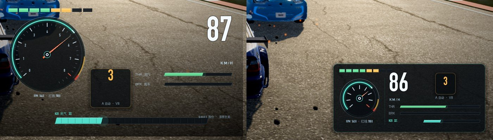
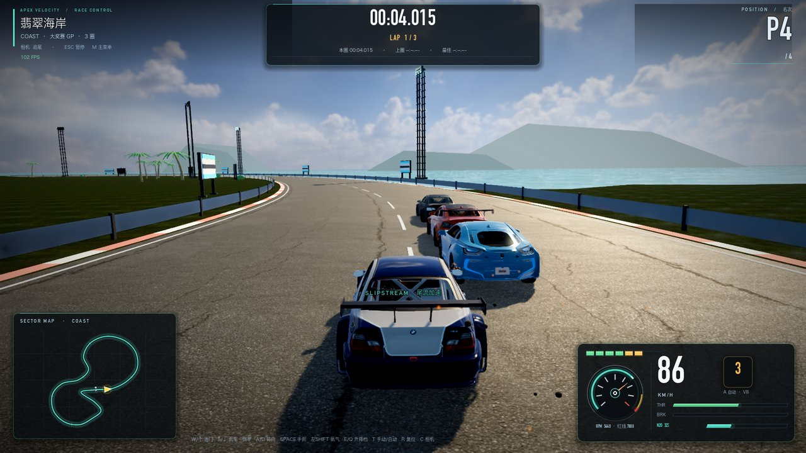
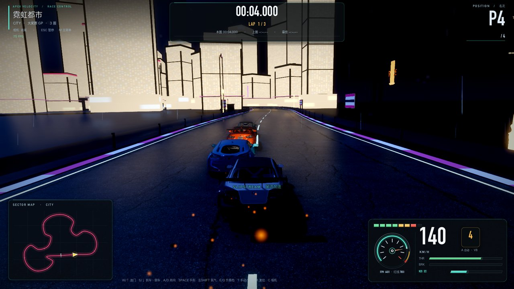
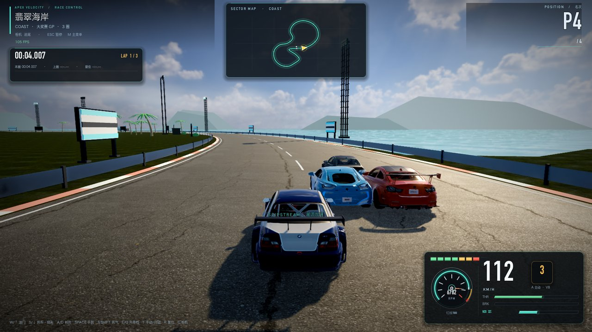

# 54 · 比赛 HUD：右下角仪表组重新排版（紧凑玻璃仪表卡）

> 2026-11-06 · 用户：「右下角这个 HUD 它就是太大嘛，做的精致一点，重新排一下版，让做的好看一点。」

## 一、原来的问题

旧右下仪表组占 **676×356** 区域（屏幕 1600×900 时占右下很大一块）：

- 转速表直径约 224px，白字刻度 + 数字全部展开，视觉重量最大；
- 速度数字 100px，和转速表、档位、踏板条彼此分散在不同位置；
- 背景只用一条渐变阴影片，没有面板边界，和左下小地图、右上名次不是一个视觉体系。

## 二、新排版

**整组收进一张 432×196 的圆角玻璃仪表卡**（右下角 22px 边距），信息层级重新排：

```
┌──────────────────────────────────────────────┐
│ ▮▮▮▮▮▮▮▮ 换挡灯            ▲ 升档提示（右对齐）│
│                                              │
│   ◜小转速环◝   86         ┌──┐               │
│   （无刻度数字） KM/H      │ 3│  A 自动 · V8  │
│   RPM 5000 · 红线 7000    └──┘               │
│                          THR ▓▓▓▓▓▓▓▓▓▓▓▓   │
│                          BRK ░░░░░░░░░░░░   │
│                          N2O ▓▓▓░░░░░░ 32%  │
└──────────────────────────────────────────────┘
```

- 转速：224px 大表盘 → **118px 小环**，新增 Gauge 紧凑模式（保留数值弧/指针，隐藏数字刻度与小刻度），
  表下只留一行 `RPM 5000 · 红线 7000`；
- 速度：100px → **76px**，单位 KM/H 缩小并拉开字距，贴住速度数字；
- 档位：从竖长面板改为 **金色小胶囊**（58×62），旁边一行 `A 自动 · V8`；
- 踏板/氮气：改为两条 6px 细条 + N2O 细条，横排在卡片下半部；
- 换挡灯：缩成卡片顶部 150×8 的 8 段小灯（绿→金→红，红线闪烁保留）；
- 背景：一条渐变阴影 → 统一 `UIStyle.glass_style` 玻璃卡（半透明深底 + 1px 青色描边 + 顶部青色细高光），
  和主菜单/车库/设置同一设计系统；
- 「SHIFT 按住·漂移充能」小字从 HUD 里删掉（底部操作提示里已有），减少噪音。

整组面积从 676×356（240,656px²）缩到 432×196（84,672px²），**约 -65%**，屏幕中心/车身的可见面积明显变大。

## 三、验证

- `--editor --quit` 0 SCRIPT ERROR；
- 白天（翡翠海岸）与夜间（霓虹都市）截图核对：卡内文字在亮/暗背景下都可读，车与路面不再被 HUD 遮挡；
- HUD 其余部分（左上信息、上中计时塔、右上名次、左下小地图、底部键位提示）未改动；
- 所有数值刷新 API 不变（速度/档位/转速/踏板/氮气/换挡灯仍走原 refresh 路径）。

对比（左旧右新）：



白天完整画面：



夜间完整画面：



## 四、追加排版：小地图顶置 + 计时塔左上（2026-11-06）

用户：「我把这个小地图放到最上面，就现在写着时间的那个位置。」

- **小地图**：从左下角移到**顶部正中**（380×202 玻璃卡，原计时塔位置），地图本体 356×172；入场时从屏幕上方
  滑下并淡入（0.55s ease-out，每场比赛开始时一次）；
  仍带 `SECTOR MAP · TRACK` 标题；
- **计时塔**：44px 大计时器改为**左上紧凑计时条**（360×92，接在赛道信息牌下面）：
  28px 计时数字 + 右侧金色 `LAP 1/3` + 下方一行本圈/上圈/最佳；`FINAL LAP` 提示放在计时条下方；
- 底部左侧空出来后，操作键位提示从屏幕中间移到左下，不再和右下仪表卡挤在一起；
- 双人提示条、超车 toast 同步下移，避开顶部小地图。



## 五、追加：转速表数字（2026-11-06）

用户：「右下角这个转速表可以加上这个转速。」

- 在 118px 小转速环的**下半开口区**（表盘 42°~138° 天然没有刻度）加实时转速数字：
  `6762`（17px DIN 白字）+ 下面小号 `RPM`，指针不会扫过这块；
- 原来表下的 `RPM 5000 · 红线 7000` 改成只留一行小字 `红线 7000`，避免重复；
- 转速表可见性仍跟「设置→HUD→转速表」开关走。

## 六、可继续调的地方

- 卡片位置/大小：`race_hud.gd :: _build_cluster()` 第一行 `UIStyle.place(_cluster, …, -454, -218, -22, -22)`；
- 转速环尺寸：`UIStyle.place(tach_gauge, …, 16, 40, 134, 158)`；
- 速度字号 76、档位胶囊 58×62、踏板条高 6、氮气条高 7 都在同一函数里；
- Gauge 紧凑模式开关：`show_numbers` / `show_minor`（其他界面用不到，默认 true）。
